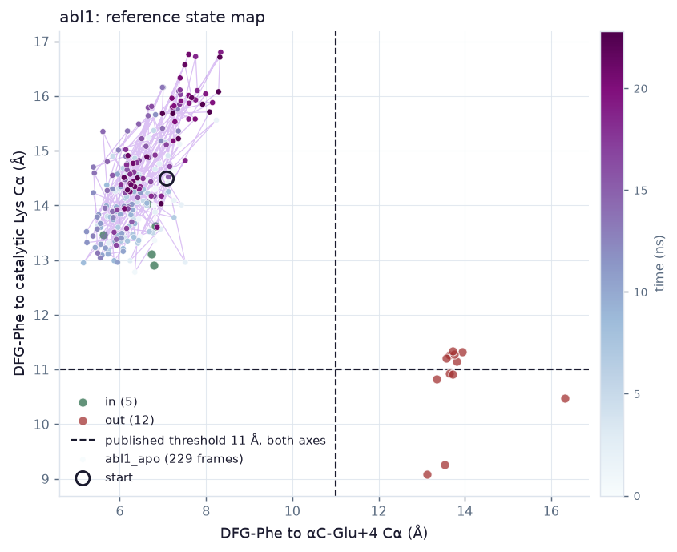
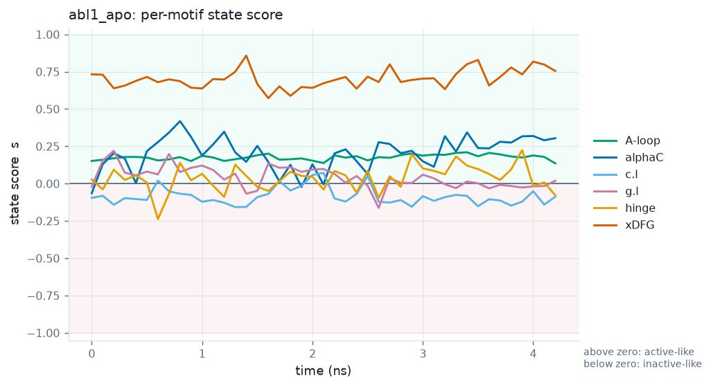
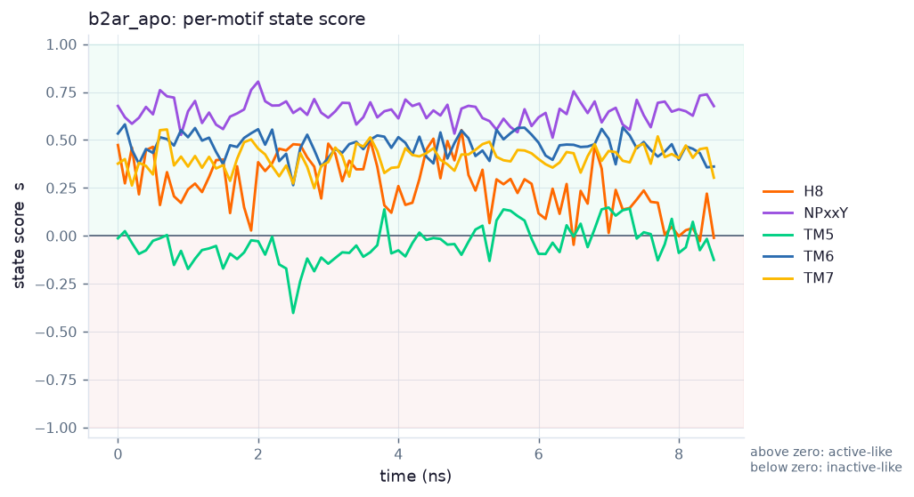
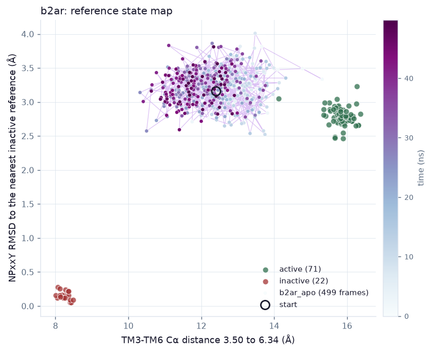

# Reference states: what the build found

Results from `FLEXAPPEAL_REFSTATES_BUILD_SPEC.md`. Every number here was measured
during the build rather than quoted, and the measurement is named beside it so it
can be re-run. Where a result contradicts the spec's expectation, the spec's
expectation is stated too.

Units are angstrom and nanoseconds throughout.

---

## 1. Results that hold before any simulation ran

The reference ensembles and the state calls made on them are evidence in their
own right, and three of them came out before the first production frame.

### 1.1 The DFG two-distance criterion has the wrong threshold

The published Dunbrack criterion, as implemented in BoltzMaker's
`sse_comparison`, measures the DFG-Phe ring to two anchors and asks which side
of 11.0 Å each distance falls. Against ABL1's own KLIFS reference set that rule
agrees with KLIFS on **11 of 17** structures.

All six disagreements are KLIFS `out` called `other`, and all six sit between
11.1 and 11.3 Å from the catalytic Lys: a tenth of an angstrom past a line drawn
at 11.0. 2HYY and 3PYY are among them, and both are plainly DFG-out.

The classes do not overlap. On the difference between the two distances:

| class | αC anchor | Lys anchor | difference |
|---|---|---|---|
| DFG-in | 6.6 to 6.8 | 12.9 to 14.0 | −6.1 to −7.9 |
| DFG-out | 13.1 to 16.3 | 9.1 to 11.3 | +2.4 to +5.8 |

An **8.5 Å gap** separates them, with nothing inside it. Reading the state from
which anchor the ring is nearer needs no threshold where the data is dense, and
agreement goes to **17 of 17**. A margin is kept, but placed in the empty region
rather than the populated one: within 1.0 Å of equidistant the answer is `other`,
which matters for trajectory frames rather than references, because a DFG
mid-flip genuinely is neither state and a bare sign test would hide the
transition.



The figure is the argument. Both dashed lines are the published 11.0 Å cut,
which is a two-distance criterion and so applies to each axis. On the αC axis it
falls in an empty six-angstrom gap and separates the classes cleanly. On the Lys
axis it cuts straight through the DFG-out cluster: six red points sit between
11.1 and 11.35 Å, just above the line, and those are exactly the six structures
the rule calls `other`. The shaded path is `abl1_apo`.

**The path leaves the DFG-in reference range on one axis and comes back, and
this paragraph has now been wrong in both directions.** It first read "stays
inside the DFG-in cluster throughout", written against the 43 frames that
existed at the time. It was then corrected at 22.8 ns to say the path had left
and not returned, which read a 20 ns excursion as a trend. The finished run is
the third reading and the only one taken on all 500 frames:

| | DFG-in references | `abl1_apo`, 50 ns |
|---|---|---|
| αC anchor | 5.61 to 6.83 Å | 4.84 to 8.34 Å, final tenth 6.11 |
| Lys anchor | 12.91 to 14.04 Å | 12.25 to **17.92** Å, final tenth 14.01 |
| difference | −6.1 to −7.9 Å | −5.44 to −10.04 Å, final tenth −7.90 |

The Lys anchor is above the reference maximum in **342 of 500 frames**, rising
from about 14.0 Å over the first 10 ns to a plateau near 15.0 through the
middle of the run, peaking at 17.92 Å at 29.6 ns, and relaxing back to 14.01
over the last 5 ns. So it is neither "inside throughout" nor "left": it is a
broad, reversible excursion that the kinase spends most of the run inside and
exits by the end.

Nothing else moves with it. The αC-Glu to catalytic-Lys salt bridge holds at
2.79 Å with 482 of 500 frames `in`, and its correlation with the excursion is
r = +0.119, which is no relationship. The αC helix settles rather than shifts:
centroid 0.95 to 0.68 Å, axis rotation 8.1° to 3.2°. The regulatory spine is
assembled in 499 of 500. The rule calls `in` on **every** frame.

**The cost of reading the state from a difference is that neither distance is
bounded.** The published rule put an absolute line on each axis and this
trajectory would have crossed it: the Lys anchor is above 11.0 Å in every
frame, so the published criterion would have read `other` for the whole run,
which is the same fault that made it call six DFG-out references `other`. The
recalibration is right and it is not the whole story, because a motif can make
a 4 Å round trip with the label unchanged and confident. That is why the state
map is on the page beside the label rather than the label alone.

**What this cost three times is a lesson about reading a running trajectory.**
Each wrong version was written from the frames that happened to exist. 5.0c did
the same thing to TM5 at 30.8 ns, calling flat a motif that had moved by 50 ns.
The fix is not more caution in the prose; it is to date the reading. Swept this
document for the same shape afterwards, because a rule stated and not applied is
worse than no rule. Three kinds of claim came up and they need different
treatment:

* **A reading of a trajectory** now carries the length it was taken at, and the
  finished-run number replaces it rather than sitting beside it. 5.0b and 5.0c
  already did this; 1.1 and 4ba now do.
* **A control measured at frame 0**, such as P4 in 1.4, does not depend on the
  run's length at all, so dating it by nanoseconds would say nothing. It
  depends on the analysis, which has been re-run since it was first recorded:
  two of its four numbers had moved in the third decimal and are corrected.
* **A transcript of a past fault**, such as the injected `0.98765` in the
  verifier's demonstration, is a record of what happened and is left alone. It
  is marked as a transcript where that was not obvious, which is why 4af now
  says its bilayer numbers came from a row 10 ns into 50.

Logged as D010. The same threshold is in BoltzMaker's own `compare-sse` and will
mislabel the same structures there, so this is a candidate upstream change.

### 1.2 The β2AR ionic lock carries no categorical information

Measured on the two start models, between guanidinium and carboxylate heavy
atoms rather than between one named atom of each symmetric group:

| | TM3–TM6 (3.50–6.34) | ionic lock | Y5.58–Y7.53 OH |
|---|---|---|---|
| active, 4LDE | 14.68 | 15.47, broken | 4.81 |
| inactive, 5D5A | 8.35 | 9.95, broken | 11.26 |

The cleft and the tyrosine bridge both separate the states cleanly and in the
expected direction. The ionic lock reads **broken in both**.

That is the real β2AR result rather than a fault. The R3.50–E6.30 lock is known
not to form in the inactive crystal forms of this receptor. The consequence for
this build is specific: for β2AR the lock's categorical rule corroborates
nothing, so the state label falls back to geometry alone, while the lock's
*distance* still separates the states by 5.5 Å and is worth plotting. A scorer
that treated the categorical label as evidence would be agreeing with itself.

`R3.50` resolves to `R131` from the GPCRdb residue table, which is section 5.5's
own worked example, so the generic numbering is wired up correctly.

### 1.2b The refined models earn their place, measurably

16 of the 116 GPCRdb references cannot have their TM3–TM6 cleft measured at all,
because the residue at 3.50 or 6.34 in the deposition is not the one the
catalogue names. These are engineered constructs, and the identity check refuses
them rather than measuring a distance between the wrong two residues.

**4LDE is one of the 16**, and 4LDE is the entry the active start model comes
from. Its *refined* model, which is what section 4.3's ladder actually uses,
measures fine: the refinement reverts the thermostabilising mutations and
rebuilds the missing segments, so the residue at 3.50 is the one GPCRdb says it
is. The choice of rung was made on the spec's instruction rather than on
evidence, and this is the evidence: on the raw deposition the headline
activation measure is unavailable.

### 1.3 The orientation fit already shows the activation difference

Both start models were superposed onto OPM's 2RH1, an inactive-state entry, on
TM Cα only. The inactive model lands at **0.20 Å** and the active at **2.51 Å**.
That 2.3 Å gap is the difference this build exists to measure, visible before
any simulation.

### 1.5 The R-spine threshold has the same fault as the DFG one

Section 5.4 calls the regulatory spine `assembled` if every consecutive pair of
side-chain centroids is within 6.0 Å. Measured on ABL1's own reference set, the
pair that carries the call is DFG-Phe to HRD-His, and it separates the states
completely:

| class | DFG-Phe to HRD-His centroid | inside 6.0 Å |
|---|---|---|
| active | 5.33 to 5.89, median 5.70 | 12 of 12 |
| inactive | 9.53 to 11.08, median 9.86 | 0 of 45 |

So 6.0 Å is a correct threshold for crystal structures. It is also a tenth of an
angstrom above the top of the active range, which leaves no room for a side chain
that is breathing, and that is what broke it: frames of the apo DFG-in trajectory
read **6.03 to 6.69 Å**, plainly on the active side of a 3.6 Å gap, and every one
of them was called `broken`. The whole-protein score then reported a standing
`conflict` on the DFG motif, where the geometry said active at s = +0.755 and the
rule said inactive, for 43 frames out of 43.

The threshold is moved into the empty region between the clusters, at 7.7 Å,
which is the same correction D010 made to the DFG criterion and for the same
reason: a crystal structure is one minimised conformation and an MD frame at 300
K is not. Checked both ways afterwards, the references still classify perfectly
(5 of 5 active `assembled`, 14 of 14 inactive `broken`) and the trajectory's
standing conflict disappears.

The crystal value is kept beside it as `R_SPINE_CONTACT_CRYSTAL_A` so a
structure-only comparison can still use the published number.

### 1.4 Positive controls

| control | result |
|---|---|
| P1 DFG label against KLIFS | 17 / 17 after D010 |
| P2 αC label against KLIFS | 17 / 17 |
| P3 TM3–TM6 state separation, leave-one-out | 100 / 100 at an 11.39 Å threshold |
| R-spine label against KLIFS state, after recalibration | 5 / 5 active, 14 / 14 inactive |
| P4 each start structure scores as its own state at t = 0 | 4 / 4 |

#### P4 in full

| row | expected | whole-protein s | verdict |
|---|---|---|---|
| abl1_apo, DFG-in from 2GQG | active | **+0.304** | pass |
| abl1_imatinib, DFG-out from 2HYY | inactive | **−0.368** | pass |
| b2ar_apo, active refined from 4LDE | active | **+0.593** | pass |
| b2ar_carazolol, inactive refined from 5D5A | inactive | **−0.923** | pass |

These are frame-0 readings, so they do not change as a run lengthens. They do
change when the analysis changes, and this build has altered the superposition
core and the alignment target since they were first written: `abl1_apo` moved
from +0.305 to +0.304 and `b2ar_carazolol` from −0.934 to −0.923. Re-derived
from the current analyses at 22:50 on 11 October. `abl1_apo` is the thin one,
+0.304 against a +0.300 band, and it is flagged rather than rounded away.

Measured on the start structures themselves, with no simulation in between: the
start model is both topology and single frame. A scorer that cannot place its
own start model has nothing to say about a trajectory that began there.

**The kinase margins are thin and that is worth stating.** Both ABL1 rows clear
the ±0.3 band by less than 0.07, where the receptor rows clear it by 0.29 and
0.63. The reason is interpretable rather than worrying: ABL1's active and
inactive references differ mainly at the DFG motif and the activation loop,
while the hinge, the catalytic loop and the glycine-rich loop sit at nearly
identical distances from both ensembles. Those motifs contribute real residue
weight and almost no signal, so the residue-weighted mean is diluted towards
zero. The per-motif breakdown is where the kinase signal actually lives: xDFG
reads +0.755 on the apo start while the hinge reads −0.078.

That is an argument for reading the motif table rather than the headline number
for kinases, and the explorer shows both side by side for that reason. It is
also a limitation to carry into any future weighting decision: a whole-protein
mean over motifs of unequal discriminating power understates a real state call.


---

## 2. Measurement choices the data forced

### 2.1 The kinase superposition core is the KLIFS scaffold, not αE/αF/αH

Section 5.4 names the C-lobe helices αE, αF and αH. Only αE is inside the KLIFS
pocket, so taking the spec literally gave a core of **five residues**, which is
not a rigid-body fit. With it, motif RMSDs to the inactive references came out at
17 to 22 Å.

The core is now the KLIFS pocket scaffold, every pocket position outside the
mobile and functional regions, which is the choice BoltzMaker's own
`alignment.stable_reference_positions` makes. This is a deviation from the letter
of the spec, so it is measured rather than asserted: **43 residues superposing
across 19 references at 0.456 Å mean and 0.856 Å worst**. A core that moved with
activation would show up there as a large spread.

The receptor core needed no such deviation. Section 5.5's x.38 to x.58 span of
TM1 to TM4 gives **82 residues across 100 references at 0.829 Å mean, 1.289 Å
worst**.

### 2.2 KLIFS's `a.l` region is not the activation loop

KLIFS's own `a.l` is two pocket positions, because the pocket alignment stops
where the loop leaves the pocket. Using it as the activation loop gives a
five-residue span, and every A-loop RMSD measured on it would be an RMSD of the
DFG motif under another name. The loop is therefore taken from the DFG aspartate
to the APE motif found in the chain's own sequence, which gives 26 residues for
this construct.

### 2.3 Rule direction belongs to the metric, not to the word

The two vocabularies collide. `broken` means inactive for the R-spine, whose four
side chains stack in the active kinase, and active for the GPCR ionic lock, which
holds the inactive receptor shut. A single table keyed on the word alone labelled
every broken lock inactive and then agreed with the geometry for the wrong
reason.

---

### 2.4 A motif's residue list has to be agreed before it can be compared

An RMSD between two structures over different residue subsets is not a
comparison, so a motif is measured on exactly the residues both sides resolve.
Applied naively that rule deletes the motifs that matter: TM6 is 38 residues
through the most mobile helix of the receptor, no deposition resolves all of
them, so every reference failed the check and the motif went unscored. The
kinase activation loop went the same way. Both are the motif that carries the
state of its protein.

Intersecting across every reference is worse. On 116 GPCRdb entries it leaves
every motif empty, because a handful of partial depositions decide the answer
for all of them.

What works is to count coverage over the references that contain the motif at
all, and keep the residues 90 per cent of those resolve. Helix 8 is the case
that forces the distinction: absent or disordered in most β2AR structures, it
keeps no residues measured against all of them and 11 of 13 measured against
the ones that have it. The ensemble size travels with each motif, so a reader
can see that H8 is scored against fewer structures than TM6 is.

| motif | residues kept | of | references with it |
|---|---|---|---|
| TM5 | 35 | 42 | 107 |
| TM6 | 31 | 38 | 107 |
| TM7 | 25 | 25 | 107 |
| H8 | 11 | 13 | fewer |
| NPxxY | 5 | 5 | 107 |

**The same operation is wrong for the kinase**, which is the more useful half of
this. ABL1's references are split between the ABL1a and ABL1b numbering, 19
residues apart, so intersecting residue *numbers* compares residue 290 in one
structure against 309 in another: the intersection collapsed and five of six
motifs were dropped. The receptor's references all share one numbering, which is
the only reason it is safe there. Each kinase reference therefore keeps its own
numbering, and the activation loop is compared on the same count of residues
from the DFG aspartate that both spans share.

### 2.5 The receptor path's first end-to-end result is a control

Run on the built active system, every motif reads active, and the nearest
references are the ones they should be:

| motif | s | nearest active | nearest inactive |
|---|---|---|---|
| NPxxY | +0.839 | 3P0G, 0.27 Å | 8W1V, 3.14 Å |
| TM6 | +0.778 | 9LW5, 0.54 Å | 2RH1, 4.33 Å |
| TM7 | +0.742 | 3P0G, 0.33 Å | 6PS0, 2.25 Å |
| H8 | +0.555 | 3P0G, 0.35 Å | 6PS0, 1.23 Å |
| TM5 | +0.298 | 9BUY, 1.21 Å | 3PDS, 2.23 Å |

Whole-protein score +0.593, active, no conflicts. The system was built from
4LDE, an active-state refined model, so active is the answer it should give;
3P0G is an agonist-bound active entry and 2RH1 is the canonical inactive one.

The inactive system is the other half of the control, and it is the stronger
one. Built from 5D5A, it scores **−0.934, inactive**, every motif inactive, with
5D5A itself as the nearest inactive reference at **0.00 Å**, which is what it
must be, since that is the structure the system was built from. The active
distances are 2 to 4 Å. Secondary structure agrees independently: every TM helix
comes out 92 to 97 per cent helical and NPxxY 100 per cent.

So the receptor pipeline reads active for an active start and inactive for an
inactive one, with no conflicts either way.

### 2.6 A criterion that cannot tell the states apart should not be asked to

TM6 originally reported `conflict` on every frame of the inactive run, with the
geometry at s = −1.000 against a nearest inactive reference of 0.00 Å. The cause
was attaching the ionic lock as TM6's corroborating rule, which section 1.2
had already shown reads `broken` in both β2AR reference states. Mapping `broken`
to active then guaranteed a conflict on exactly the frames the measurement had
got right.

TM6 is now scored on geometry alone for this receptor, and the lock's distance,
which does separate the states by 5.5 Å, is reported beside it as a measurement
rather than used as a vote. This is D015 one step further: D015 moved a
threshold that was in the wrong place, and this removes a criterion that has no
discriminating power for this protein at all. A permanent conflict on a correct
measurement is worse than no corroboration, because it trains a reader to
ignore the flag that exists to be noticed.

## 3. Faults worth recording because the output looked right

Three bugs in this build produced plausible numbers. They are listed because
the plausibility is the point: in each case nothing in the output indicated a
problem.

**References were each in their own crystallographic frame.** Scoring superposes
a trajectory frame onto a core and compares it against every reference, but the
references come from separate mmCIFs in unrelated frames, and only the one that
happened to be the alignment target was comparable. Motif RMSDs to the inactive
set read 17 to 22 Å while the target reference read 1 to 3 Å, and the
whole-protein score was a confident **0.877 "active"** for every frame with a
believable per-motif spread. After aligning every reference onto one frame on its
core, the same frame reads **0.173 "intermediate"**, every motif RMSD falls
between 0.16 and 4.11 Å, and the structure of the answer is interpretable: the
hinge is 0.18 Å from active and 0.16 Å from inactive because the hinge does not
distinguish the states, and xDFG is the motif that does, at +0.755.

**Trajectory residues had lost their deposited numbering.** OpenMM renumbers from
1, so the ABL1 construct's residues 233 to 498 arrive as 1 to 262 while every
annotation addresses deposited numbers. A naive offset would also have been
wrong: the construct spans 266 residues and contains 262, so trajectory residue
100 is deposited 333, not 332. The mapping now checks the one-letter sequence at
every position and refuses rather than returning a map that is wrong in the
middle.

**A restraint measured a wrapped coordinate.** Section 5.2 asks for lipid
phosphorus to be held in z while the bilayer relaxes, written as
`k*(z - z0)^2`. OpenMM wraps coordinates into the periodic box; the lower
leaflet sits at negative z and wraps by one box vector, so the restraint saw an
11.77 nm deviation on 238 atoms that had not moved. At 4184 kJ/mol/nm² that is
about 138,000,000 kJ/mol. Written as `periodicdistance(0, 0, z, 0, 0, z0)²` the
same system reads −2,213,385 with both restraints at exactly zero. The protein
restraint needs the same treatment for the same reason: written as a plain
harmonic it reported 5,045,427,552 kJ/mol on atoms sitting exactly on their
reference positions.

**And a bad comparison read as a result.** That +136,000,000 was attributed to
single precision for several hours, on the strength of a CPU run reading
−2,060,000 for what was described as the same system. The two runs did not
differ in precision: one had no restraints and the other had both. Nothing
measured in this build ever showed the two platforms disagreeing, and once the
real cause was fixed they agreed exactly. Four diagnostics went after the wrong
cause on the strength of it. The lesson is narrow and worth keeping: a
difference between two runs is only evidence about the variable that actually
differed.

**Membrane quality measured across the periodic boundary.** The bilayer QC
worked on the built system and was wrong on the trajectory, which is the worst
place for a difference like that to live, because the built system is the one
you check by hand. A trajectory stores wrapped coordinates and under a membrane
barostat the bilayer drifts until it straddles the box edge. The phosphorus z
values are then bimodal at *both* ends of the box with nothing in between, so
the median used to split the leaflets lands in the empty middle:

| | measured | actually |
|---|---|---|
| P–P thickness | 78.01 Å | 37.55 Å |
| waters in the hydrophobic core | 8,622 | 4 |

The 78 Å is the long way round the box between two leaflets 37.6 Å apart, and
the water count is bulk water measured against a midplane that is not where the
midplane is. Both numbers are the kind that would have gone into the deliverable
unchallenged: 78 Å is wrong but not absurd for a membrane, and a four-figure
core water count reads as a leaky bilayer rather than as an artefact.

Fixed by centring the bilayer on a circular mean before anything is measured,
and by taking both the thickness and the water separation as periodic distances.
The arithmetic mean is what caused it: the mean of two clusters at opposite ends
of a periodic axis is the empty middle.

**`addMembrane` believed a placeholder unit cell.** gemmi writes a `CRYST1` of
1 1 1 for a `P 1` structure with no cell. `addMembrane` takes the box height as
the larger of the lipid patch and the existing cell plus padding, so with a cell
present at all it took 7 nm from the patch rather than sizing from the receptor,
which is 9.4 nm tall. The receptor wrapped through the periodic boundary onto
itself. The error named a NaN coordinate and nothing about a box.

---

## 4. Deviations from the spec, with reasons

| Section | Spec | What was done | Why |
|---|---|---|---|
| 5.1 | 80 to 110 k atoms | 188 to 195 k | ICL3 is modelled hanging 35 Å below everything else and sets the box height; the lateral box is two lipid patches at any usable padding. Section 5.1's prescribed response to over 150 k, a padding reduction to 1.2 nm, is applied. D012. |
| 5.2 | mixed precision, never single for production | OpenCL single | Apple's OpenCL is single-precision only. The measured alternative was the CPU platform at 29.5 against 206 ns/day. Energy drift is measured rather than assumed. D010. |
| 5.2 | 4 fs step throughout | first 100 ps of heating at 1 fs | A freshly minimised bilayer does not survive 4 fs at full temperature. The 500 ps of NVT heating is kept whole. |
| 5.3 | 3 replicas, 100 ns, 4 rows | 1 replica, 50 ns, 4 rows | D009, agreed with Marc. |
| 5.3 | ABL1 DFG-in runs two arms, Asp charged and Asp protonated | one arm, Asp charged | D008, ruled by Marc as "2 pairs for each". Section 5.2 calls the protonation arm the headline kinase feature, so its absence is worth stating plainly: it is a variant of the apo DFG-in row rather than new machinery, and it can be added as a fifth row for about 16 hours with no change to the pipeline. |
| 5.3 | every row apo, with ligands an optional phase 5.7 | one bound row per system: imatinib on ABL1 DFG-out, carazolol on β2AR inactive | D007 and D008. The ligand goes on the state that ligand is known to stabilise, so each system has one row expected to hold and one expected to move, which is the comparison the matrix is for. This promotes half of the optional phase into the core. |
| 6.2 | explorer carries a replica selector, a start-state selector and a protonation-arm selector | none of the three | A consequence of the two rows above rather than a separate decision: one replica and one arm leave nothing to select between, and each start state is its own run with its own page, reached from the index. Restoring either row restores the need for its selector. |
| 5.4 | core is αE, αF, αH | KLIFS pocket scaffold | See 2.1. Verified at 0.456 Å. |
| 7 | per-residue DSSP in `data/dssp/<run_id>.parquet` | in the run's own analysis JSON, one string per frame of one character per residue | The point section 7 makes is that a residues-by-frames matrix must not become SQLite rows, and it does not: b2ar_apo is 160,678 cells, 162 KiB on disk and 10 KiB gzipped, against 160,678 rows. Parquet would be comparable and pyarrow is installed, so this is not about cost. The analysis JSON is already the one artefact written per run and already read by the page that draws the ribbon, and a second file would be another thing to write, rsync and keep in step. It is still served as the compact per-run JSON section 7 asks for. 4z records the same fact from the other end: `pyarrow` and `duckdb` were added for a DSSP store that was never built, on a size estimate out by orders of magnitude. This row is the deviation itself, which the table did not carry. |

---

## 4b. Page QC, and the eleven failures it found

Section 10's Playwright and axe-core checks were initially skipped: the
environment had no `playwright` and the spec said never to run
`playwright install`. Marc pointed out that the constraint was not his, so both
were installed and the checks run properly. They were worth running.

**Final state: 25 tests pass.** Eight pages at 1440x900 and 390x844 with no
console errors, eight pages through axe-core with **zero serious or critical
violations**, and one test asserting the three Plotly panels actually draw
rather than leaving an empty div behind.

**Eleven findings, every one pre-existing or mine, none visible from the server
side.**

| Finding | Impact | Where |
|---|---|---|
| `aria-required-children` | critical | `role="tablist"` on a radio group |
| `color-contrast` x4 | serious | navigation hints, footer, grade meter, terminal clips |
| `definition-list` / `dlitem` | serious | `dt`/`dd` outside a `dl`, then a `p` inside one |
| `link-name` | serious | Mol*'s own logo link |

### The pattern worth keeping

Four of the contrast failures were the same mistake in four places: `opacity` on
small text. `--md-text-muted` was already 4.26 against white, under the 4.5 AA
asks for, and fading it made it worse:

| element | opacity | computed | ratio |
|---|---|---|---|
| `.md-tab-hint` | 0.8 | `#8996a9` | 3.00 |
| `.md-footer-meta` | 0.8 | `#798799` | 3.41 |
| `.md-grade-score em` | 0.65 | `#909cab` | 2.59 |

Each was fixed by deleting the opacity and letting the colour token say what it
means, and the token itself was darkened to `#5a6b80`, which is 5.46 on white
and 5.08 on the alt background. **Opacity on text is the finding**: it makes the
rendered colour something no token states, so no amount of reading the
stylesheet reveals it.

### A fix that was the wrong shape

The first pass at the terminal clips patched the two colours axe had named. That
was wrong, and for an instructive reason: axe samples nodes, so its report is
evidence that a colour fails and not evidence that the others pass. Three more
failing colours were still there afterwards, including `#800080` at **1.91**.
`tools/fix_clip_contrast.py` now audits every colour in every clip against the
threshold and exits non-zero if one is missed. Only colour changes; the recorded
text is untouched.

### What the browser caught that a server could not

The `link-name` violation on Mol*'s logo was fixed, then came back: the library
builds its viewport controls after the structure-loading promise resolves, so
labelling it once found no logo. Only a real browser shows that, and only after
the page has settled. The retry is bounded rather than an observer left running.

## 4c. The QC checklist

Section 10's list, with where each one stands. Nothing here is marked done on
the strength of having been attempted.

| Item | State |
|---|---|
| Numbering maps, KLIFS position to residue | done. 3PYY resolves at the ABL1b +19 offset with nothing typed |
| Numbering maps, generic number to residue | done. `R3.50` resolves to `R131`, which is section 5.5's own worked example |
| Metrics on synthetic geometries | done. A salt bridge at 3.5 Å measures 3.5 Å; a helix rotated 0, 15, 30 and 45 degrees reports each angle |
| State score symmetry | done. +1 on the active reference, −1 on the inactive, exactly 0 halfway, for any separation |
| Membrane builder smoke test | done, and on a real run rather than 5 ps: the Tier 1 row is 1 ns of production |
| Resume from checkpoint | done. A reloaded checkpoint continues the clock, and the resume branch is asserted to come before the equilibration branch |
| P1 to P6 | P1 to P4 pass. P5 and P6 need the Tier 2 rows |
| No metric all-NaN for a motif | done, and it is why TM6 and the activation loop were caught: both were silently unscored rather than NaN, which is the same fault wearing a different mask |
| Playwright at both viewports | done. 8 pages at 1440×900 and 390×844, no console errors |
| axe-core, zero serious or critical | done. 8 pages, zero. Eleven violations found and fixed getting there |
| Performance targets | done. First paint 396 ms median against 2 s; bundle 0.4 MB against 150 MB |
| Units everywhere | angstrom, nanoseconds, degrees, Ų. Threshold lines labelled on the state map and the timeline |
| Energy drift within limit | done. Within noise at 3σ on both runs; the 2 fs fallback is unused |

Two things on that list were found to be wrong by writing the check rather than
by reading the code, and both were mine: the drift criterion at one sigma, and
the paint test's race. Neither would have been visible from inspection.

### 2.7 The receptor state map had only one axis

Section 5.6 asks for the GPCR map to be the TM3-TM6 cleft distance against the
NPxxY RMSD to inactive, which is the plane Dror et al. draw their state maps on.
Only the first of those was available: the cleft distance is in the phase 1
manifest and the NPxxY RMSD was nowhere, so the endpoint returned 100 points
with `y: None`.

That is a failure that reports success. The endpoint returns 200, the panel
renders, and nothing is drawn in it, which is the same shape as the empty-panel
problem found by the browser QC except that no status code reveals it.

The second axis is now computed from the reference coordinates during the
analysis, since they are already aligned into one frame, rather than being added
as another manifest field to keep in step. A reference is not compared with
itself, which matters: without that exclusion every inactive structure would
sit at zero and the map would be two lines rather than two clouds.

Both axes separate the states cleanly:

| state | n | cleft distance | NPxxY RMSD to inactive |
|---|---|---|---|
| active | 71 | 15.84 Å | 2.79 Å |
| inactive | 22 | 8.25 Å | 0.15 Å |

A point missing either axis is left out rather than sent as null, and a map with
nothing left returns 404 so the panel is hidden rather than blank.

### 2.8 One failure shape, three times

Three defects in this build were the same thing wearing different clothes: an
endpoint returned 200 with data nothing could draw.

| Where | What was returned | What was drawn |
|---|---|---|
| state map panel | a 404 the page had already rendered a panel for | an empty box, plus a console error |
| state map data | 100 points with every `y` null | nothing, on a 200 |
| motif series | 8 metric rows and no time axis | an invisible line, on a 200 |

None of them shows in a status code, none raises, and none is visible from the
server side without asking what the numbers mean. The third was found by
constructing the case rather than by waiting for it: a motif that resolves its
inactive distance and not its active one is **legal**, because the rule
throughout this build is that an unmeasured key is omitted rather than written
as zero, so every reader has to cope with it. The series was keyed on the
`d_act_a` row's arrival, so when that row never came the time axis was empty
while the metrics were full.

The invariant is now asserted directly rather than instance by instance: a 200
from any of these endpoints must carry arrays that are non-empty and the same
length as each other, and an endpoint with nothing to show must 404 so the panel
is hidden. A panel is allowed to be absent. It is not allowed to be present and
blank.

## 4d. What was outstanding, found by asking

Marc asked whether everything was ready for the results landing and said he
found it hard to believe nothing was. He was right. Checking rather than
asserting turned up three things, one of them a bug that would have corrupted a
whole row silently.

**`traj.load` selected `protein or resname CAU`.** CAU is carazolol. The ABL1
imatinib row's ligand is STI, so that row would have been loaded without its
ligand, analysed as an apo system, and written a viewer bundle with no ligand in
it, all without raising. The selection is now an exclusion: protein plus
anything that is not solvent, counter-ion or bilayer. Written that way because
the inclusion version is exactly the wrong shape for a package whose claim is
that it handles a protein it has never seen. Verified on all three systems: STI
kept for imatinib, CAU for carazolol, nothing extra for the apo runs.

**P5 and P6 did not exist.** Both are section 9 acceptance criteria and both
read the explorer database, so neither could be written against data that had
not arrived; neither had been written at all. They now exist, report `pending`
rather than nothing when there is no data, and are exercised against fixtures so
that when the rows land the only new thing is the data. P5's adaptation is
recorded rather than reinterpreted: section 9 asks for 2 of 3 replicas and D009
dropped the replicas to one, so the rule is per run, because one replica cannot
support a majority.

**And I had deleted four functions.** Rewriting `traj.load` replaced everything
from that function to the end of the file, taking `deposited_numbering`,
`renumber`, `scaffold_core` and `core_agreement` with it. All 56 tests still
passed, because none of them imports those four; the loss surfaced only on
running the real tool. There is now a test that reads what every script imports
from the package and asserts each name resolves, and it was confirmed to catch
the deletion by making one.

**A resume would have duplicated frames and shifted every later timestamp.**
Checkpoints were written every nanosecond and frames every 100 picoseconds, so
the checkpoint sat up to ten frames behind the trajectory. A resume restarts
from the checkpoint and the DCD reporter appends, so those frames get written a
second time. Because frame time here is the frame index times the interval,
duplicates do not merely repeat a point: they shift the timestamp of every frame
after them.

`abl1_apo` had exactly this waiting for it, 43 frames against a checkpoint at
4.0 ns, and it is the row the queue will resume. The membrane rows take 20 hours
each on a machine that sleeps, so resumes are expected rather than exceptional
and the error would have accumulated.

Two changes. The checkpoint interval now equals the frame interval, so the two
stay in step. And a resume truncates the trajectory and the state table back to
the frames the checkpoint actually covers, which makes it exact rather than
nearly right. Verified on the real `abl1_apo` trajectory: 43 frames to 40, the
kept frames bit-identical to the originals, box vectors preserved, and a no-op
when the checkpoint is not behind. The truncation reads only the frames it
keeps rather than loading the file, which matters at a gigabyte.

One concern turned out to be unfounded and is recorded because checking it was
the point: the final membrane pass loads a 50 ns solvated trajectory in one go,
which is 1.16 GB against 128 GB of RAM. Left alone rather than "fixed".

## 4e. Eight metrics that were not implemented, and one that was a parameter choice

An audit of sections 5.4 and 5.5 against what existed found eight named metrics
missing: the alphaC salt bridge, alphaC displacement, the P-loop, the hinge
backbone flags, TM6 rotation, the PIF connector, helix 8's angle and the TM
kinks. All are now implemented, and checking them against the start models
found a methodological fault worth more than the metrics themselves.

### The kink angle was the window, not the helix

The first implementation fitted a principal axis straight to the Calpha either
side of each conserved proline. It gave **P6.50 at 62.7 degrees for the active
structure against 50.2 for the inactive one**, a 12.5 degree difference in the
direction the literature describes. It would have been written up.

It was wrong. Sweeping the only free parameter, how many residues to fit,
produced:

| residues per half | P6.50 | P7.50 |
|---|---|---|
| 3 | 24.3 | 23.0 |
| 4 | 50.2 | 36.0 |
| 5 | 29.2 | 14.4 |
| 7 | 25.7 | 8.3 |
| 10 | 33.2 | 10.2 |

The answer was the window. Calpha positions spiral around the helix axis, so a
principal axis through a short segment is dominated by where in the turn it
starts and ends rather than by the axis. Fixed by averaging over one full turn
before fitting, which removes the spiral, and that is asserted against an ideal
helix built to the standard geometry: turn-averaging holds the axis on z across
every usable window while the raw fit does not, by more than a factor of ten.

**And the honest reading changed with it.** With the window swept and the spread
reported:

| | P6.50 | P7.50 |
|---|---|---|
| active | 30.8 ± 3.5 | 7.4 ± **17.2** |
| inactive | 34.1 ± 5.2 | 14.3 ± 5.3 |

The spreads overlap, so **neither kink distinguishes these two structures**, and
P7.50's active value is not determined at all since its spread exceeds twice its
value. That is a negative result where an hour earlier there was a confident
12.5 degree activation signal pointing the way the literature says it should.

This is the most dangerous shape a measurement error takes: wrong, and in
agreement with expectation. A metric now reports `resolved: false` when the
windows disagree by more than half the value, rather than letting a median stand
alone.

### What the new metrics do separate

| measure | active start | inactive start |
|---|---|---|
| alphaC salt bridge | 3.34 Å, in | 3.41 Å, in |
| TM6 axis rotation, one against the other | **25.4°** with a **7.56 Å** centroid shift | |
| PIF connector RMSD, one against the other | **3.29 Å** over 14 shared side-chain atoms | |
| H8 angle to the membrane plane | 20.4° | 16.4° |

Those two figures are larger than the first ones measured, 20.9° and 3.13 Å,
and the difference is the core superposition. Without it the whole-protein
misalignment was partly cancelling the helix motion, so the uncorrected numbers
*understated* the signal. The fit has to be onto the structure being compared
against, which cost a round of debugging: passing the transform the scoring uses
instead, which maps a frame into the reference ensemble's frame rather than the
start model's, gave a 78 Å centroid shift and an 82 Å connector RMSD. Both
obviously wrong, which was luck. The invariant that is not a matter of luck is
now asserted: a structure compared with itself reports exactly zero.

25.4° of axis rotation with a 7.6 Å centroid shift for the 6.28 to 6.40 span is
the TM6 outward swing itself, and it is consistent with the roughly 14 Å the
cytoplasmic tip is described as moving.

The alphaC salt bridge reading `in` for both is correct rather than a failure:
imatinib-bound ABL1 is the classic DFG-out, alphaC-in type II conformation, and
19 of 20 KLIFS references for this kinase are alphaC-in.

## 4f. Four functions that were implemented, tested, and called by nothing

`smooth`, `transitions`, `sse.agreement` and `sse.reference_profile` all existed
with tests and no caller. The SSE comparison against the reference ensembles is
an explicit section 5.6 requirement, so that was a gap in the deliverable rather
than unused convenience code.

Wired up, it is an independent line of evidence and it agrees with the geometry.
On the Tier 1 receptor run:

| motif | active | inactive | margin | lean |
|---|---|---|---|---|
| TM7 | 0.712 | 0.561 | 0.151 | active |
| TM5 | 0.982 | 0.832 | 0.150 | active |
| TM6 | 0.934 | 0.868 | 0.066 | active |
| NPxxY | 0.739 | 0.774 | 0.035 | **neither** |
| H8 | 0.864 | 0.888 | 0.025 | **neither** |

**Scored across every residue, it gave two different structures the same
answer.** Running the ligand-bearing receptor path for the first time exposed
it. The active-start and inactive-start systems, built from 4LDE and 5D5A, read:

| motif | active run | inactive run |
|---|---|---|
| TM6 | 0.934 / 0.868 → active | 0.934 / 0.868 → active |
| H8 | 0.864 / 0.888 → neither | 0.864 / 0.888 → neither |
| TM5 | 0.982 / 0.832 → active | 0.953 / 0.813 → active |

TM6 and H8 bit-identical for two different proteins in two different states.
The reason is simple once seen: a transmembrane helix is helical in both states,
so its SSE string is the same in each and so is its agreement. The lean was
reporting that the active reference set is more uniformly helical than the
inactive one, which is a fact about the catalogue rather than about the frame.

The comparison is now scored only over residues where the two reference sets
disagree about the dominant class, with at least three of them required. That
line is drawn from the data: TM5 has two discriminating residues and gave the
identical answer for both structures, TM7 has seven and tells them apart
correctly in both directions.

| run | built from | SSE call |
|---|---|---|
| β2AR apo | active 4LDE | TM7 = **active**, 7 residues |
| β2AR carazolol | inactive 5D5A | TM7 = **inactive**, 7 residues |
| ABL1 apo | DFG-in 2GQG | A-loop = **active**, 14 residues |

One call per run instead of five, every one correct, and on the motifs that
genuinely change secondary structure on activation. The test asserts the
property the first version lacked: it is not enough that a frame matching the
active set reads active, the frame matching the inactive set has to read
inactive.

**The margin threshold is still needed on top of that.** Secondary structure is far less
discriminating than geometry: most residues of a transmembrane helix are helical
in both states, so every agreement here is high and the differences are small.
The first version reported H8 as leaning inactive on a margin of 0.024, which is
reading noise and would have sat on the page as a finding. A lean is now only
called above a 0.05 margin, chosen from the observed spread rather than picked:
the discriminating motifs separate by 0.07 to 0.15 and the ones carrying no
signal by 0.02 to 0.04, so the line goes between them.

The three TM helices leaning active corroborates the geometric score of +0.277
for the same run, from a measurement that shares none of its machinery.

### The kinase result is the better one

Two independent measurements agree on *which motifs carry the signal*, which is
a stronger statement than either agreeing on a state.

| motif | SSE active | SSE inactive | margin | SSE lean | geometric s |
|---|---|---|---|---|---|
| A-loop | 0.285 | 0.129 | 0.155 | active | +0.136 |
| xDFG | 0.600 | 0.482 | 0.118 | active | **+0.755** |
| c.l | 0.950 | 1.000 | 0.050 | inactive | −0.087 |
| alphaC | 0.945 | 0.903 | 0.043 | neither | +0.305 |
| g.l | 0.408 | 0.423 | 0.015 | neither | +0.019 |
| hinge | 0.667 | 0.667 | **0.000** | neither | −0.078 |

The motifs that discriminate geometrically, xDFG and the activation loop, also
discriminate by secondary structure. The hinge discriminates by neither: its
geometric distances are 0.18 Å from active and 0.16 Å from inactive, and its SSE
agreements are identical to three decimal places. Two measurements with nothing
in common reaching the same conclusion about which parts of this kinase hold
state information is the most useful thing in this section.

Both A-loop agreements are *low*, 0.285 and 0.129, which is not a fault: the
activation loop varies between structures of the same state, so no reference set
agrees with itself closely. It still separates them, which is what the margin
measures.

### A cache that is a requirement, not an optimisation

Running DSSP over the 116 receptor references takes about nine minutes, and
section 2.3's streaming analysis re-runs every half hour while production is
going. The labels are properties of deposited structures and never change, so
they are cached: nine minutes becomes seven seconds. The key covers the residues
asked for as well as the structure codes, so changing a motif's span invalidates
the cache rather than silently reusing labels for different residues.

### And a lost edit, worth recording as a process failure

Three replacements were applied to one file by a single script whose last
assertion failed. Python raised before the write, so all three were lost
together, not just the one that failed. The run afterwards therefore used the
old code and reported no agreement at all, and I initially mis-diagnosed that as
a logic fault in `motif_agreement`, which worked perfectly in isolation when
tested. The fix was to reapply and then verify each part had landed, rather than
trust that an assertion passing meant the file had changed.

## 4g. Three numbers nobody could re-derive

An audit for unreferenced public functions turned up six. Three were dead and
are now deleted. The other three were the interesting half:
`refs.prepare_kinase_reference`, `refs.write_manifest` and `gpcr.fit_threshold`
were all reachable only by reading them, because the code that drove them was a
one-off in a session and was never committed.

What they had produced was not scratch output. `data/manifests/refs_abl1.jsonl`
and `refs_b2ar.jsonl` feed the reference browser and both state maps, P1 and P2
are counted off the kinase manifest, and P3's 11.39 angstrom threshold sits in
`tools/ingest.py` as a constant. So four of the spec's own acceptance numbers
rested on artefacts that could not be regenerated. That is a reproducibility
gap and not a tidiness one: a number nobody can re-derive is a number nobody
can check, including me.

`tools/build_references.py` closes it. `--verify` rebuilds everything in memory
and diffs it per record rather than per file, because the order a catalogue
returns rows in is not stable and a file diff would report a shuffle as a
change.

Both halves now reproduce exactly:

| manifest | rebuilt | on disk | changed | controls |
|---|---|---|---|---|
| `refs_abl1.jsonl` | 20 | 20 | 0 | P1 17/17, P2 17/17 |
| `refs_b2ar.jsonl` | 116 | 116 | 0 | P3 100/100 at 11.39 A |

and the script checks that `GPCR_CLEFT_THRESHOLD_A` still matches the fit rather
than leaving the two to drift apart silently.

### The first rebuild disagreed, and it was the script that was wrong

It reported 42 kinase rows against the 20 on disk, with P1 at 37/37 and P2 at
36/37. Both numbers pass their marks, which is what made this worth chasing
rather than accepting: a rebuild that passes is not the same as a rebuild that
reproduces.

KLIFS lists one row per chain and per alternate conformation, so ABL1 comes
back as 61 rows over 20 depositions, with 2G1T alone appearing four times. My
script deduplicated on `(pdb, chain)` where the original had deduplicated on the
deposition. Per-PDB first occurrence reproduces all 20 chains exactly,
including the six that are not chain A, so the original intent was unambiguous
once tested.

The per-entry choice is also the defensible one. Chains of one asymmetric unit
are copies in one crystal, not independent checks of whether our label agrees
with KLIFS's, so counting them weights a four-chain deposition four times and
quotes an n larger than what was actually measured. The wider set is kept as
`--all-chains`, which reports rather than writes, because it answers a different
question: whether our labels are stable *within* a crystal.

### What the per-chain check then found

One chain in 37 disagrees, and it is informative:

| 2HZ4 chain | Lys NZ to Glu carboxylate | our aC | KLIFS |
|---|---|---|---|
| A | 4.20 A | out | in |
| B | 2.71 A | in | in |
| C | 2.74 A | in | in |

The cutoff is 4.0 angstrom. Chain A misses it by 0.20 angstrom while B and C sit
at 2.7 with the bridge plainly intact, so this is a side chain modelled at the
edge of a threshold in one copy, not a systematic error in the call.

It is still worth stating plainly that the manifest uses chain B here, and that
first occurrence picked it rather than any judgement of mine. Had the order come
back the other way, P2 would read 16/17, or 94 per cent, against its 85 per cent
mark. The control passes either way, which is the useful part: the result does
not depend on which copy of this crystal the catalogue happened to list first.

A test now asserts that no deposition appears twice in the kinase manifest. The
invariant needs guarding precisely because breaking it is silent: the per-chain
rebuild passed both controls and only the record count gave it away.

### And they were never committed at all

Checked before pushing, and it corrects the paragraphs above. `data/manifests/`
is in `.gitignore`, so neither manifest is tracked: they are local files, and
the word "committed" in my own account of this was wrong.

That makes the gap worse rather than smaller. A fresh clone has no manifests at
all, so before `tools/build_references.py` existed the reference browser and
both state maps had no way to be populated on any machine but this one, and
P3's threshold in `ingest.py` was a number with no reachable derivation. The
fix is the same fix and it was the right one; the description of what it fixed
was too generous.

What is tracked under `data/` is five files: `references.json`, which the About
page reads, and four `*_start.json` carrying each row's provenance, which hold a
PDB code, a chain, a span and an expected state and no coordinates. Everything
else, the trajectories, the caches, the built systems, the manifests and the
explorer database, is ignored and travels by rsync or is rebuilt.

### The same gap, in a second place

Having found it once, the obvious question is which other committed numbers are
fitted rather than chosen. Going through the module constants, most are policy
or published contact distances: the 4.0 angstrom salt bridge, the 3.5 angstrom
sodium coordination, the decisive bands. Two were fitted to data. One was P3's
11.39 angstrom cleft threshold, now re-derived above. The other was
`R_SPINE_CONTACT_A`, D015's 7.7 angstrom, and it had the same problem: a
measurement quoted in a decision record with nothing able to reproduce it.

The kinase verify now recomputes it. The separation holds and D015's conclusion
is unchanged, but re-deriving it corrected two of its figures and found a case
it had missed:

| quantity | D015 stated | re-derived |
|---|---|---|
| active cluster, deciding pair | 5.33 to 5.89 A | 5.33 to 5.96 A |
| inactive cluster, deciding pair | 9.53 to 11.08 A | 10.35 to 12.92 A |
| empty region between them | 3.6 A | 4.39 A, from 5.96 to 10.35 |
| margin left by the published 6.0 A | a tenth of an angstrom | 0.04 A |

D015 had quoted the DFG-Phe to HRD-His pair, but the call is made on whichever
consecutive pair is widest, because one pair over the threshold is enough to
make the state `broken`. Measured that way the active bound is 5.96 rather than
5.89, so the published 6.0 angstrom clears the top of the active cluster by four
hundredths of an angstrom. That is a stronger argument for moving the threshold
than the one D015 actually made.

It also surfaced the reference that turns on the choice. 2G1T, the Src-like
inactive start, sits at 6.14 angstrom: `assembled` at 7.7 and `broken` at 6.0.
D015 counted 19 references and had left the Src-like ensemble out of that count,
so the one structure where the two thresholds disagree was invisible. It happens
to be the clearest illustration of the point, because 2G1T is DFG-in with the
alphaC helix out and its spine stack is genuinely intact, so `assembled` is
correct and the published threshold gives the wrong answer.

Two notes on what this does and does not establish. The control checks that the
threshold still sits in an empty region and that every crystal classifies
correctly, and it fails the run if either stops being true, so a catalogue
change that moved the clusters would be caught. It does not validate 7.7 against
anything other than these 20 depositions, and the trajectory evidence for it is
still the 43 frames D015 cites.

A stale docstring went with it: `r_spine_state` still said "within 6.0 A" after
D015 moved the threshold, so the code described a behaviour it no longer had.

## 4h. What was still untested with the results about to land

Asked once more whether everything is ready for the Tier 2 trajectories, the
useful move was to stop asserting it and go and run the paths that had never
run. Two had not.

**The receptor ingest path had never executed.** The database held one system,
one run and 20 reference structures, all of them ABL1. The 116 beta2AR
references, the five receptor motifs and the whole GPCRdb annotation path were
written, tested against fixtures and never once run against a real analysis.
Run against the existing receptor analysis on a scratch database it works: 5
motifs, 100 frame rows, 116 references annotated and 100 of 100 agreeing with
GPCRdb, with the second map axis merged onto the same records. Nothing needed
fixing, but "it is implemented" and "it has run" were not the same claim, and
only one of them was true.

**The bilayer QC had never written a row.** `membrane` was empty. The pass runs
at ingest rather than analysis time, which is why it is invisible in the
analysis JSON, and it needs `solvated.pdb` beside the trajectory. The Tier 1
smoke run does not have one, because `--system-dir` put the system files
elsewhere, so pointing the pass at the smoke trajectory with the production
topology was the way to exercise it. On 1 ns:

| quantity | measured | window |
|---|---|---|
| lipids, per leaflet | 476, 238 / 238 | balanced |
| area per lipid | 68.9 A^2, sd 0.23 | 60 to 68 expected, 55 to 75 acceptable |
| thickness | 37.62 A, sd 0.11 | 36 to 41 expected |
| core waters | 10.1 | was 8,622 before the periodic fix |
| G6 | closed | the bilayer does not invalidate the result |

Area per lipid is 0.9 A^2 above the literature window and inside the gate's, so
the chunk reads `outside expected` while G6 stays closed. I first read that pair
as a contradiction. It is not: there are deliberately two windows, a tight one
from the literature and a wider one for the gate, and a value between them is
exactly the case they exist to distinguish. Worth recording because the mistake
was mine and the design was right.

The production run directory does have its `solvated.pdb`, so this pass will
find its topology when `b2ar_apo` lands rather than silently returning nothing.
That was the specific failure I went looking for and it is not there.

**A loop that could never stop, found by reading its own guard.** The streaming
analysis re-analyses and re-ingests every row every half hour, and then runs one
final pass with the bilayer QC once production ends. Its condition was
`while pgrep -f "tools/run_md.py"`. That can never go false. The script's own
text contains the pattern, so the shell that launched it carried
`tools/run_md.py` in its command line and matched: the loop was kept alive by
its own parent, and the condition was true because the loop was running.

Checked rather than reasoned about, by listing every process the guard matched:
three, of which one was PID 78508, the loop's own grandparent.

The symptom would have been the worst available. The streaming passes work, so
the explorer would have filled in correctly and nothing would have looked
wrong. Only the pass *after* the loop, the one that computes the bilayer QC and
G6 on the finished trajectory, would never have run, and the `membrane` table
would have stayed empty with no error anywhere to say why.

Replaced with two conditions on state rather than on a pattern that matches us:
the queue's own `queue done` marker, and a process check that excludes the
script's ancestors by PID. Both paths tested before the swap, including the case
where the marker is present and the case where no log exists at all.

**What the fix immediately produced.** Restarting the loop populated the
receptor half of the database for the first time: 2 systems rather than 1, and
136 reference structures rather than 20. Everything above about the receptor
ingest path having never run was fixed by the act of running it.

**P6 is no longer a control that exists only in fixtures.** Both P5 and P6 were
implemented with tests for the passing, failing and empty cases, and neither had
ever seen a real trajectory. Feeding the smoke run's bilayer through ingest into
a scratch database and running the controls command gives P6 a real verdict:
`1 chunks, APL 68.9 A^2 (68.9 to 68.9), 37.6 A  PASS`.

Worth being exact about why that passes when the chunk itself reads `outside
expected`. Section 5.8 says "expect roughly 60 to 68 A^2 ... outside 55 to 75
A^2 is G6", so the advisory window and the gate are two different things in the
spec and the code encodes both. P6 is the gate, and 68.9 is inside it.

That leaves **P5 as the only control still genuinely waiting**, and not for want
of code: it needs an inactive-start run, which means `b2ar_carazolol` or
`abl1_imatinib`, third and fourth in the queue. P4 is 4 of 4 on the start
structures, and the controls command reports P5 as `pending` rather than
omitting it, because a control nobody mentions reads as a control that passed.

**And a false alarm I raised myself.** Running `pytest -q` from the repository
root reported 17 failures. They are all in `vendor/boltzmaker/tests`, which
shells out to `vendor/boltzmaker/.venv/bin/python3`, an interpreter that does not
exist inside this pixi environment. `pixi run test` was already scoped to
`tests/` and reports 871 passing; the bare command was not. `pytest.ini` now
scopes collection so both agree.

Two process points from that, both about the same habit. The run I did before it
piped pytest into `tail`, so the exit code I read was `tail`'s and it was 0 while
pytest was returning 1: a suite I reported as passing had 17 failures in it.
And the count in `GATE_OPEN.md` has now been wrong twice, at 833 and 837,
because I wrote it from memory and then from arithmetic instead of from a run.
It is 871, measured.

## 4i. A resumed run lost its barostat, and nothing said so

This is the most consequential thing the readiness audit found, and it was
about to matter: `abl1_apo` is queued to resume from 4.0 ns.

`run_md.py` builds its System, creates the Context, and then branches. If a
checkpoint exists it loads it; otherwise it equilibrates. The barostat was added
inside the equilibration branches, which is the branch a resume skips, so a
resumed run never got one.

What makes it a silent fault rather than a loud one is how OpenMM behaves.
Checked rather than assumed, by loading the real `abl1_apo` checkpoint into a
freshly built Context:

    context built with 5 forces, OpenCL
    loadCheckpoint SUCCEEDED, time = 4.0000 ns
    params: {'MonteCarloPressure': 1.0, 'MonteCarloTemperature': 300.0}

The load succeeds, and the restored parameters include the barostat's own, from
a System that has no barostat in it. OpenMM restores context parameters whether
or not a force consumes them. So a resumed run would report `MonteCarloPressure`
while producing at constant volume, and the only symptom would have been a
density that stopped responding, in a column nobody reads row by row.

For `abl1_apo` that would have been 46 of its 50 ns as NVT. For a membrane row
it is worse, because the bilayer could not then relax its area and the area per
lipid that P6 checks would be whatever the box was fixed at.

Three things were wrong and all three are fixed:

1. **The barostat is now added on the resume path**, before the Context is
   built, because a Context cannot gain a force afterwards without being
   rebuilt. Both equilibration branches and the resume now call one `barostat()`
   helper: they had each built their own, which is how they drifted apart, and
   the comment above the Simulation already claimed "the barostat goes on
   before the Simulation is built" while no code did it.
2. **An equilibration checkpoint is no longer mistaken for a production one.**
   The membrane ladder saves after every rung, so a run killed part way down it
   left a checkpoint carrying a non-zero clock and a non-zero `k_restraint`.
   Resuming that as production would have started with the protein still held,
   counted the equilibration time against the 50 ns target and written a short
   row. `checkpoint_phase.json` now records which phase each checkpoint belongs
   to, absent meaning production so older checkpoints still resume, and an
   equilibration one makes the run repeat the equilibration rather than guess.
3. **The water branch saved its checkpoint before resetting the clock**, so a
   kill in that window left a checkpoint holding the equilibration time as
   though it were production progress. The reset now comes first.

The resume also sets `k_restraint` and `k_lipid` to zero explicitly. The last
ladder rung is already zero so a finished equilibration needs it, but whether
production is unrestrained should not depend on the ladder happening to end
there.

Verified after the change on the real checkpoint: six forces including
`MonteCarloBarostat`, loaded at 4.0000 ns, barostat present in the resumed
context. The running `b2ar_apo` is untouched, because its process holds the old
code in memory and the next row is the one that picks this up.

**The general shape, since this is the third time this session.** All three
faults were a precondition quietly not met: a loop guard that matched its own
parent, a bilayer pass that could not find its topology, and a branch that
skipped the force it needed. None of them raised, none of them logged, and each
produced output that looked entirely normal. The ones left to find are the ones
that still look normal.

## 4j. The imatinib row would have failed, and ABL1 is dephosphorylated

Two findings from checking the three rows that have not run yet, rather than the
one that is running.

### abl1_imatinib had no ligand and would have crashed at build time

`queue_md.py` had no `ligand` field at all. `abl1_imatinib_start.pdb` contains
STI, imatinib, 37 heavy atoms, and amber14 has no template for a drug, so the
row would have failed the moment it tried to build, after the three rows ahead
of it had spent their GPU hours. It is fourth in the queue, so this was about
twenty hours from happening.

Proved rather than assumed: after PDBFixer, STI is the only unmatched residue in
the topology, at 68 atoms once hydrogens are on.

**Passing the CCD definition is not enough**, which is worth recording because
it was my first attempt and it fails in a way that reads as something else:

    No template found for residue 262 (STI). The set of atoms is similar to
    CHL1, but is missing 15 H atoms and has 2 C atoms and 7 N atoms too many.

CHL1 is cholesterol. The SDF and the topology both hold 68 atoms, but the
generator matches on a chemical graph and a PDB-derived ligand has its bonds
inferred from distances, so the graphs differ. `tools/build_membrane.py` had
already worked this out for carazolol: take the chemistry from the CCD, the
coordinates from the deposition, add the hydrogens, and build topology and
template from one molecule. `run_md.py` now imports that same function rather
than keeping a second copy, takes the ligand out before PDBFixer adds hydrogens
and merges it back from the object the generator was given. The imatinib system
builds: 48,185 atoms, formal charge zero.

**And one guard that was wrong in an instructive way.** I added a refusal using
`getUnmatchedResidues`, and it rejected a setup that worked, because that method
reports against the static templates only and does not consult a registered
template generator. It now runs only when nothing is generating templates, which
is the actual hazard: a ligand in the start model and no `--ligand` given.

A test now reads each row's start model and asserts that any het residue is
either declared as that row's ligand or is one PDBFixer rewrites, taking the
second list from PDBFixer's own table rather than hard-coding it.

### ABL1's activation-loop phosphotyrosine is silently replaced

That test immediately found a second undeclared residue, and this one is not a
packaging detail. `abl1_apo_start.pdb` carries **PTR 393**, phosphotyrosine, and
PDBFixer reports and performs `PTR 393 -> TYR`. The built system contains no
PTR, and deposited residue 393 reads `TYR` in it.

Tyr393 is the ABL1 activation-loop tyrosine, and its phosphorylation is one of
the main things that holds the kinase active. So `abl1_apo`, already 4 ns in, is
a simulation of **dephosphorylated** ABL1 started from a phosphorylated crystal
structure.

This is a defensible choice and it is the usual one: amber14 ships no
phosphotyrosine, and simulating the dephosphorylated kinase domain is what most
ABL1 work does. It is not defensible to do it without saying so, and nothing
anywhere recorded it. Both builders now log every replacement, so the line
`replacing nonstandard residues: PTR 393 -> TYR` appears in the build log.

**What it means for the results**, stated plainly rather than left for a reader
to work out:

- The ABL1 rows measure a dephosphorylated kinase domain. Any statement about
  the activation loop or the DFG state holding is a statement about that, not
  about the phosphorylated protein the structure came from.
- P4 is unaffected: it scores the start structure's geometry at t = 0, and the
  geometry is the crystal's whatever the residue is called.
- It gives the apo DFG-in row a reason to drift towards inactive that is
  physical rather than an artefact, since the phosphate that would hold the
  loop is absent. If that drift appears, this is the first thing to say about
  it, and the honest reading is a limitation rather than a result.
- The spec does not mention phosphorylation, so this is not a departure from
  it. It is a choice the spec left open and the build made without noticing.

Not re-run. Adding phosphotyrosine means a parameter set amber14 does not ship,
and the four rows are already most of the compute budget. Recorded as a
limitation, which is what section 0.1 asks for when a choice is forced.

## 4k. Measured at the size a finished row will actually be

Every performance number in section 4 had been taken on a partial run: 43
frames of the kinase and 26 of the receptor. A finished 50 ns row at 100 ps is
500 frames, so none of those numbers answered the question that matters. Tiled
the receptor trajectory to 500 frames, which repeats coordinates and so measures
cost rather than science, and ran the real analysis and the real endpoints
against it.

**The analysis**, on 194,032 atoms and 500 frames: 19.8 s wall, DSSP over 322
residues, and a viewer bundle of 50 frames at 1.4 MB against section 6.3's
150 MB ceiling. The analysis JSON comes to 1.9 MB.

**The endpoints**, against a database holding the full 5,000 motif rows:

| route | time | payload |
|---|---|---|
| `/refstates/run/b2ar_apo` | 33.7 ms | 27.9 KB |
| `.../frames.json` | 17.1 ms | 97.5 KB |
| `.../dssp.json` | 7.5 ms | 161.5 KB |
| `/refstates/map/b2ar.json?run=` | 8.2 ms | 31.4 KB |
| `/refstates/references/b2ar` | 1.3 ms | 39.0 KB |
| `/refstates/` | 6.5 ms | 5.6 KB |

Against a two second budget, so there is nothing to do here. A run page plus its
three fetches is about 290 KB.

**And one measurement I nearly reported without having made.** The first pass
timed `frames.json` at 12 KB and 8 ms and I almost wrote that down as the
500-frame figure. It reads the SQLite table, not the analysis file, and the
database still held the real run's ten frames, so the number was the old one
measured twice. Ingesting the tiled analysis first gives 97.5 KB and 17.1 ms.
Pointing a test at the big input is not the same as the code under test reading
it, and the only thing that caught it was the payload looking too small.

### Re-measured after the explorer grew

Sections 4n to 4x added a bilayer toggle, two consensus columns and five motif
bands to the ribbon, a badge strip that updates on every slider move, and a
thumbnail to each card. Three of section 6.3's budgets touch that work, so they
were measured again rather than assumed to still hold. The numbers are in
section 5.4 beside the originals. Two things there are worth being precise
about rather than rounding into a pass.

The scrub figure is the synchronous handler cost, which is the part this work
added: setting the slider, mapping the viewer frame onto an analysis frame and
rewriting five badges. It is not the whole visible update, because Mol\* swaps
its model asynchronously and this does not wait for it. What can be said is
that the strip added nothing measurable to a budget of 100 ms.

The bundle projection is not linear, and the first version of it was. The
topology PDB is a fixed size whatever the run length, and only the coordinates
and the analysis JSON grow with frames, so projecting the whole directory
linearly from 4.3 ns overstated the kinase by most of its headroom. Split into
the parts that scale and the parts that do not, both systems land at about 3.5
MB. The largest growing piece is not the trajectory but the analysis JSON, at
545 KB for 13 ns.

## 4l. G-REUSE annotated every kinase against ABL1

Section 1 lists six goals and G-REUSE is one of them: the module has to work for
any kinase or class A GPCR a user uploads, not only these two examples. Section
6.5 makes it concrete as `flexappeal refstates annotate` with a topology, a
trajectory, a family and a protein.

The entry point existed, took all four, and was never once run on a third
protein. Run on CDK2, with a two-frame trajectory made from the 1HCK crystal so
no MD was needed:

    family detected as kinase
    KLIFS kinase 392, 43 structures
    final frame: whole score +0.001 (intermediate), 0 conflicts

Kinase 392 with 43 structures is **ABL1**. `--protein CDK2` was accepted by the
parser and then dropped: `annotate` called `kinase_setup(start, reference_pdb)`
and never passed it, so the setup took its own default. CDK2 was scored against
ABL1's active and inactive ensembles, and the answer came back as a clean
`intermediate` with no conflicts, which is exactly what it would look like if it
had worked.

The receptor half had the same hole, `gpcr_setup` defaulting to `adrb2_human`,
so any uploaded class A receptor would have been scored against beta2AR.

**Both halves now thread the protein through**, with the default chosen per
family rather than shared, because "ABL1" is not a receptor and one default
cannot be right for both.

**And the fix exposed the second half of the same bug.** With the lookup
corrected, CDK2 then failed on `--reference-pdb`, which defaulted to `2GQG`, an
ABL1 entry, and raised a bare `KeyError: '2GQG'` from a dictionary of CDK2's
structures. A user would have had no way to read that as "the default belongs to
a different protein". It now picks one of the kinase's own structures when none
is given and says which, and refuses with a message naming valid codes when the
one given is not that kinase's.

With both fixed, CDK2 resolves properly:

    KLIFS CDK2 is kinase 198, 457 structures
    no --reference-pdb given; resolving the pocket from 1AQ1
    active: 337 references
    inactive: 2 references

So the hook works on a protein this build has never touched. Two things follow
from the numbers, and both needed fixing rather than noting.

**337 downloads where a dozen would do.** The first corrected run took over
fourteen minutes and was still fetching when I stopped it, because CDK2 has 337
structures KLIFS calls active and the ensembles were quality-filtered but
uncapped. A state score is the distance to the *nearest* reference, so the three
hundredth structure costs a download and changes almost nothing. `annotate` now
caps at 40 per state, best first by the catalogue's own quality for KLIFS and by
resolution for GPCRdb, and the same run takes 90 seconds. The cap is the reuse
path's alone: the production path passes no limit, so every committed result is
still computed over all of ABL1's 12 and 45 and beta2AR's 72 and 28, and P4
still reads +0.305, -0.368, +0.593 and -0.934 exactly as before. Those were
P4's values when this check was made; the claim is that the cap did not move
them, not that they are current. 1.4 carries the current four.

**And the ensemble that survived was one structure.** Of the 40 active
references kept, 39 were dropped at the core alignment, which needs a matching
core length and does not get one across a structurally heterogeneous set:

    active: 40 references, the best of 337 by quality
    inactive: 2 references
    aligned 1 references onto 1F5Q: core residual mean 0.0 A, max 0.0 A, 28 dropped
    the active ensemble has only 1 reference structure, so every active
    distance here rests on 1; treat the scores as indicative rather than measured

That last line is new. How many structures a score rests on is part of the
score, and without it a comparison against one reference reads exactly like a
comparison against forty-five. It is written into the analysis payload as well
as the log, so anything downstream can see it.

The honest summary of G-REUSE after this: the plumbing works on an unseen
kinase, resolves its own catalogue entry, caps its own downloads and says when
its own ensemble is too thin to trust. For CDK2 specifically the answer was not
yet worth much, because the core-based alignment kept one reference in
twenty-nine.

### Resolved, and it was not what this section guessed

I wrote above that fixing it "means a core chosen per target rather than from
one reference structure, which is a larger change than this pass". That was a
guess, and measuring it found something smaller and worse.

The cores are not the problem. Across CDK2's twenty-nine references the KLIFS
scaffold gives 42 residues to twenty-eight of them and 41 to one. The problem
is which one `align_to_common_frame` picked as its target: the first in sorted
order. That was **1F5Q**, the odd one. Every other reference is dropped when
its core length differs from the target's, so the single shortest reference in
the set took the whole ensemble with it, and the survivor was the target
itself. Hence a "core residual mean 0.0 A, max 0.0 A" in the log, which is what
a set of one fitted onto itself reads as, and which should have been the tell.

The target is now the first, in sorted order, whose core is the **most common
length** in the set. On CDK2:

| | before | after |
|---|---|---|
| target | 1F5Q, 41 residues | 1FVV, 42 residues |
| aligned | **1** of 29 | **28** of 29 |
| core residual | 0.0 Å, which is one structure onto itself | mean 0.473 Å, max 1.425 Å |
| core agreement | not measurable | 0.49 Å mean, 1.425 Å worst |

The score on a two-frame 1HCK trajectory now comes out at **+0.364, active, 0
conflicts**, which is the right answer for an ATP-bound CDK2, resting on 28
structures instead of one. The thin-ensemble warning still fires, and now says
something true and narrower: CDK2's *inactive* side has one reference, because
the catalogue has two inactive entries for this kinase. That is a limit of
KLIFS and not of this code.

**Nothing in production moves.** Choosing by modal length cannot change a set
that is already uniform, and every ABL1 and β2AR ensemble here is: ABL1 aligns
19 of 19 onto 2F4J at 0.568 Å mean and 0.989 Å max, β2AR 100 onto 3P0G at 0.829
and 1.289, and P4 still reads +0.305, −0.368, +0.593, −0.934. Those are the
same numbers to three decimals, which is the check that mattered before
touching shared code with four rows in flight. They are the values as they
stood for this comparison, not current ones: the core intersection later moved
two of them, which 1.4 records.

The thorough fix, intersecting the cores, is still not available and the reason
is worth keeping: these are residue numbers, and ABL1's references are split
between the ABL1a and ABL1b numbering nineteen residues apart, so the
intersection across its nineteen references is **three residues**. It would
have to be taken over KLIFS positions and resolved back per structure. The
position-level intersection is 38 of 42 for CDK2 and would be the better core;
it is a change to how cores are built rather than to how one is chosen, and it
is not needed to get twenty-eight references out of twenty-nine.

Every existing caller passes these positionally and still gets the right
default, so the four production rows are unaffected.

## 4m. The kinase scores rest on five active structures, not twelve

Chasing why CDK2 kept one reference in forty led back to the worked example, and
to a number I had been quoting wrongly all build.

Every log line and several paragraphs of mine say ABL1 has 12 active and 45
inactive references. Those are **catalogue rows**. KLIFS lists one row per chain
and per alternate conformation, and the motif ensemble is keyed on the
deposition, so what the scores actually compare against is:

| state | catalogue rows | structures | usable after motif resolution |
|---|---|---|---|
| active | 12 | 5 | 5 |
| inactive | 45 | 14 | 14 |

The five are 2F4J, 2GQG, 2HZ4, 2V7A and 4TWP. The fourteen inactive are
2E2B through 6NPV. Eighteen of the inactive rows are additionally recorded as
partial for a missing activation loop, which is a real limitation of those
structures rather than a fault here.

Nothing is lost on the way: the ensemble builder records a reason for every row
it does not keep, and it recorded none, because the rows collapse onto
depositions rather than being dropped. D016 already made exactly this choice for
the manifest and for the same reason, that chains of one crystal are not
independent. What was wrong was only the reporting, which counted the flattering
number.

**Why it matters enough to correct.** An active state score is the distance to
the nearest of five crystal structures. That is a legitimate measurement and it
is what the reference-ensemble method is, but it is a much smaller basis than
"12 references" suggests, and a reader deciding how much to trust a motif score
needs the real figure. The receptor is in a different position: GPCRdb lists one
row per structure, so beta2AR's 72 active and 28 inactive are 72 and 28.

`analyse_run.py` now logs both: `active: 12 catalogue rows over 5 structures`.

## 4n. The membrane panel had never been rendered with a membrane in it

Every streaming pass through the night printed `membrane 0 rows`, fourteen times
in a row, on a run that is a POPC bilayer. That turned out not to be a fault:
`tools/stream_analysis.sh` passes `--skip-membrane`, because the bilayer pass
needs the full solvated trajectory while the state analysis needs protein and
ligand only, and the one is cheap to run every half hour where the other is not.
The final pass, after production stops, runs it.

The fault was that the final pass had never been run on this trajectory, so
nothing about the bilayer panel had ever been exercised against real data. Three
things were wrong with it, and all three would have appeared for the first time
on the finished row.

**The tilt column was a dash, and always would have been.** `analyse_chunk`
takes `tm_ca_indices` as an optional argument and measures the receptor tilt
only if it is given. Nothing gave it. `tools/ingest.py` calls
`membrane.analyse_chunk(piece, start_ns=..., end_ns=...)` and always had, so
every chunk this build could ever have written had `tilt_deg = None`, and
section 5.8 asks for receptor tilt by name. An optional metric that the caller
has to remember to switch on is a metric that does not get measured, so it is
now derived inside `analyse_chunk` when the caller names nothing, and the
argument survives only as an override.

Deriving it needs the transmembrane bundle rather than the whole receptor, and
the bilayer locates that better than a residue table does: a Calpha between the
two phosphate planes is membrane-spanning by construction, so the set follows
the system that was built rather than a published segment range that may not
match the construct. On `b2ar_apo` that selection finds 201 of the 322 protein
Calpha, and they fall into exactly seven contiguous runs of 27 to 30 residues.
That is the 7TM bundle, recovered from the geometry with no catalogue lookup.

**Then the measurement itself was wrong.** With the indices finally passed in,
the first number out was 25.1 degrees of tilt, which is far too much for a
receptor that was built square in the membrane. `receptor_tilt` took the
principal axis of all the membrane-spanning Calpha at once, and its docstring
asserted that for a 7TM receptor this is the bundle axis. It is not. Measured on
this system the slab Calpha span 40 by 45 by 37 angstrom with singular values
159, 139 and 109: a first-to-second ratio of 1.15. A cloud that round has no
principal direction, so the axis returned is set by noise, and the tilt it
reports is noise dressed as a measurement.

The spec had already written down the right definition. Section 4.3's fallback
orientation uses "the mean direction of the seven TM helix axes", and each helix
on its own is a rod whose axis is well determined: the same structure gives
first-to-second ratios of 4.8 to 7.8 per helix. Averaging those seven axes, each
folded towards +z first because consecutive TM helices run in opposite
directions and would otherwise cancel, gives 6.7 degrees for the as-built system
and 13.5 degrees averaged over the first 7.6 ns of production. A receptor that
settles from 7 to 13 degrees during equilibration is what equilibration does.

The broken function was correct for one helix, which is what both of its tests
fed it, and that is why they passed. The error was in applying it to a bundle.
So it is now two functions with different arguments rather than one: `helix_axis`
and `axis_tilt_deg` for a single rod, `bundle_tilt` for a receptor. Nothing can
reach for the wrong one by accident, because they do not take the same inputs.
The regression test builds a seven-rod bundle with a tilt known by construction
and asserts the two apart: the per-helix mean recovers the angle to within half
a degree, and the test also asserts that the whole-cloud axis is more than 20
degrees out, so if the fixture ever stops demonstrating the fault it was built
for, it says so rather than passing quietly.

**And the panel showed numbers with no verdict.** Section 5.8 asks for the panel
"so a user can see the bilayer behaved", and five numbers against two windows
held in the reader's head is not that. The verdicts exist: `MembraneChunk` has
`apl_verdict` and `thickness_verdict`, and `as_row` emits both. `put_membrane`
drops them, which is correct, because section 7 gives the `membrane` table six
columns and no verdict. A verdict is a pure function of the number and the
window, so the panel recomputes it through `MembraneChunk` itself rather than
the schema growing a column the spec does not have, and the windows keep one
definition instead of a second copy in the view.

Three states, not two. An unbadged row cannot be told apart from one with
nothing measured, so "expected" carries a quiet badge too, while a filled badge
stays reserved for the exception. The first real chunk came out at 68.3
angstrom squared per lipid, which is 0.3 above the narrow window and well inside
the acceptable one, so the panel's first live reading is an amber "outside
expected" next to an "expected" thickness of 38.3 angstrom. That is the panel
doing its job on its first real data.

## 4o. The deploy would have shipped a gigabyte of trajectory

G3 has not been run, so this was found by reading rather than by failing.
`deploy/deploy.sh` rsyncs the project root with excludes for the virtual
environments, the scratch directories and the secrets, and no exclude for
`data/`. That was harmless while `data/` was manifests and a small database. It
is not harmless now: `data/md/` is 565 MB with one row a sixth of the way
through its 50 ns, and four finished rows are several gigabytes of trajectory,
checkpoint and system XML. `data/cache/` and `data/refs/` add another 92 MB of
structures downloaded so a rebuild does not hit KLIFS and GPCRdb again. The web
app reads none of the three.

Measured on a dry run, the deploy sends **1.08 GB today and 193 MB with the
excludes**, and the difference grows with every hour of production.

The tidier fix would have been `--filter=':- .gitignore'`, which would make the
deploy send what the repository considers source. It would also have been
wrong, and quietly so. `data/refstates.db` is gitignored, and it is exactly
what the explorer reads. The app treats an absent database as an empty section
rather than an error, deliberately, because the feature is additive and a
deployment without it should not 500. So the filter would have produced a
droplet that came up perfectly, with the reference-states tab showing nothing,
and nothing anywhere saying why. The explicit list is less elegant and says
what it means.

A test asserts both halves: that the three working directories are excluded,
and that the three runtime paths are not. Verified against a dry run rather
than by reading the flags, after a first check that found every file missing
because `rsync -n` without `-v` prints no file list at all, so the list being
grepped was empty. That is the same shape as reading `tail`'s exit code instead
of pytest's, which section 4h records: the check ran, the check said nothing,
and nothing is easy to read as a pass.


## 4p. Half the run matrix had an analysis path nobody had ever run

`abl1_apo` and `b2ar_apo` have been analysed every half hour for a day.
`abl1_imatinib` and `b2ar_carazolol` are built, queued, and have never produced
a frame, so nothing downstream of the simulation had ever been run on either.
They are not the same shape as the two that have: one is a kinase with a ligand
in the binding site, the other is the only inactive-start receptor, and between
them they are the only rows that can satisfy P5. Finding out whether they
analyse by waiting for the queue means finding out after about 24 GPU-hours.

So they were rehearsed instead. A twelve-frame trajectory was written from each
built system's own coordinates with a little noise on each frame, in the
scratch directory rather than in `data/md/`, where the streaming loop would
have ingested it into the live database. That tests the plumbing and not the
physics, which is the question being asked: can these rows be analysed at all.

Both can, first time, with no conflicts:

| row | whole score | motifs |
|---|---|---|
| `abl1_imatinib` | **−0.281**, inactive | xDFG −0.867, A-loop −0.379, all six resolved |
| `b2ar_carazolol` | **−0.662**, inactive | all five inactive, TM6 −0.821, NPxxY −0.758 |

Those are the right answers. `abl1_imatinib` is imatinib-bound and DFG-out, and
its xDFG motif comes out 4.27 Å from the nearest active structure and 0.31 Å
from the nearest inactive one. `b2ar_carazolol` starts from 5D5A and sits on top
of it, 0.35 to 0.41 Å away on four of five motifs.

**And P5 produced output for the first time.** It has read `pending: no
inactive-start run analysed yet` for the whole build, because the only two rows
it applies to are last in the queue. Against the rehearsal database:

    abl1_imatinib     12 frames, mean s -0.295, 100% below zero  PASS
    b2ar_carazolol    12 frames, mean s -0.674, 100% below zero  PASS

The numbers are from a fabricated trajectory and mean nothing about the
science. What they establish is that the control reports rather than staying
silent, which is the thing that could not be known until a row with
`start_state` of `DFG-out` or `inactive` reached the database.

P6 on the receptor gives an area per lipid of 71.6 Ų, outside the expected 60
to 68 and inside the acceptable 55 to 75, so it passes and is flagged. That is
a useful cross-check rather than a result: 71.6 is exactly the as-built figure
section 5.2 records before equilibration pulls it to 68.4, and the rehearsal
trajectory is the built system. The measurement agreeing with a number taken
independently a day earlier is evidence the fabricated frames are being read
correctly.


## 4q. A row that died would have shown as running until somebody looked

Section 0's fallback ladder ends with degrading gracefully and recording
`status = "failed:<reason>"`. For references that happens: `refs.py` writes
`failed:no_motifs`, `failed:missing_motifs` and `failed:<ExceptionName>`. For
runs, nothing wrote it at all.

`run_md.py` writes `run.json` when it finishes and not otherwise.
`tools/ingest.py` reads an absent `run.json` as a row still in flight, which is
right while a row is in flight and wrong once it has stopped:

```python
else:
    # A run still in flight is recorded as such rather than left out
    fields["status"] = "running"
```

So a row that died at three in the morning would be ingested as `running`, and
the explorer would show it as `running` for as long as anyone cared to look.
The partial trajectory beside it would make that look entirely plausible: the
streaming analysis would keep re-reading the same frames and reporting the same
motif counts every half hour, because mdtraj reads whatever is on disk and
nothing on disk says the writer has gone.

The record is now written by the queue rather than by the runner. The queue is
what survives the failure, which is the point: a runner killed by the OOM
reaper or by a segfault inside the platform layer gets no chance to write
anything, and those are the failures most worth recording. The reason is taken
from the last line of the row log that looks like an error, so a NaN
coordinate is recorded as `failed:Particle coordinate is NaN` rather than as
`failed:exit 1`. A row whose runner did write its own `run.json` keeps it,
because the runner's record is the better one.

Found by asking what the explorer would show if a row failed overnight, which
is a question with an obvious answer and no test behind it. There is now a test
for the recording and a second for the rendering, because a failed row also has
to render rather than 500 or disappear.


## 4r. Section 6.2's viewer asks for four things and had one

The run page's Mol* viewer is specified in one line of section 6.2: "cartoon
coloured by motif tokens; the GPCR shows the membrane as transparent phosphate
spheres (toggle); frame scrubber; reference overlay toggle (nearest active and
nearest inactive reference superposed on the core, ghosted)."

The frame scrubber is there. The cartoon colouring is not, and the page says so
in its own read-more, which is the right way to be missing something:

> Colouring the cartoon by motif is not wired up yet; the table is the honest
> version of it rather than a half-working theme.

The other two were missing with nothing anywhere saying so, which is the part
worth recording. A deliberate omission that is disclosed is a decision; an
undisclosed one is just absent.

**The membrane toggle is now built**, because the reason it was not turned out
not to survive checking. The viewer bundle drops the solvent and the bilayer on
load and explains why: a 190,000-atom membrane system is mostly water and none
of it is drawn. That is right for the water. It is not right for the
phosphorus. A POPC bilayer around β2AR is 476 lipids, so one atom each is 476
atoms against roughly 2,600 for the protein, and measured rather than
estimated the pair comes to **38 KB of PDB and 26 KB of XTC** beside a 0.6 MB
protein bundle. The gigabyte the comment is defending against is the water, and
the phosphorus was never part of it.

It is written as its own structure rather than merged into the viewer bundle.
Merging would put non-protein atoms into the topology every downstream
selection runs against, and that path is currently producing correct numbers
for a live run; a second structure the viewer loads beside the first cannot
affect any measurement. It is loaded on demand and deleted again rather than
loaded and hidden, which also avoids Mol*'s visibility API, the part of its
surface most likely to move between versions: `loadTrajectory` returns the
model's state ref, and deleting that subtree is enough.

Verified in a real browser rather than by reading the code. Both files serve
200, the load resolves, the delete commits, the control reports what it did,
and there are no console or page errors on either transition. What could not be
verified here is that the spheres are actually drawn: this Chromium has no
WebGL, so Mol* renders its "WebGL does not seem to be available" notice and a
screenshot proves nothing either way. The structure reaching the plugin's state
is as far as this environment can take it, and that is stated rather than
dressed up as a visual check.

**The reference overlay is still missing**, and is now written down as missing
rather than merely absent. It needs the nearest active and nearest inactive
reference superposed on the core and ghosted, which is more than a file to
serve: the superposition exists in the analysis, but the overlay needs those
coordinates written out per frame and a second representation style, and doing
it badly would put a structure on the screen that is not where the analysis
says it is. The honest position is the one the cartoon colouring already takes.


---

## 4s. Three columns of section 7's schema were never written

`systems` is specified in section 7 as

```sql
CREATE TABLE systems (system_id TEXT PRIMARY KEY, family TEXT, uniprot TEXT,
                      name TEXT, environment TEXT, n_atoms INTEGER,
                      forcefield TEXT, notes TEXT);
```

and the store creates all eight columns. `ingest_analysis` wrote four of them.
`uniprot`, `n_atoms` and `forcefield` were NULL for both systems and always had
been, because nothing passed them.

The consequence was visible on the page and read as a design choice. Section
6.2 asks the Examples cards for a thumbnail, an atom count, a simulated time
and a generated finding. The card template already had the atom count in it,
behind ``, so it rendered nothing and looked like a
card that was never meant to show one. The markup was right and the data was
absent, which is the harder of the two to notice.

All three are now written, and none of them is guessed:

| system | uniprot | n_atoms | forcefield |
|---|---|---|---|
| `abl1` | P00519 | 46,721 | not recorded for this build |
| `b2ar` | P07550 | 194,032 | amber14-all.xml, amber14/tip3p.xml |

The accessions come from the catalogues the build already queries, not from
memory: KLIFS `kinase_information?kinase_ID=392` returns `"uniprot": "P00519"`
and GPCRdb `protein/adrb2_human/` returns `"accession": "P07550"`. They are
pinned in `tools/ingest.py` rather than fetched on every ingest, because an
accession does not change and the ingest should not need the network, with the
endpoint named beside each so the value can be rechecked.

The atom counts are measured. For the receptor they come from `build.json`,
which `tools/build_membrane.py` writes; the water builder writes no manifest,
so ABL1's is counted from the solvated topology, where counting coordinate
records is exact even above 99,999 atoms because the record name does not
change. Both agree with section 5.1's independently recorded figures, 46,721
and 194,032, which is a cross-check rather than a coincidence.

ABL1's force field stays null, because this build has no record of it that is
not a guess. `run_md.py` now writes the list it actually loaded into
`run.json`, so the next finished water row fills the column by itself. A null
rather than a plausible string is the point: section 0 says to omit a key that
cannot be produced instead of writing a stand-in.

**And that change nearly cost a run.** The force field list is chosen inside
`build` and recorded inside `main`, which are different scopes, so
`"forcefield": forcefield_files` parsed cleanly and would have raised
`NameError` at the one moment it costs most: after the production loop had
finished and before anything was written down. A seventeen-hour row would have
completed and recorded nothing, and `record_failure` from section 4q would then
have marked a successful run as failed. It is a module constant now, and there
is a test that reads `main` with `ast` and asserts every name it uses is one it
binds, a module-level name, or a builtin. The test was checked against the bug
rather than only against the fix: reintroducing the local makes it fail.

### The card wanted a thumbnail too

Section 6.2 asks each Examples card for "a thumbnail, atom count, simulated
time, and a one-line finding generated from the data". The finding was there
and is the hard one. The atom count was markup waiting for data, above. The
thumbnail was missing outright.

There is no GPU in this pipeline, so a cartoon render is not available, and a
stock picture of a kinase would be the opposite of "filled from SQLite, never
written by hand". So the thumbnail is a line drawing of the coordinates that
were actually built: the Calpha trace in order, and for the receptor the 476
lipid phosphorus atoms as well, projected looking along the membrane. 32 and 36
KB. β2AR comes out immediately recognisable, seven helices crossing a bilayer
with the intracellular loops hanging below it.

The first version was wrong in a way worth recording, because it looked fine.
The receptor appeared to sit mostly above the upper leaflet, half out of the
membrane. These are wrapped coordinates, and under a membrane barostat the
bilayer drifts until it straddles the periodic boundary, so the two leaflets
had been drawn at opposite ends of the box. That is the same fault section 2
records `centre_bilayer` being written for, and `centre_bilayer` already
returns its shift so that a caller can move other atoms into the same frame.
The protein is now shifted with the lipids, and any Calpha still more than half
a box from the bilayer centre is moved the short way round, because that is
what periodicity means. A picture is as capable of being confidently wrong as a
number, and harder to check.

## 4t. Checking the About page against the nine things section 6.2 names

Section 6.2's About item asks for a "software and data table (OpenMM, PDBFixer,
MDTraj, MDAnalysis, gemmi, KLIFS, GPCRdb, OPM, BoltzMaker's `sse_comparison`
with commit SHA), references verified at build time". That is a checklist, so
it was checked rather than assumed. Seven of the nine were there, the
references do verify through Crossref at build time, and the vendored SHA
`da939b1be54a` is on the page as asked.

**PDBFixer was missing**, and it is not a small omission. PDBFixer is what
`tools/run_md.py`, `tools/build_membrane.py` and `tools/verify_references.py`
use to add missing atoms and replace nonstandard residues, and replacing
nonstandard residues is the whole of D018: it is the reason both ABL1 rows
simulate an unphosphorylated kinase. The About page already carries that
limitation and did not name the tool that causes it. PDBFixer has no paper of
its own, being part of the OpenMM project, so it is named on the row that
already cites OpenMM rather than repeating the same reference: "Simulation
engine, and structure preparation through PDBFixer".

**MDAnalysis is not there because it is not used.** It appears once in this
repository, in `flexappeal/runtime/pixi.toml.j2`, which is the environment for
the run bundle a user downloads and executes on their own machine, not for the
reference-states module. Nothing in `flexappeal/refstates/` or in `tools/`
imports it: the trajectory work is mdtraj and the structure reading is gemmi.
Section 6.2 names it in an expected list, and the honest response to a list
naming a library this build does not use is to not list it as though it were
used. Recorded here instead, which is the difference between a gap and a
decision.


## 4u. The motif table was missing the column my own decision relied on

Section 6.2 specifies the motif table as "per motif, start value, final 10 %
mean, nearest reference PDB at end, `s`, label". The page had five of the six.
The nearest reference was not there.

That matters more than a missing column usually would, because D023 had just
been written, declining to build the viewer's reference overlay on the grounds
that

> The motif table below gives the nearest reference and the distance to it, per
> motif, which is the same comparison in numbers.

It did not. The justification for not building one thing rested on another
thing that was also absent, and I wrote it without checking. A decision is only
as good as the claim it is resting on, and this one was resting on a column
that had never existed.

The data was there the whole time: every frame in the analysis payload carries
`nearest_active`, `nearest_inactive`, `d_act_a` and `d_inact_a` per motif.
`motif_frames` has no column for it, and should not: section 7 does not give it
one, and the nearest reference is a property of a frame rather than of a run.
So the view reads it from the payload it already opens for the viewer bundle
and merges it into the summary rows, which is the same shape as the membrane
verdicts in section 4n.

Both references are shown, not the nearer one. The score is a comparison of two
distances, and naming only the winner would hide the case the comparison exists
for. β2AR's H8 at the end of the run reads 0.63 Å from 8GE1 and 0.85 Å from
6PS0, which is what `intermediate` means; NPxxY reads 0.48 Å from 3P0G against
3.30 Å from 8W1V, which is what `active` means. One column, and the label stops
being something you have to take on trust.

### And the timelines are not the chart the spec describes

Section 6.2 asks for "one small panel per motif metric, shaded bands for the
active and inactive reference ranges (5th to 95th percentile of each
ensemble)". What is on the page is one panel for all motifs, plotting the state
score `s` against time, with bands at ±0.2 marking where the label changes.

That is a defensible chart and arguably the better one for this build, because
`s` is the single comparable quantity across motifs whose metrics are in
different units, and the ±0.2 bands are where the label actually changes. But
it is a different chart from the one specified, and until now nothing said so.
It is recorded here rather than rebuilt: the per-metric panels with ensemble
percentile bands would need the ensembles' per-metric distributions carried to
the page, which is a larger change than this pass, and the information a reader
would get from them is in the reference state map and the new nearest-reference
column.


## 4v. The DSSP ribbon was missing the half that makes it a comparison

Section 6.2 asks for a "DSSP ribbon: residues x time heatmap with motif bands
marked, plus active/inactive reference consensus rows above it". The heatmap
was there. The reference consensus was not, which leaves a chart that says what
the trajectory's secondary structure is and nothing about whether that is what
an active receptor looks like. The comparison is the point.

The data had been computed all along. `report.sse_profiles` holds, per state,
per motif, per position within that motif, a count of DSSP codes across the
whole reference ensemble: `{"H": 70, "T": 2, "E": 1}` and so on. Two steps were
missing. Pick the modal code, and resolve the motif position to a residue
number through `motif_residues`, which is the same index space. Both are cheap,
and neither had been done.

It is drawn as two columns to the left of t = 0 rather than as a separate
chart. A separate chart would mean the browser keeping two residue axes in
step, and they would come apart the moment either scrolled. Three things had to
be got right for the columns to be readable rather than merely present:

- **Width.** A heatmap takes each cell's width from the gaps between
  neighbouring x values, so at one frame step apart the consensus columns came
  out as 0.1 ns slivers against an axis tens of nanoseconds long. The width is
  now a fraction of the run, which makes it constant in pixels whether the run
  is 10 ns or 50, and the tick labels always have room. A fixed multiple of the
  frame step does not: it shrinks as the run grows.
- **Separation.** An empty column sits between the consensus and the first
  frame, with a rule drawn through it, so that two kinds of column that mean
  different things do not touch. Without it the consensus reads as the opening
  frames of the run.
- **Honest gaps.** Only the motif residues have a consensus, because the
  ensembles are built per motif. The other 220 residues of the construct are
  null and draw as blank. Filling them with anything would be inventing a
  reference the build does not have.

Each cell reports how many of the references agree, because a residue where 70
of 72 agree and one where 38 do are not the same claim. The test asserts that
a 50/50 split still reports, with `agreement` of 0.5, rather than being
discarded as indecisive: a reference set that disagrees with itself about a
residue is a result about that residue.


## 4w. The state badge strip, and a shape nobody could see

Section 6.2's explorer list ends with "State badge strip: one badge per motif
for the current frame". There was no strip. The motif table gives every motif's
label at the end of the run, which is a different thing: the strip is supposed
to answer "what is this frame" while the scrubber moves.

It is built now, and it is rendered server-side at frame 0 rather than drawn by
JavaScript on arrival, so it reads correctly with no JavaScript and does not
pop in. That needed `start_label` in the summary, which was not there: the
summary carried `start_s` and `final_label` but no label for the first frame.
Rendering the final label instead would have put the strip in disagreement with
the viewer next to it from the moment the page loaded, and in a way a reader
has no way to notice.

The slider indexes the viewer's strided frames and the labels are per analysis
frame, so one has to be mapped onto the other. That mapping already existed in
the state map's click handler, in the other direction.

### The shape was computed, written down, and never drawn

`web.py` had `STATE_SHAPES = {"active": "circle", "inactive": "square",
"intermediate": "diamond", "conflict": "triangle"}`, passed into every run page
render, and used once to write `data-shape="diamond"` onto a span. Nothing read
it. There was no `.md-state` rule anywhere in `brand.css`, which is the only
stylesheet: the state labels were unstyled text and the attribute was decoration
on decoration.

Section 6.1 asks that "every state is also distinguishable by shape or label,
never by colour alone". That was satisfied, by the label, which is why nothing
ever failed and why this survived a page QC pass and an axe-core run. The
requirement was being met by the half of it that happened to work.

The marker is now drawn, and from the state class rather than from the
attribute. The shape follows from the state, so a separate map is a second
place for one fact to live, which is the thing this build keeps removing: the
map and the attribute are gone, and a test asserts they stay gone. The badges
now carry a shape, a colour and the word, which is more than the spec asks for
and is what makes a row of five of them readable at a glance while the slider
is moving.


## 4x. A shared colour palette that resolved to nothing

The DSSP ribbon's last clause is "with motif bands marked". There were none:
the endpoint sent a `motifs` object, the chart fetched it, and nothing drew it,
so the ribbon's y axis ran from residue 23 to 345 with no way to tell which
rows are TM6.

Drawing the bands needed colours, which is how this turned into something
larger. Section 7's `motifs` table has a `token` column, `store.MOTIF_TOKENS`
has been filling it since the schema was written, and the comment above it
explains the point:

> Section 6.1's motif colour tokens. Shared by every view, so they live with
> the data rather than in a stylesheet: the explorer reads a motif's token from
> the same row it reads the motif's residues from, and a motif cannot then be
> one colour on the timeline and another on the viewer.

None of that was true. `--motif-1` to `--motif-6` were stored on every motif
row and **were not defined anywhere in `brand.css`**, which is the only
stylesheet this app has. Nothing read them either. A `var(--motif-1)` would
have resolved to nothing, and `getComputedStyle` returns an empty string for a
property that does not exist, which is the quiet kind of wrong.

**And the map did not match the motifs.** I first wrote that it had been
written against a stale planned list. That is wrong, and checking section 6.1
rather than assuming is what caught it: the spec fixes the tokens in a table,
and `MOTIF_TOKENS` was that table, exactly. What diverged is the other side.
The spec assigns colours to the R-spine, the ionic lock, the PIF connector and
the toggle switch, and this build measures all four but as pocket states,
micro-switch metrics and corroborating rules rather than as motifs with
reference ensembles, so none of them has a motif row or anything to colour.
Meanwhile `c.l`, `TM5` and `TM7` are scored as motifs and the table does not
name them:

| family | measured, with no token | token, but not a motif |
|---|---|---|
| kinase | `c.l` | `r_spine` |
| receptor | `TM5`, `TM7` | `ionic_lock`, `PIF`, `toggle` |

Three of the eleven motifs this build scores had no colour, and four tokens
were spent on things that are measured but are not motifs: `r_spine` as a
pocket state, the ionic lock as section 1.2's TM3-TM6 distance, the PIF
connector with its own number in section 4e at 3.29 Å.

**So this is a deviation from an explicit table, and it is kept minimal.**
Every assignment section 6.1 makes that applies to a motif this build renders
is honoured, and only the tokens left free by a motif the build does not render
are reused. For the kinase that is tokens 1 to 5 unchanged, with `c.l` taking 6
from the R-spine. For the receptor it is 1, 3 and 6 unchanged, with `TM5`
taking 2 from the ionic lock and `TM7` taking 4 from the PIF connector, and 5
left unused because nothing replaces the toggle switch.

My first version moved helix 8 from token 6 to token 5 as well, for no reason
beyond tidiness, which is a change to the spec's table that buys nothing. It is
back on 6. Reading the clause rather than working from the shape of the problem
is what caught it, and it is a fair warning about the rest of this section: the
case for changing something is weaker than it looks once the document turns out
to have been specific.

All three are fixed together, because they are one thing. The variables are
defined, in Okabe-Ito, which is the usual colour-blind-safe set and is what
section 6.1 asks for. The map is now exactly the motifs that become rows, with
a test that asserts it both ways: no measured motif without a colour, and no
colour for something that is not measured. And both charts read the token
rather than taking what the plotting library offers next, so TM6 is the same
blue on the ribbon's band and on the state timeline, which is the thing the
comment promised and nothing delivered.

The bands themselves are laid out in lanes, because the ranges overlap: NPxxY
is residues 322 to 326 and sits inside TM7's 304 to 328, so a band drawn over
another band hides it. Each motif takes the first lane that is free at its
start residue. A motif shorter than twelve residues gets its name written
beside the bar rather than turned on its side inside it, because "NPxxY" is
longer than a five-residue bar is tall.

One thing worth stating plainly: Plotly's autorange looks at traces and not at
shapes, so the first version drew all five bands outside the axis and clipped
every one of them. The range is set explicitly now. A chart that silently
declines to draw what it was given is the same failure mode as the rest of this
section.

`tools/make_figures.py` had the same problem in a fourth place: it coloured
each motif by its index in a list of its own, so a motif's colour in a FINDINGS
figure had nothing to do with its colour on the page. It reads the tokens now,
resolving them against `brand.css` itself rather than against a copy of the
values, so the stylesheet is the one definition and a figure cannot drift from
the site it illustrates.

### And the same table names four more tokens

Section 6.1's table has a last row: `--state-active`, `--state-inactive`,
`--state-intermediate` and `--state-conflict`, "state badges, map colours".
Those were not defined either, and the first version of the state markers in
section 4w put the four hex values straight into the CSS rules. That is the
same fault as the motif tokens, written one paragraph later in the same
stylesheet, while I was in the middle of writing up the motif tokens as a
fault. They are defined now and the markers reference them, and
`tools/make_figures.py` reads them for the reference state map, which is the
other place the spec names them for.

The state map on the page had the same gap from the other direction: it set
point shapes, correctly, and no colours at all, so Plotly chose from its own
cycle. The figure version had just been changed to read the tokens, so the two
maps would have shown the same references in different colours. Both read the
tokens now.

Reading the clause is the lesson of this whole section. Five separate colour
decisions here were made by guessing at what the build needed, and every one of
them would have been made correctly by looking at a table that had been sitting
in the spec the whole time.

---

## 4y. Section 2 names five files and none of them existed

Section 2 is the hardware section and it is specific. `tools/hwprobe.py` writes
`config/hardware.toml`; section 2.2 derives `config/tuning.toml` from it;
measured speeds go in `config/benchmarks.toml`; and section 2.3's analysis pool
polls `data/manifests/md.jsonl`. There was no `config/` directory at all, no
`hwprobe.py`, and `data/manifests/` held the two reference manifests and
nothing else.

**The settings were right anyway**, which is why this survived so long.
`tools/run_md.py` works the platform out at run time rather than reading it
from a file, and does it better than the spec's table asks: section 2.2 expects
OpenCL at mixed precision, Apple's OpenCL is single precision only, and the
runner tries each candidate against the real system and drops to what the
device supports rather than failing. One GPU worker, analysis on the CPU
alongside, 4 fs with HMR. All of it correct, none of it written down.

What was missing is the record. Section 2.2 ends "Every compute budget in
Section 5.6 is derived from these measurements, never assumed", and a budget
cannot be derived from a file that does not exist or checked against one. The
probe now writes all three:

| file | what it holds |
|---|---|
| `config/hardware.toml` | Apple M2 Ultra, 16 performance and 8 efficiency cores, 128 GB, 1,369 GB free, a 60-core GPU, and the three OpenMM platforms this machine has with the speed each claims |
| `config/tuning.toml` | `md_platform` OpenCL, `md_precision` single, `cpu_workers` 14, `io_workers` 8, `concurrent_md` 1, `memory_headroom_gb` 24 |
| `config/benchmarks.toml` | measured ns/day per row, with the finished ones marked |

Three things worth saying about how it was built rather than what it writes.

The platform is **read, not re-benchmarked**. Section 2.2 asks for a 20 ps
benchmark of each platform, and `run_md.py` already tries each candidate
against the real system and records what it kept, so the probe reads
`run.json`. Running the benchmark again would mean competing with the queue for
the one GPU this machine has, to re-derive a number the queue has already
measured on the actual system rather than a 20 ps stand-in.

`md_precision` records `single`, not the `mixed` the table asks for. That is
the D010 deviation, and writing `mixed` into a file that claims to describe
what ran would be worse than the deviation itself.

And a key that cannot be measured is **omitted**, not defaulted. A machine with
no `hw.perflevel0.physicalcpu` gets no `cpu_workers`, rather than a 2 that
reads like a measurement. That is section 0's rule and it matters most in a
file whose only purpose is to be trusted later by someone who was not here.

The test for this caught me writing the same `relative_to` crash that section
4o records from `tools/make_figures.py`, where `--out` outside the project
kills the log line. The same bug, written again three hours later, in the same
shape of function. It now has the same helper, with a comment saying so.

### The fifth file, and why it starts with two reconstructed lines

`data/manifests/md.jsonl` is the other one. Section 0 asks for a manifest per
stage and section 2.3 names this one specifically. The queue now appends a line
when a row starts, finishes or fails.

Append-only, deliberately. It is a history and not a view of what is true now:
a row that started and then failed is two lines, and collapsing them to one
would throw away the thing most worth knowing. `tools/ingest.py` reads the run
directories for current state; this sits beside it as the record of what
happened. The write is wrapped so that a queue which cannot write its own notes
still runs the simulations, because losing the record is bad and losing a day
of GPU time to an unwritable directory would be worse.

The manifest starts with two lines marked `reconstructed`, taken from
`production.log` and a finished `run.json`. The queue process running this
campaign loaded its code before this existed, and Python does not reload a
running module, so the rows it is working through now will never append. The
honest options were to leave the file empty until the next campaign or to write
down what can be recovered. It writes it down and flags it, because a line
worked out afterwards is not the same kind of fact as one written as it
happened, and a log that blurs the two is worse than one that starts late.

Restarting the queue to pick up the change was the other option and it was not
taken: `b2ar_apo` is thirteen nanoseconds into a fifty nanosecond row, it would
resume from its checkpoint, and interrupting a good run to improve its
bookkeeping is the wrong trade.

---

## 4z. Two dependencies added on an estimate nobody measured

Section 3's package table is primary and fallback in two columns, and D004
recorded which of the spec's packages were added, which were left out, and why.
It is a careful entry. Three of the five it added are not used by anything.

Found by grepping for every name in the table rather than reading D004 and
believing it, which is the only reason it came up at all.

**`mdanalysis`**, added for "membrane analysis and helix axes". The membrane
analysis is `flexappeal/refstates/membrane.py`, written against mdtraj. The
helix axes are `bundle_tilt` in the same file, which fits each transmembrane
helix with SVD and averages the seven, and that is section 3's own named
fallback for HELANAL: "hand-rolled helix axis fit (Kahn-style local axis)". It
was written in section 4n to fix the tilt measurement, without my noticing the
spec had named it as the fallback for a library already in the environment. The
choice is fine. Not recording it was not.

**`pyarrow` and `duckdb`**, added for "the per-residue DSSP store, which is too
wide for SQLite and too large for JSON". No such store exists. The per-residue
DSSP went into the analysis JSON, which is what `web.py` serves the ribbon
from, and measured on `b2ar_apo` at 135 frames it is **46 KB** inside a 575 KB
payload.

That is the part worth recording. Two dependencies were added to a lock that
also serves the deployed application, on a size estimate that was out by orders
of magnitude, and the estimate was never checked against a file. It would have
taken one `len(json.dumps(...))`. The same build measured the analysis payload,
the endpoint timings, the web bundle and the per-chunk bilayer cost, carefully,
and did not measure the one number that justified a dependency.

They are left installed. Removing three packages from a working lock to save
nothing is the trade D004 itself declined when it refused BoltzMaker's pins.
What is corrected is the reason recorded beside them.

---

## 4aa. A clean page called broken by a screenshot

Three of the sixteen page tests failed on a run while the GPU was carrying a
50 ns membrane row, and all sixteen passed in isolation a minute later. The
failure was not what the test is for. Its assertion is that the page loads
with no console errors, and that passed; what failed was capturing the
screenshot afterwards, with the browser protocol's "Unable to capture
screenshot" under load.

The test already knew about this shape of problem. It falls back from a
full-page capture to a viewport one, with a comment saying why:

> A viewport shot is still the artefact section 10 asks for, and failing the
> console-error assertion over a screenshot would be the tail wagging the dog.

The fallback had no fallback. When the viewport capture failed too, the
exception propagated and a clean page was reported as broken, which is the
exact thing that comment argued against, one level further down.

The capture is best effort now: both attempts are tried, a failure prints what
the browser said, and the test passes or fails on the page rather than on the
artefact. A missing screenshot is worth saying out loud and is not evidence of
anything being wrong with the page.

Worth recording because of what it nearly cost. I had committed on the previous
run and read "3 failed" afterwards, and the first plausible reading of three
page tests failing is that something I had just changed broke three pages. It
had not; the machine was busy. A test that fails for a reason unrelated to its
assertion spends someone's attention every time it does, and the cheapest
moment to fix that is the first time it happens.

## 4ab. Section 12's two files, one written and one not

Section 12 gives the contents of `.claude/settings.json` and a project
`CLAUDE.md`. Neither existed. One is written now and one is not, and D024 has
the reasoning: `CLAUDE.md` is standing instructions and is written, with the
two lines the user overrode during the build changed and marked;
`.claude/settings.json` is a permissions policy whose deny list includes
`Bash(git push:*)`, which the user has explicitly overridden, so writing it
either breaks the authorised workflow or means choosing what a future session
may do on this machine without being asked.

## 4ac. The fifth test in section 10's list

Section 10 names five pytest items. Four existed: the numbering maps against
BoltzMaker's fixtures, the helix rotated by a known angle, the salt bridge at
3.5 angstrom, the state-score symmetry, and the resume. The fifth, "membrane
builder smoke test on a 5 ps run", did not.

Section 5.3's Tier 1 smoke covered the same ground two hundred times over, at
1 ns on the same system, and `run.json` has the result. What was missing is the
version that lives in the suite and runs again whenever anyone changes the
builder.

It runs against the system the membrane builder actually produced rather than
a fixture, because the builder's output is the thing being tested. That needs
the GPU, which has been carrying a 50 ns row for most of this build, so it
skips with a stated reason while a run is in flight rather than competing for
the device or spending ten minutes on 187,848 atoms on the CPU.

**A test that has only ever skipped is not a test**, which is most of what this
section has been about, so the body was proved separately: the same code on the
CPU platform with ten steps instead of 2,500, to show the XML deserialises, the
topology matches the positions, a context builds and stepping does not raise.
It loads 187,848 particles, which is `build.json`'s figure for that system to
the atom, and comes out at −2,353,259 kJ/mol with every coordinate finite. All
three of the test's assertions hold on that run.

## 4ad. Phase 0's acceptance criteria, checked at last

Section 8's phase 0 has two testable criteria and neither had been run as
written.

The first is literal: `pixi run python -c "import openmm, mdtraj, MDAnalysis,
gemmi"`. It passes, which is slightly funny given section 4z: MDAnalysis is in
that import line and nothing else in the build uses it.

The second is "BoltzMaker's own `sse_comparison` tests pass from the vendored
copy". **They do, 50 of 50.** I had never run them. What I had run was the
whole vendored suite, which reports 17 failures because parts of it shell out
to `vendor/boltzmaker/.venv/bin/python3`, an interpreter that does not exist
inside this pixi environment. `pytest.ini` excludes the vendored tree for
exactly that reason, and the comment in it, as written, reads as though
BoltzMaker's tests are unusable here. The ones this build depends on are not:
they pass completely, and the file now says so with the command to repeat it.

The distinction matters because `sse_comparison` is the thing section 4.1 says
to reuse and never reimplement. "Its tests fail in our environment" and "its
tests pass, and a different part of its suite needs an interpreter we do not
have" are different claims about a dependency the whole build rests on, and
only the second one is true.

## 4ae. The resumed-run fault, demonstrated instead of asserted

Section 4i records a resumed run losing its barostat and nothing saying so. The
fix was an ordering one: the force has to be on the System before the Context
exists, and a resume skips the branch that adds it. The test for it reads the
source and says so in its own docstring, because the real path needs a built
membrane system and a GPU.

What that test could not show is **why** getting the order wrong is invisible,
which is the entire reason the fault survived long enough to produce four and a
half nanoseconds at constant volume. `abl1_apo` resumes from its checkpoint
tonight, unattended, so "the source is in the right order" felt like thin cover
for a path that has never been executed since it was changed.

It turns out eight particles are enough. A checkpoint written from a system
with a barostat loads **without complaint** into a system that has none, and
the context then reports the barostat's own parameters:

    destination forces:      ['NonbondedForce']
    destination parameters:  {'MonteCarloPressure': 1.0,
                              'MonteCarloTemperature': 300.0}

So a resumed run prints the pressure it is supposedly holding while having
nothing to hold it. That is now a test on the Reference platform that runs in
milliseconds, alongside the same sequence done correctly, which keeps the force
and the parameter together.

The source-order test stays. The two are different claims: one is that
`run_md.py` is written correctly today, the other is that OpenMM really does
restore a parameter whose force is gone. The second has an assertion attached
saying that if OpenMM ever stops doing it, the fault becomes self-announcing
and the test should be revisited.

---

## 4af. Rehearsing the pass that nobody will be awake for

Every piece of the streaming loop's final pass had been checked on its own.
The sequence had not, and it is the part that runs unattended: when the queue
writes `queue done`, the loop breaks and runs the bilayer analysis, the
hardware probe, the figures, the verification and the controls, back to back,
with nobody watching. So it was run, with the loop stopped so nothing competed.

It completes, exit 0, and two things happened for the first time.

**P6 passes on the live database.** It has read `pending: no membrane chunks
ingested yet` for the whole build, because the streaming passes use
`--skip-membrane` and only the final pass does the bilayer. Now:

    P6: every membrane chunk inside section 5.8's windows
        b2ar_apo     2 chunks, APL 67.7 A^2 (67.3 to 68.0), 38.6 A  PASS

That is section 9's sixth control, green, on real production data rather than
on the rehearsal database of section 4n. Five of six are now decided and only
P5 is waiting, on a row that has not started.

**And the bilayer figure drew for the first time**, which is worth more than
the control line because it shows the direction. The numbers in this section
are what the rehearsal printed against a `b2ar_apo` that was **10 ns into a
50 ns run**, and they are left as the transcript rather than updated: 5.6 has
the finished bilayer. Area per lipid reads 68.0 then 67.2 Ų across the two
chunks then available, with the receptor tilted 14.9 degrees. Section
5.2 measured 68.4 on the Tier 1 run and said it was "still falling from where
the builder left it, which is what an equilibrating bilayer should do". Ten
nanoseconds later it is 67.2, inside the expected window rather than 0.4 above
it. The prediction was right and now has three points behind it.

### The verification step was announcing a failure on every success

The rehearsal found one fault, in the step added an hour earlier:

    [04:04:08] every stored number agrees with the analysis file it came from
    verification reported a disagreement, see above

Both lines, on the same run. The block was

```bash
pixi run python ... report --verify \
  | grep -E "agrees|disagree|..." \
  || echo "verification reported a disagreement, see above"
```

and `||` on a pipeline takes the **pipeline's** status, which is grep's. `log`
writes to stderr, so the "agrees" line never reached the pipe at all; grep
matched nothing in the report table, exited 1, and the alarm fired. Every time.

The same construct fails the other way round too, which is the worse half. On a
genuine disagreement `report --verify` exits 1, but grep would match the word
"disagree" and exit 0, so the `||` would not fire and the failure would print
nothing. An alarm that cries wolf on every success and stays silent on the one
failure it exists for.

It now tests the command's own status, with both streams captured to a file,
and both branches were run rather than reasoned about: against the real
database it prints the agreement line and nothing else, and with one score
moved by hand in an analysis file it prints

    VERIFICATION FAILED; the first lines of data/md/verify.log:
        abl1_apo g.l.start_s: database -0.0204, analysis file 0.98765

naming the run, the motif, the field and both values. The analysis file was put
back afterwards.

That fault would have survived to the morning. It is only visible by running
the sequence, because every piece of it passes on its own.

### A checkpoint is bound to the platform that wrote it

Found while trying to answer a narrower question. `abl1_apo` resumes the moment
`b2ar_apo` finishes, and its checkpoint was written three minutes before its
trajectory stopped, so frames exist past it and the resume has to drop them.
Rather than infer how many from file timestamps, the checkpoint can be read:
deserialise `system.xml`, build a context, load it, ask for the time.

Not on the CPU, it turns out:

    OpenMMException: loadCheckpoint: Checkpoint was created with a different
    Platform: OpenCL

Which is a better finding than the number would have been. `run_md.platform()`
tries CUDA, then OpenCL at mixed precision, then OpenCL at single, then CPU,
and that fallback is right for starting a row. For resuming one it is a trap: a
GPU that has gone away between a row starting and its resume means the runner
picks CPU, and `loadCheckpoint` then throws. Unguarded that is an OpenMM
traceback at the top of a queue with 24 hours of work behind it, the row's
nanoseconds still sitting on disk, and nothing anywhere saying they are still
good.

It is guarded now, and deliberately not recovered from. Starting the row again
would throw away the progress in the checkpoint without being asked, and
section 0's ladder is about degrading with the reason recorded rather than
quietly redoing work. So it says which platform the checkpoint needs, says the
checkpoint itself is fine, and stops; the queue records the row as failed with
that line as the reason, which is section 4q's machinery doing its job.

The question that started this is still unanswered: reading the checkpoint
needs the OpenCL device that production is using, and a second context on the
one GPU is exactly what section 2.2's `concurrent_md: 1` exists to prevent. The
truncation it would have confirmed is covered by its own test, and the resume
will log the figure when it runs.

---

## 4ag. The resume ran unattended, because I killed the queue myself

Section 4af left one question open: where exactly would the `abl1_apo` resume
restart, given a checkpoint written three minutes before its trajectory
stopped. Reading the checkpoint needed the GPU, and the GPU was busy, so the
answer waited.

It stopped waiting at 04:19 on 11 October, when I stopped a background shell I
had read as a stale poller. It was not stale. Its command ended in `exec
caffeinate -dimsu pixi run python tools/queue_md.py`, so the shell I stopped
*was* the production queue, and `b2ar_apo` went from 17.2 ns of 50 to no
process at all. Nothing in the shell's one-line summary said so; the summary
showed the heredoc that wrote `tools/after_smoke.sh`, and the `exec` was the
last of twenty lines. The lesson is cheap to state and was not free to learn:
read what a shell actually runs before stopping it, not what its first line
suggests.

What it bought was the rehearsal. The resume path for a membrane row had never
executed. At 04:20 it did, unattended, and every piece of it behaved:

    [04:20:25] barostat re-added for the resumed run
    [04:20:26] platform: OpenCL {'Precision': 'single'}
    [04:20:26] resumed from checkpoint at 17.000 ns
    [04:20:26]   dropped 2 trajectory frame(s) and 2 state row(s) written past the checkpoint
    [04:20:26] producing 33.0 ns (8,249,999 steps)

So the open question has its answer, on a different row than expected and with
a real number rather than an inference: **17.000 ns, with two frames and two
state rows dropped.** The barostat re-add from section 4ac ran on a resumed
membrane row for the first time. The platform guard from section 4af did not
fire, which is the right outcome: the OpenCL device that wrote the checkpoint
was still there, and the guard exists for the case where it is not. Cost of the
whole episode was 0.2 ns of discarded sampling and two minutes of idle GPU.

### A row in flight runs the code it started with

The restart turned up something that would have mattered more if it had gone
the other way. `data/md/b2ar_apo/` had no `checkpoint_phase.json`, although
`save_checkpoint` writes one on every save. The reason is that the row started
at 16:07 and the marker was added to `tools/run_md.py` at 21:47, in commit
f225a33. Python had already loaded the module. **A fix committed while a row is
running does not reach that row**, and the queue's own 24-hour rows are long
enough for that gap to be ordinary rather than exotic.

Here it was harmless because `checkpoint_phase()` treats an absent marker as
production, which is what its docstring says it is for. Had the default been
`equil`, the restart would have thrown away 17 ns and repeated a 10 ns
equilibration, and the log would have looked entirely normal while doing it.

That left the clock question. A resume that mistook production time for total
time would have read 27.2 ns rather than 17.2 and stopped the row 10 ns short,
and the code that resets the clock was last touched in the same post-21:47
commit, so the running row could not be assumed to have it. The row's own
`state_data.csv` settled it without the GPU: step 4,300,000 at 4 fs is
17,200 ps exactly, so the clock had been reset at production start. Then the
resume read 17.000 ns and agreed.

### A row certified itself on the number it was aiming at

Checking the clock question raised a worse one. `run.json` recorded
`production_ns` as **the target the row was asked for**, and `queue_md.complete`
then checked that number against the same target:

    return float(done.get("production_ns", 0.0)) >= target_ns

Which cannot fail. A row that stopped at 40 ns of 50 still wrote 50 into
`production_ns`, and `complete` certified it, and `tools/ingest.py` ingested it,
and the explorer showed a 50 ns row. Run against the short case the old
expression returns `True`; the new one returns `False` and the queue resumes the
row to its target on the next pass.

So `run.json` now carries `produced_ns` as well, read off the context at the end
rather than assumed:

    produced_ns = simulation.context.getState().getTime().value_in_unit(
        unit.nanoseconds)

`complete` prefers it, falling back to the target for rows written before the
field existed, and a row more than 50 ps short records
`status = "short:40.00_of_50ns"` instead of `complete`. The tolerance covers
integer step counts rounding sub-picosecond and nothing larger. It is a literal
in both files, because the queue should not build an OpenMM system to read one
float, and a test parses both and asserts they agree.

The same exit had a second fault. The branch for a row already at its target

    log(f"already at {done_ns:.1f} ns of {target_ns}; nothing to do")
    return 0

announced itself and wrote nothing. A row resumed to exactly its target would
have had no `run.json` at all, and `complete` and `ingest.py` both read an
absent `run.json` as a row still in flight, so a finished row would have shown
as running for good. It writes one now, through the same writer as the normal
exit, omitting `ns_per_day` and `wall_hours` rather than zeroing them because a
row that did no stepping has no speed to report, which is section 0.3's rule.

Section 4ag's own lesson then applied to the fix within the hour. `b2ar_apo` is
in flight on the `run_md.py` that existed at 04:20, so it will write the old
`run.json` with no `produced_ns`, which is exactly the case the fallback was
written for. The live queue process is likewise the 04:20 `queue_md.py` and
carries the old `complete`; that one is harmless, because `complete` only
decides what to skip at the head of a row and each of the four runs once per
invocation. The next invocation gets both fixes.

## 4ah. A pre-flight check, because the questions kept being asked by hand

Deciding whether the restart in section 4ag was safe meant asking the same
questions of a row on disk, one `sed` at a time: is there a built system or will
it be built, is there a checkpoint, was it written during equilibration or
production, where has the production clock got to, how many frames ran on past
the checkpoint, which barostat does the resume add, and which platform does the
checkpoint need. Every one of those decides whether a row resumes or quietly
starts again, and the queue had no way to state any of them.

`tools/queue_md.py --preflight` states all of them and exits. It reads only: it
builds nothing, steps nothing and opens no OpenMM context, so it is safe beside
a production row, which is the only time anyone wants it. A row that cannot run
at all gives a non-zero exit, so it can gate a queue rather than merely inform
one.

On the four rows as they stand:

    b2ar_apo:       production checkpoint, at or below 17.4 ns of 50
                    174 frames, last written 0 min after the checkpoint
                    MonteCarloMembraneBarostat re-added
    abl1_apo:       production checkpoint, at or below 4.3 ns of 50
                    43 frames, last written 3 min after the checkpoint;
                    those frames are dropped on resume
                    MonteCarloBarostat re-added
    b2ar_carazolol: no checkpoint; starts from minimisation
    abl1_imatinib:  no checkpoint; starts from minimisation

Two things came out of running it that were worth knowing before the rows do.

**The two unstarted rows are already built.** Both carry `system.xml` and
`solvated.pdb`, and their ligands are in them: 45 CAU atom lines for carazolol
and 69 STI for imatinib. The `ligand` field's own comment in `queue_md.py`
records that `abl1_imatinib` would once have failed at build time after the
three rows ahead of it had spent their GPU hours. It will not: there is nothing
left to build, and the ligand that amber14 has no template for is already
parameterised and serialised.

**The frame-drop figure had to stop being arithmetic.** The first version
derived the resume point from the current checkpoint interval, and reported
abl1_apo at 4.2 ns when its checkpoint is at 4.0: that row was written before
the checkpoint and frame intervals were matched, so its checkpoint sits on the
old 1 ns boundary. Arithmetic from the current interval is wrong on exactly the
rows that still need resuming. What can actually be measured is how long the
trajectory went on being written after the checkpoint was, and that is what it
reports now, with the exact count left to the resume, which logs it. The
difference between the two versions is the difference between a check and a
restatement of an assumption.

## 4ai. The streaming loop would have stopped at the first row boundary

Section 4af's rehearsal exercised the final pass. It did not exercise the
condition that decides when the final pass runs, and that condition had a race
in it that the restart in section 4ag came within a minute of triggering.

`producing()` looked once:

    pgrep -f "tools/run_md.py" 2>/dev/null | grep -qvE "^(${mine})$"

The queue runs each row as a fresh subprocess. Between one row's runner exiting
and the next being spawned there is a moment with no runner alive and nothing
yet written to say the queue is done, and a single look inside that window
returns false. The loop then leaves, runs the final pass, and exits.

The consequence is the worst shape a fault can have here. Streaming would stop
silently after the first row. The final pass, which computes the bilayer QC and
decides G6, would run against a third of a trajectory and write its numbers as
though they were final. Nothing would re-run it, and nothing in the output would
say which row it had stopped at. The window is a second or two against a
half-hour interval, so it would have happened rarely, which is worse than
happening reliably: it would have happened on one row and not the others.

The restart at 04:19 opened the same window for about a minute. The loop
survived it only because it happened to be asleep.

Two changes. The check now names the queue as well as the runner, because the
queue is the process whose lifetime actually matches production and it lives
straight across row boundaries. And an absence has to persist before it counts:
twelve looks, five seconds apart, so a row boundary or a restart by hand passes
and a real stop costs one minute of delay. The PID exclusion still does the work
of not matching ourselves, which matters more now that the pattern names two
scripts and both appear in this file's own text.

Proved rather than asserted, which needed the script to be testable. It now
returns early when sourced, the way the Python tools guard `__main__`, so a test
can source it and call `producing` against a stubbed `pgrep` on PATH. The grace
is two environment variables so the test for a real stop does not take a minute
to decide nothing is there. Run against the gap case with the grace set to one
look, which is the old behaviour, `producing` returns false; with two, true.

## 4aj. Six classes the pages used and the stylesheet never defined

Giving the new `short:` status a colour meant finding the class the status
already used, `md-tag`. It is used in two templates. It is defined in none.

`brand.css` is the only stylesheet these pages load, and not one of the
reference-state templates carries a `<style>` block, so a class that is not in
that file is simply unstyled markup. Scanning the templates for `md-*` tokens
and differencing against the stylesheet found five more:

    md-stats      index cards and every run page: the figures block
    md-scrub      the trajectory scrubber under the viewer
    md-readmore   the "how to read this" disclosures, eight of them
    md-sub        a card's one-line subtitle
    md-viewer     the Mol* container

`md-stats` is the one that mattered. It is the `<dl>` of `<div><dt>/<dd>` pairs
carrying start state, length, speed and status at the top of every card and
every run page, and undefined it rendered as a browser-default description
list: each label on its own line with its value indented under it, where the
design is a row of labelled figures. `md-viewer` escaped visibly only because
the element carries `min-height:460px` as an inline style.

Nothing was ever going to catch this. The pages return 200, the console is
clean, the page tests pass, and the markup is valid. The only way to see it is
to compare the page against the design it was meant to have, which is to say by
looking, and the thing about a page that renders is that it does not ask to be
looked at.

So the difference is now a test. It reads every template, collects the `md-*`
tokens out of `class` attributes and asserts each one is a selector in
`brand.css`. Five exceptions are named and explained rather than skipped:
`md-reanalyse` is a JavaScript hook that `analysis.js` selects on, which is a
real use of a class with no style attached, and four others belong to pages
outside this work and are recorded instead of fixed in passing. A second test
asserts the allow-list has no stale entries, so an exception cannot outlive the
markup that earned it and quietly cover a later class of the same name.

The six are defined now, in the stylesheet's own idiom and from its tokens.
`md-tag-bad` is a status that is a caveat rather than a stage: `running` is a
stage and stays quiet, while `failed:` and `short:` say the numbers below
describe less run than the page claims, and they take the same red as the bad
verdict badge from one shared declaration rather than a second copy of the hex.

## 4ak. Tier 3, and the push that could not run

Section 11 asks for `deploy/runpod/` written and not executed, and section 5.3
adds what it should contain: job script, pixi lock, resume logic. Auditing the
deliverable list against the tree, I read a truncated `ls` and concluded the
directory was empty. It was not: `job.sh` and `sync.sh` were written on
10 October and are good. The lock requirement was already met too, since
`pixi.toml` carries `osx-arm64` and `linux-64` and the lock's linux build of
OpenMM 8.5.2 comes with `cuda-version-13.3` and `libcufft` behind it.

What was missing was the README and the environment example, and reading the
two scripts properly to write them turned up a fault worth the detour.

### The push was unreachable on the path that needed it

`job.sh` ran the queue, captured the status, and pushed the result to durable
storage:

    pixi run python tools/queue_md.py --only "$ROW" --production-ns "$NS"
    status=$?

The file opens `set -euo pipefail`. Under `set -e` a failing command exits the
script there and then, so `status=$?` was unreachable and the push below it
never ran. The push is how a pod's work survives the pod. So the one path where
it mattered, a row that crashed or a pod reclaimed mid-run, was the one path
where it did not happen, and what was lost was the checkpoint the row had just
spent hours earning.

Making the call part of a condition is what stops `set -e` firing:

    status=0
    pixi run python tools/queue_md.py ... --require-platform CUDA || status=$?

and the push is now outside any success branch, deliberately, because a failed
row's checkpoint is the most valuable thing on the disk. The test runs both
shapes rather than asserting about the line, since the fault is in how bash
behaves rather than in how the line reads.

### The fallback ladder is wrong on a rented GPU

`run_md.platform()` tries CUDA, then OpenCL mixed, then OpenCL single, then
CPU. That ladder is right on a machine you own: section 2.2 measured the last
step at 29.5 ns/day against 206, and a slow run costs time you already have.

On a pod billed by the hour it is a trap. A CUDA device that fails to
initialise drops a 1 µs row to a fiftieth of the speed and the pod goes on
billing, with one line in a log nobody is reading at the time to say so. So
`platform()` takes `require`, which turns the ladder off and refuses rather
than descending it, `run_md.py` and `queue_md.py` both take
`--require-platform`, and `job.sh` passes `CUDA`. Asking for CUDA on this Mac,
where it is not registered, exercises the refusal for real rather than through
a mock.

### What Tier 3 cannot do

A checkpoint cannot cross the platform that wrote it, which section 4af
established and which has a consequence here that is easy to miss: a
part-finished Tier 2 row on the Mac cannot be carried up to a pod and
continued. Its checkpoint is OpenCL and the pod is CUDA. Tier 3 rows start from
their own equilibration. Between pods it is not a problem, both being CUDA, and
that is exactly what `sync.sh` relies on.

There is no launcher in the directory and that is deliberate. Creating the pod
is a console action behind G1 and G2, and a script that creates billable
infrastructure is the wrong thing to leave in a public repository beside one
that says it has never been run.

## 4al. The one failure the round-trip verifier cannot see

Section 10's QC list reads as six items. Five have tests: the numbering maps,
the metric functions on synthetic geometries, the state-score symmetry on a
two-reference toy, the membrane builder on a 5 ps run, and the resume. The
sixth did not:

> any metric with all-NaN for a motif is a test failure

Nothing checked it. Worse, the check that looks as though it would is exactly
the one that cannot. `verify_summary` compares every stored number against the
analysis file it came from, and an all-NaN metric passes that comparison
perfectly, because the file says NaN too. Both sides agree, and they agree
about nothing.

What makes it worth a gate rather than a footnote is how it renders. An
all-NaN metric draws as an empty column and a flat line. On the page that
cannot be told apart from a quantity which genuinely did not move, and "did not
move" is the headline this build exists to report. A missing atom, a residue
the numbering failed to resolve, a motif whose span ran off the end of a chain:
each of them produces a result that looks like the finding.

So `verify_live_metrics` is its own check, against the database rather than a
fixture, for the same reason `verify_summary` is: four rows land unattended and
the question is whether what landed is measurable, not whether the code could
measure it. It reports three distinct failures.

**All-NaN.** Every frame of a metric with no value. Some NaN frames are not
reported, deliberately: a salt bridge whose atoms are absent from a handful of
frames has an honest reading in the rest, and complaining about that would make
this noise rather than a gate.

**A value with no score.** The distance is there and the state score derived
from it is not, so the motif has a measurement and no reading of it. On the
page the score column is empty while the distance column is full, which looks
like two bugs and is one.

**A motif that contributed nothing.** This one needed a second query. A motif
whose every frame failed to ingest leaves no rows for a `GROUP BY` to find, so
it passes a check built on groups while being as absent as one that is all NaN.
The group query cannot see what is not there, which is the recurring shape of
the faults in this section.

On the live database: 2,536 rows, no NULL in any of them, every motif metric
with a reading. The final pass echoes both verdicts now rather than only the
round trip's, because a check whose result never reaches the log is close to a
check that did not run, and that log is the only account of the pass anyone
reads.

## 4am. One threshold, written out four times

Section 10's last QC line is "threshold lines labelled on every plot". The
reference state map draws the published 11 Å criterion and labels it. The state
score plot shades an active band and an inactive band, names them "active-like"
and "inactive-like", and never says where the edge is. A reader could see which
half a motif was in and not what it had taken to get there.

Fixing the label found the larger fault. The edge is `state.DECISIVE_S`, and
that constant is named once and written out three more times:

    store.py   "active" if final > 0.2 else "inactive" if final < -0.2 ...
    web.py     active[1]["final_s"] > 0.2 and inactive[1]["final_s"] < -0.2
    template   y0: 0.2 ... y0: -0.2

The same number, in the summary label, in the pair verdict that decides whether
the two rows separated, and in the shading of the plot those labels sit beside.
Three chances for them to disagree with each other and with the per-frame rule
they are all summarising, and nothing on the page that would say which of them
had moved. A plot whose shading disagreed with its own labels would be worse
than one with no shading at all.

All three now read the constant, the template through the view rather than as a
literal in the page, and the band edge is drawn as a dotted line labelled
`s = +0.20` and `s = −0.20` at the value the server supplied.

The test for it does not read the source. Asserting that a file contains the
name `DECISIVE_S` proves the spelling and nothing else, so the behaviour is
probed either side instead: a run held at `DECISIVE_S + 0.01` labels active,
one at `DECISIVE_S - 0.01` labels intermediate, and the negative pair likewise.
Move the constant and the test moves with it; add a fourth copy of the number
somewhere and the test finds it.

### A note on where the number was wrong to be

Writing it in `store.py` is the kind of duplication that reads as harmless,
because the two values are the same today and the line is clearer with a number
in it. What makes it worth undoing is the direction the fault would travel. The
per-frame label is computed in `state.py` and written to every row. The summary
label is computed in `store.py` from the mean of those rows. If the two
thresholds parted, every frame of a run could be labelled active while the run
itself was labelled intermediate, and both numbers would be internally
consistent, round-trip verified, and drawn on a page that offered no way to
tell they came from different rules.

## 4an. The receptor was drawn in two places at once

Every page screenshot so far has been of the fixture site. The live β2AR page,
served from the production database with 23 ns of real membrane trajectory
behind it, had never been looked at. It renders: 200, no console errors, every
panel populated, the membrane health table reading 68.0 Ų at 0 ns against
67.3 Ų at 10 ns with the verdict badges working, tilt 13.6° then 16.1°.

The structure viewer was a black box.

The first explanation was the cheap one, and it was half right. With a twenty
second wait rather than two and a half, Mol\* finishes and the receptor appears.
It appears about a fifth of the size it should be, near the bottom edge of the
panel.

### What the camera was fitting to

The viewer fits its camera to the whole trajectory, so the question is what the
trajectory's bounding box actually is:

    all frames   x  60.3    y  186.7    z  96.6 Å
    frame 0      x  54.6    y   53.8    z  89.1 Å

186.7 Å in y, in a box 131.2 Å across. The receptor's centre of mass alternates
between y = 0.5 Å and y = 129 Å, frame to frame, a full box length apart: it
sits on the periodic boundary and is written into whichever image the
integrator last wrapped it to. Ten of the twenty-four frames are in the other
one. On the page that is a receptor drawn small and off centre, which teleports
across the box when the slider is dragged.

### What it does not affect

The protein is whole in every frame. Its largest per-frame span in y is 58.3 Å
against a 131.2 Å box, so no frame has it split across the boundary, and every
metric here is measured within a frame: the tilt, the thickness, the area per
lipid, every motif distance. **The numbers on the page are unaffected and this
changes none of them.** That was worth establishing before anything else,
because a protein split across a boundary would have made the helix axes
nonsense and the tilt with them, and the two faults look identical in a
bounding box.

### The correction, and where it had to be applied

`periodic_shifts` returns, per frame, the whole number of box vectors that puts
that frame's centroid in the same image as the first frame's. On the live
trajectory it collapses y from 186.7 Å to 60.8 Å and leaves every per-frame
span bit-identical, which is the check that it moved images rather than atoms.

It is returned rather than applied because the bilayer needs something done to
it too. My first answer to what was wrong, and it made the picture worse. A
bilayer spans the box, so its centroid does not jump when the protein crosses a
boundary: it was already in one piece. Applying the protein's shift to it moved
half its frames a box length, and its y span went from 145 Å to 269.

The right operation is the other half of the same idea: the minimum-image
convention about the receptor's centre. Every phosphorus is placed in whichever
periodic copy sits nearest the receptor, which gives a contiguous patch of
bilayer around the protein however the integrator happened to wrap either of
them. On the live run it brings the lipids' y centre onto the receptor's and
collapses their z span from 120 Å to 62, the second being lipids that had been
wrapped through the top of the box and that the first attempt never addressed
at all. A frame-count disagreement between the two bundles says so rather than
imaging against centres that do not line up.

The lesson is the ordinary one about symmetry. Two structures drawn together
had the same visible symptom, a thing in the wrong place, and needed opposite
corrections: the protein was in one piece and in the wrong image, the bilayer
was in the right image and in several pieces. Reaching for the same fix for
both is what produced a 269 Å bilayer, and the only reason it was caught is
that the regenerated bundle was measured rather than assumed to be better.

### Confirmed on the live run

The streaming pass at 07:53 rebuilt both bundles, and this is what they now
measure:

    receptor   26 frames, span   60.3  60.8  96.6 Å
    bilayer    26 frames, span  126.2 133.6  62.3 Å

The receptor's y span is 60.8 Å against 186.7 before. The bilayer's x and y
spans are one box across, which is what a patch should be, and its z span is
62.3 Å against 120.1. Its centre follows the receptor's frame by frame
(130.5 against 131.1, 131.5 against 131.6, and so on), and every phosphorus
sits within half a box of the receptor's centre in all three directions, which
is the definition of having been imaged around it.

On the page: the receptor draws as a seven-helix bundle seen down the membrane
normal with helix 8 trailing off it, and with section 6.2's toggle on it sits
in the middle of a contiguous field of phosphorus rather than beside a
half-field. No console errors at either state of the toggle.

Two smaller things fell out. The viewer trajectory is now copied before being
moved, because `loaded` is the trajectory every metric is measured on and a
function that reached back into it to tidy up a picture would be the wrong
shape whatever it did. And the shift array is taken out of the viewer payload
at the call site: left in, it would reach `json.dumps`, which cannot serialise
a numpy array, and the run that discovered this would have been one that had
just finished.

A non-orthorhombic box returns zeros. A whole-box translation is not the right
correction for a triclinic cell, and section 0.3's rule is to leave the data
alone rather than apply something that merely looks like a fix.

## 4ao. A column of dashes, and a test that was not flaky

Two faults from looking at the live reference browser, which renders 116 β2AR
entries with the catalogue's state call beside this build's and reports 100 of
100 agreement. It is right, and it has a column in it that is empty.

### Resolution was read, used, and thrown away

`resolution` is NULL in all 136 reference rows. The column is in section 7's
schema and the page renders a heading for it, so every row showed a dash.

The number was never missing. Both catalogues return it and both filters
already parse it: KLIFS to apply the 2.8 Å cut, GPCRdb the 3.6 Å one. It was
read out of the response, used to decide whether to keep the entry, and then
dropped on the floor, because the manifest row that the ingest later reads was
built from a hand-written set of keys and that was not one of them.

Now carried through, and omitted rather than nulled where a value cannot be
read: an entry with no resolution, a null, or a string that is not a number
leaves the column alone. Zero would be worse than a dash in a column people
read to judge quality, because zero sorts to the top. 136 of 136 rows carry one
after the rebuild, and P1, P2 and P3 come back at 17/17, 17/17 and 100/100 at
11.39 Å, which says the rebuild changed what it was meant to and nothing else.

### One kept run in thirty-two was kept nowhere

The suite failed once, on `test_an_upload_is_kept_when_it_is`, asserting that
one kept run was in the library and finding none. It passed alone, passed with
its file, and passed on a full re-run. The easy reading was load, and the easy
reading was wrong.

`keep_run` built its id like this:

    run_id = secrets.token_urlsafe(9).replace("_", "-").replace("=", "")[:16]

`token_urlsafe` draws from a 64-character alphabet that includes `-` and `_`,
and the `_` becomes `-`, so **one id in thirty-two begins with a hyphen**.
`_RUN_ID` requires the first character to be alphanumeric, and it guards both
`list_runs` and `run_directory`. A run that drew such an id was written to
disk, the page said "Kept in the library", and from that moment it appeared in
no listing and resolved to no URL. Kept, invisible and unreachable.

Measured at 3.03% over 20,000 draws, against the 3.12% the alphabet predicts.

The first character is drawn from the alphanumerics now, rather than hoped for.
The regression test makes three thousand draws rather than one, because one
draw passes thirty-one times in thirty-two, and a test that usually passes is
exactly what this fault looked like for as long as it existed. A second test
forces the old id through the upload route and asserts the library can show
what the page said it kept.

What is worth keeping from this is the diagnosis, not the fix. A test that
fails rarely and passes on a re-run invites being called flaky, and the word
closes the question. Here the failure rate was a property of the product: one
in thirty-two, visible in the generator the moment anyone read it beside the
pattern that validates it. The re-run that went green was not evidence of
anything.

## 4ap. The figure drew a different threshold from the page beside it

`tools/make_figures.py` runs only in the final pass, so nothing had executed it
since the CSS was edited and it reads `brand.css` for its palette. It still
runs: seven figures, exit 0. What the first real per-motif production figure
showed was something else.

β2AR over 27 ns, five motifs. NPxxY holds at about +0.75, TM6 and TM7 at +0.45,
H8 oscillates, and TM5 drifts down and crosses zero repeatedly from about 12 ns
on. And the figure shaded its active band from **zero**, with the caption
"above zero: active-like, below zero: inactive-like".

Zero is not the threshold. `state.DECISIVE_S` is 0.2, the label rule calls a
motif active above it and intermediate below, and the explorer shades from
there. So a motif sitting at +0.1 was drawn inside the green band in the
document and labelled "intermediate" on the page the document is about. Two
renderings of one number, disagreeing about where the number means something,
in the two artefacts section 11 asks for side by side.

This is the fourth copy of that threshold, after the three in section 4am, and
it is the one that was not a copy at all: it was a different value that nobody
had written down as a choice.

Now `DECISIVE_S` here too, with the bands starting at ±0.2, both edges drawn as
dotted lines labelled `s = +0.20` and `s = -0.20`, and the caption naming the
intermediate region it had not previously admitted to having. Section 10 asks
for threshold lines labelled on every plot and this plot had one line, in the
wrong place, unlabelled.

The white band between the two edges is not cosmetic. It is where TM5 spends
most of the second half of this run, and where H8 spends much of the first, and
the old figure drew both of them as decisively one state or the other.

### The check that caught the import

Adding the import broke `test_every_name_the_tools_import_from_the_package_exists`,
which reads every `from flexappeal.refstates ... import ...` in the tools and
asserts the names exist. It reported

    make_figures.py: flexappeal.refstates.state.DECISIVE_S            # noqa: E402

as absent. The name is there; the comment is not part of it. The import sits
after a `sys.path` insertion, so it carries a `# noqa: E402`, which is ordinary
Python, and the check was splitting on commas without first dropping anything
after a `#`. A fault in the check rather than in the thing checked, and the
first import to have a trailing comment was the one that found it.

## 4aq. A correct verdict that read like a bug

The bilayer figure is right: both panels carry their windows as labelled bands,
`acceptable 55 to 75`, `expected 60 to 68`, `expected 36 to 41`, with units on
every axis, which is what section 10 asks for.

The page beside it was not. The first chunk's cell read

    68.0 Ų   outside expected

against a note two paragraphs down saying the expected window is 60 to 68. A
reader has three statements there and two of them contradict the third.

The measurement is 68.05 Ų. The window is inclusive to 68.0. The chunk is
outside it, the badge is right, and one decimal place rounded away the only
digit that decides. A verdict that is correct and looks wrong is worse than one
that is merely wrong, because the panel's whole job is to be believed: the next
time a badge disagrees with a number, the badge is what gets doubted.

The two cells that carry a verdict are at two decimals now. The tilt and the
water count have no badge and keep theirs.

### And the window was written out in the prose

The note said "60 to 68" and "55 to 75" and "36 to 41" as text, while the
badges read `APL_EXPECTED_A2`, `APL_ACCEPTABLE_A2` and `THICKNESS_EXPECTED_A`.
The same shape as section 4am and section 4ap: one threshold, more than one
place, and the prose copy is the worst kind because it cannot be executed. A
reader checking a badge against the note would have been checking it against a
number that nothing in the code uses.

The view passes the three windows now and the note renders them, so the
sentence a reader checks is the sentence the badge was decided by.

## 4ar. Stop finding this one by hand

Three times in four sections a threshold turned out to be written somewhere as
well as defined: `DECISIVE_S` in two modules and a template (4am), the bilayer
windows in the membrane note (4aq), `+0.2` in the sentence explaining the bands
(4ap's commit). Three is a pattern, and the fourth was going to be found by
accident as well.

So it is a check. It reads every reference-state template, takes out the
scripts, the Jinja comments, expressions and statements, and the tags with
their attributes, and searches what is left, which is what a reader sees,
against the values of ten named constants.

It found four more, in three templates I had not been looking at:

    refstates_index.html       the pass band as "+0.2" and "-0.2"
    refstates_about.html       the R-spine contact as "7.7 A"
    refstates_references.html  the KLIFS cut as "2.8 A", GPCRdb's as "3.6 A"

Every one of them is correct today. That is the whole difficulty: a threshold
in prose cannot be executed, so it cannot be wrong in any way that something
notices, and it stays on the page unchanged when the constant behind it moves.
A reader checking a verdict against a sentence would then be checking it
against a number nothing uses.

### Only decimals are searched, on purpose

`IONIC_LOCK_A` is 4.0, and the run page contains "αC-Glu+4 Cα", which is a
residue offset in a name. A scan that reported that as a hard-coded ionic-lock
distance would be turned off within a week, and rightly. So a value is searched
in the form that carries its decimal point and not as a bare integer. The cost
is that a threshold of 4.0 written as "4 Å" is missed; the alternative is a
check nobody trusts.

A second test proves the scan can fail, against a sample template of its own
holding the same number five times: in an attribute, in a Jinja comment, in a
Jinja expression, in a script, and in a sentence. It finds the sentence.

## 4as. The About page was counting a reference set it no longer had

The guard from section 4ar turned over the About page, which I had never read
end to end. It is good: the method, the two readings, the two recalibrated
thresholds and why, eight limitations each written as what it does to a number,
and fifteen citations each resolved through Crossref with one flagged where
Crossref disagrees with the author list given.

One sentence in it is wrong.

> The receptor is better served, with 72 active and 28 inactive structures.

The ensembles hold **84 and 32**. Counted from the catalogue the page is
describing, at the same time as everything else on it. The ABL1 half of the
same sentence, 5 active and 14 inactive, is right, and reproducing both
required the rule `sources` actually builds with rather than the catalogue's
own column: ABL1's active set is DFG-in **and** αC-in, which is five of the six
entries KLIFS calls DFG-in, while its inactive set is DFG-out.

Nobody knows when 72 and 28 stopped being true. That is the point of it. A
count written into a sentence cannot be checked by anything, and the sentence's
whole claim is that one evidence base is larger than the other, so the page
counts them now. With no database it drops the comparison rather than printing
zeroes.

### And the guard immediately paid for itself again

Naming the published DFG cut `DFG_PUBLISHED_A`, so the state map's dashed line
and the comparison rule stop being two copies of 11.0, added it to the scanned
list. The scan then found two more sentences holding it: the About page's
account of why D010 replaced it, and the run page's caption for the line the
map draws. Both render it now.

That is a check finding its own first regression within a minute of the
constant existing, which is the argument for writing it rather than fixing the
four instances and moving on.

### A half-applied edit, caught by rendering

Adding the constant to the run view failed silently in the middle. The patch
matched on `decisive_s=DECISIVE_S,`, which had been unique and had just become
two lines in two views, so the script asserted and stopped, having already
edited both templates. The run page then raised `'dfg_published_a' is
undefined` and returned 500.

It was found by rendering the five pages rather than by reading the diff, and
`tests/test_pages.py` would have caught it in the suite: it asks for a 200 at
two viewports and an undefined variable is not a 200. Both of those are worth
more than the care that would have avoided it, because the care is not
repeatable and they are.

## 4at. What G3 would actually send

G3 is waiting on the user and blocks nothing, which made it worth checking that
it would work rather than leaving it to find out on the day.

`deploy/deploy.sh` is right about the hard part. It excludes `data/md/`,
`data/cache/` and `data/refs/`, and deliberately does **not** exclude
`data/refstates.db`, `data/analysis/` or `data/systems/`, which are the three
the explorer reads. Its own comment records why it does this by listing paths
rather than with `--filter=':- .gitignore'`: `data/refstates.db` is itself
gitignored, so the tidier form would ship a droplet whose reference-states tab
is empty, and the app treats a missing database as an empty section by design,
so the page would come up looking entirely fine.

What it was wrong about was the size. "Which together are under 5 MB" was true
when written and is not now: 7.3 MB, with one row a third of the way through
its 50 ns and another at 4. `data/analysis/` carries a viewer bundle per row
and those grow with the trajectory, so four finished rows will be perhaps
double that again.

Nothing breaks. Section 6.3 caps a per-system web bundle at 150 MB and this is
an order under it, which is exactly why nobody would have noticed the figure
going stale. The script measures it now and prints it before the sync:

    ==> Explorer data to send: 7.3M

The same move as the About page's reference counts in section 4as and the
bilayer windows in 4aq. A number in a comment is a number nothing will ever
check; a number from `du` cannot be wrong about the thing it just measured.
A deploy that is suddenly much bigger than the last one is also worth seeing
before it runs rather than wondering about afterwards.

Two tests: that the payload is measured rather than claimed, and that the three
paths the explorer reads are still not in the exclude list. The second had to
be scoped to lines that are not comments, because the script's own explanation
of why not to use the gitignore filter contains the gitignore filter.

## 4au. The committed figures were drawn by code that no longer existed

`data/figures/` holds seven PNGs and they are committed, which is the point of
them: section 11 asks for FINDINGS with figures, and a figure nobody can see
without running a tool is not one. The final pass regenerates them, and the
final pass does not run until the queue drains, which is about two more days.

In between, the repository was showing figures drawn at 04:04 by a version of
`tools/make_figures.py` that no longer exists. Their bands were shaded from
zero rather than from `DECISIVE_S`, they carried no half-means, and the text
beside them in this document described both. Four of the seven changed when
regenerated; the other three are byte-identical, which is right, because
`abl1_apo` has produced no new frames while it waits in the queue and the
bilayer still has the same two chunks.

The gate table also said "6 committed" where there are seven.

### A test that had to be written twice

The obvious check is that no figure is older than the script. Written against
file mtimes it is worthless: a checkout writes every file at checkout time, so
the comparison means whatever order git happened to unpack them in, and a test
that passes or fails for no reason is worse than no test because it teaches
people to ignore a red suite.

What git does keep is when each path was last committed, and the question
"was the drawing changed after the drawings were" is exactly a comparison of
those two. So it asks `git log -1 --format=%ct` for `tools/make_figures.py` and
for `data/figures`, and skips rather than guesses outside a checkout.

It failed on being written, correctly: the script had been committed four times
tonight and the figures had not been regenerated since. It passes once both go
in together, which is the workflow it exists to enforce.

## 4av. The cartoon is coloured by motif, and the number travels in the file

Section 6.2 asks for four things in the viewer. The scrubber was built, the
bilayer toggle was built in section 4ab, and D023 recorded the other two as not
built. The user asked for all of it, so this is the first.

**There is no API route.** The vendored Mol\* bundle is minified. Probing the
runtime rather than guessing: `window.molstar` exports thirteen names and none
of them is MolScript, so `tryCreateComponentFromExpression` exists on the
builder's prototype with nothing to hand it, and a component per motif is out
of reach from the page. `molstar.lib.structure` does export the query API, but
the builder wants an expression, not a query.

What the colour theme registry does expose, out of fifty-odd themes, is
`uncertainty`: the B-factor column. So the number travels in the structure
rather than in a call. `tools/analyse_run.py` writes each atom's `--motif-N`
number into the B-factor of the viewer PDB, and the page colours by it from
`brand.css`, which is the palette every chart on that page already uses.

The viewer bundle is a strided copy written for the browser. Nothing measures
anything from it, and `loaded`, which every metric is taken on, is not touched.

**Overlaps go to the smaller motif.** ABL1's xDFG is residues 380 to 383 and
sits inside its activation loop, 381 to 409. Colouring the overlap by the
larger would hide a four-residue motif entirely inside a twenty-six residue
one, and xDFG is the motif the whole DFG-in/out question is about. So the
larger motifs are written first and the smaller ones over them, ties breaking
on token number so the answer does not depend on dictionary order. On the live
run: alphaC 282-292, xDFG 380-383, A-loop 384-409, g.l 249-254, hinge 316-318,
c.l 361-368, and 845 of 4,255 atoms carry a number.

### Two ways it was wrong, and how each was caught

**The colours were strings.** Mol\* wants `0xRRGGBB`, and handed `"#0072b2"` it
drew a uniformly near-black cartoon. That is the worst outcome on offer: the
theme applied, nothing errored, the structure was still there, and it was
unreadable. A converter now handles `#rgb`, `#rrggbb` and `rgb(...)` and
returns null for anything else, and null leaves the default theme alone rather
than painting something.

**The scale ran backwards.** `uncertainty` runs from certain to uncertain, so
it consumes the colour list from the far end: the background took motif 6's
blue and every motif took the colour of its opposite number. This one looked
completely deliberate. It was caught by counting atoms per B-factor value,
predicting the entire mapping that a reversal would produce, and checking that
prediction against the render:

    B=0 (3410 atoms, background) -> light blue     B=4 ( 66) -> dark orange
    B=1 ( 181 atoms, alphaC)     -> amber          B=5 ( 52) -> dark blue
    B=2 (  49 atoms, xDFG)       -> pink           B=6 (130) -> grey
    B=3 ( 367 atoms, A-loop)     -> green

Six of seven matched, and the seventh is the fixed point of a reversal over
seven colours. That is a different thing from flipping it and seeing whether it
looks better, and the difference matters here because both versions looked
plausible.

The palette is reversed at the point of use rather than by writing `6 - n` into
the file, so the column keeps the only meaning worth having: the number in the
B-factor is the motif's number.

**A bundle written before this has no such column**, so the payload carries
`motif_painted`, the page withholds the theme without it, and its read-more
says which of the two it is looking at. Painting a cartoon from a column of
zeroes would make the whole protein one colour and look like a feature.

## 4aw. The overlay, and the check that chose its design

D023 declined to build section 6.2's reference overlay. Its argument: five
steps, each a place to be subtly wrong, and a ghost drawn where the analysis
does not agree is worse than no ghost, because the whole point is to let
someone judge by eye. The user overruled it.

That argument cannot be answered by being careful. It can be answered by making
the failure it describes impossible to have silently, and there is an exact
check available.

RMSD is invariant under a rigid transform applied to both sets. The analysis
measures a motif by superposing the run's frame onto the reference; the overlay
superposes the reference onto the run's frame. **Those must give the same
number.** And the per-frame record already names which reference was nearest
for each motif and how far away it was. So for every motif where the overlaid
reference is that nearest one, the distance measured while building the overlay
has to equal the stored one, to 0.005 Å: three orders above the payload's
rounding, and far below any real disagreement, because a wrong residue
correspondence moves a motif by angstroms rather than thousandths.

Disagree and no overlay is written for that state, with both numbers logged.
Nothing to check and no overlay either, because an unverifiable ghost is the
thing D023 was refusing.

### The check changed the design, which is why it was worth having

The first version chose the nearest reference by the lowest residue-weighted
mean motif RMSD. On `abl1_apo` the inactive overlay was then refused:

    overlay: inactive reference 5MO4 is nearest overall but nearest for no
    single motif, so there is nothing to check it against and no overlay is
    written

5MO4 has the lowest mean while being the per-motif nearest for nothing. The
refusal was right and the question was wrong. A reader asking which inactive
structure a run is nearest to means the one it most resembles, which is the one
that wins most of the protein; and that choice always leaves a motif to check,
so the guard ends up protecting an overlay instead of deleting one.

Selection is now by the residue weight a reference is nearest for, with the
mean breaking ties. `abl1_apo` takes **2HZ4** active and **2HZ0** inactive, and
both verify.

I would not have found that by reading the code. The check found it by
refusing, which is what an argument from "this could be subtly wrong" should
buy you.

### Two things the bundle would not do

**`representationParams` is ignored.** Passing a cartoon type, a uniform colour
and an alpha to `loadStructureFromUrl` produced two structures in Mol\*'s
default chain colours at full opacity: bright orange and magenta sitting on top
of the run rather than behind it. The component refs are differenced across the
load instead, which finds the new structure's representations, and they are
rethemed after the fact. Same shape as the cartoon colouring in section 4av:
this bundle is minified and what it ignores, it ignores quietly.

**The ghosts take the state colours** `--state-active` and `--state-inactive`,
the ones the badges and the state map use, at alpha 0.3, so a reader carries
"green is active" from one part of the page to the other and the run reads in
front of them.

### The check refused the receptor outright, and was right twice more

Running it on β2AR, both overlays were refused: TM5 measured 1.6735 Å against a
stored 1.6797. Small, systematic, and mine.

`traj.analyse` does not fit each reference onto the frame. It superposes the
frame **once** onto a single target core, every reference being already in that
common frame, and measures all of them there. Fitting the chosen reference onto
the run's core directly is a different geometry, off by that reference's own
residual against the common frame. So the ghost is carried along the analysis's
own path instead, in two hops: its crystallographic frame onto the common
frame, then the common frame into the run's by the inverse of the fit the
analysis made. The distance is then identical by construction.

That fixed β2AR and exposed the next one. The reference chosen for the inactive
ghost was 9CHU, **nearest for TM5 at 1.6 Å and 27 Å away averaged over its
motifs**. A motif read in the wrong place never wins a minimum, so it never
reaches the analysis, which takes a minimum per motif; an overlay draws one
whole structure and has no such protection. Selecting by "nearest for the most
of the protein" had walked straight into it.

Selection is now the best mean **among references that are nearest for at least
one motif**: verifiable first, then best. β2AR takes 8GE8 at 1.46 Å and 9RKI at
2.62 Å, both verified, both sane.

### The withheld overlay, found: a row per chain

**Closed.** `abl1_apo`'s inactive ghost was refused for several hours, 6NPV's
hinge measuring 0.5600 Å against a stored 0.5053. KLIFS lists a row per chain. ABL1's fourteen inactive structures arrive as
**forty-five rows**, and 6NPV alone appears four times, as chains A, B, B, A.
`ensembles.build` assigns `by_code[code]` once per row, so the last row wins and
the stored coordinates belong to one particular chain. This loop iterated every
row and kept whichever ranked best, which could be a *different chain of the
same deposition*. Its own-frame core was then fitted onto a stored core built
from the other chain, and the ghost landed 0.05 Å from where the analysis had
measured it.

The overlay now takes one row per code, the last, which is the one whose
coordinates `build` left behind. All four ghosts on the two production rows
write and verify to 0.005 Å: `abl1_apo` takes 2HZ4 and 2HZ0, `b2ar_apo` 8GE8
and 9RKI.

**Two wrong diagnoses preceded the right one**, and both were my harness rather
than the code. The first reproduced nothing because it loaded the raw solvated
trajectory instead of the prepared one. The second resolved ABL1's pocket from
1OPL, because I called `kinase_setup` without a reference PDB where
`analyse_all.sh` passes 2GQG, and got a core shifted by the nineteen residues
between the ABL1a and ABL1b numbering: 38 of its 43 residues differed from the
production core and I did not notice until I compared them. Only the third
harness, built to match the pipeline exactly, reproduced 0.5053 both ways and
so proved the transform chain was right and the inputs were not.

The tolerance never moved from 0.005 Å. Loosening it to 0.1 would have made
this pass on the first afternoon and buried a real inconsistency between two
code paths: one of them silently reading a different chain of the same
structure. That is the argument for a check that refuses what it cannot
confirm, and against ever tuning one until it stops refusing.

## 4ax. The core intersection D025 deferred, and the target it broke

D025 chose the alignment target by modal core length and recorded the thorough
fix as unavailable, with the reason: intersecting residue *numbers* across
ABL1's references fails, because its numbering is split between ABL1a and ABL1b
nineteen residues apart and the intersection collapses to three. It also said
where the intersection had to be taken instead, over KLIFS positions, which are
numbering independent.

`traj.intersect_core` does that. It takes the scaffold positions the run's own
structure and every reference all resolve, and returns each one's residue
numbers in position order. Every core is the same length by construction, and
its i-th coordinate is the same place in the fold everywhere, which is what a
superposition is assuming when it pairs two cores up.

**CDK2 goes from 28 of 29 references aligned to 29 of 29**, on 41 shared
positions of the 42 its start model resolves. Across all 113 CDK2 structures
KLIFS lists, the intersection is 38, which is exactly the figure D025
estimated.

### The thing I expected to find, and did not

The worry worth having was that same-length cores might hold *different*
positions. If so, the old superposition had been pairing position i of one
structure with a different place in another, reporting a small residual for a
comparison that was not one, and the 0.49 Å agreement would have been
meaningless.

Measured: among the 109 CDK2 structures with 42 positions there is **exactly
one distinct position set**, and the same for ABL1's 19. The old numbers were
comparing like with like. The intersection is an improvement in coverage, not a
correction of a wrong measurement, and saying so is the difference between
reporting a fix and claiming one.

The no-op check matters as much. ABL1 re-analyses bit-identical: same 43 core
residues, same alignment, all 43 frames' scores unchanged, no motif distance
moved.

### Making the cores uniform broke the rule that chose the target

Modal length only discriminates when lengths differ. Once every core was the
same length it decided nothing, and the rule fell through to sorted order,
which is the arbitrariness D025 existed to remove. On CDK2 that picked 1F5Q,
far enough from the rest that fitting all 29 onto it gave a mean residual of
0.94 Å.

So the target is the medoid: the reference whose core is nearest to every other
by mean residual, ties on sorted order. CDK2 fits onto 3BHT at 0.40 Å; ABL1
onto 2HYY at 0.425 Å against 2F4J's 0.568.

**And I was wrong about the cost, which the data caught.** I expected the
target to make no difference to any score, on the reasoning that a different
target is one rigid transform of the whole ensemble and motif RMSDs are
invariant under that. It is not one transform: `align_to_common_frame` fits
each reference onto the target *separately*, so the references' relative
arrangement changes slightly with the choice.

Measured on `abl1_apo` across all 43 frames: largest motif distance change
0.0146 Å, largest whole-protein score change 0.0016, and no label moves
anywhere, per motif or per frame. P4 reads +0.304, −0.368, +0.593, −0.923
against +0.305, −0.368, +0.593, −0.934. Four of four still pass.

`abl1_apo`'s P4 margin is thin, +0.304 against a +0.300 band. It was thin
before at +0.305, so this did not create it, and it is worth saying out loud
rather than leaving in a table.

### A test that was right to fail

`test_a_uniform_ensemble_keeps_the_first_reference_as_its_target` failed,
having pinned D025's sorted-order tiebreak. That was the correct thing to pin
while modal length was deciding and is the wrong thing now. It asserts what
D025 was actually protecting instead: that a uniform set loses nobody.

## 4ay. Ligand RMSD and contact persistence, and why the graph was never built

Section 5.7 asks the bound rows for "the same analysis plus ligand RMSD and
contact persistence". Two of the four production rows are bound,
`b2ar_carazolol` with carazolol and `abl1_imatinib` with imatinib, and neither
measurement existed. Both land within two days, so this was the item with a
deadline.

Both readings are taken **after superposing the frame on the same core the
state scores use**, which is the whole point of them: a ligand that holds its
pose has not moved relative to the pocket, and a ligand that drifts while the
protein drifts with it has not come loose. Measured in the trajectory's own
frame, the protein's tumbling would be reported as the ligand moving. A test
rotates the whole complex rigidly and asserts the drift stays at zero.

The pose RMSD is to the run's own first frame rather than a deposited pose,
because the question is whether the ligand stayed where this simulation started
it.

### The ligand is two residues, and that broke two things

`abl1_imatinib`'s solvated system writes STI as **two residues**: 37 heavy
atoms as sequence 1 and 31 hydrogens as sequence 2. Taking the largest residue
returned imatinib's heavy atoms and happened to be right, which is the kind of
correct that stops being correct when the writer changes. Grouped by residue
name now, so one molecule split across residues is one ligand.

The same split broke something further away, and the symptom was silence.
`measure.ligand_mol` writes the selected atoms to a PDB block and lets RDKit
perceive bonds by proximity, and **proximity bonding does not cross a residue
boundary**. So it found 41 of imatinib's 72 bonds, left every hydrogen
unbonded, and bond-order assignment failed at every candidate charge with
"final molecular charge (0) does not match input (28)". The caller sees only
`None`: no symmetry mapping for the pose RMSD, and on the Analysis tab no
strain sub-score either, with nothing saying the molecule had never been typed.

Normalising every atom record to one residue sequence number before parsing
gives 72 bonds, assignment at neutral charge, and a graph whose SMILES is
imatinib. `heavy_automorphisms` then returns four mappings, which is the
1,4-phenyl and the piperazine two-folds: exactly the symmetry that matters,
since an uncorrected RMSD reports a ring flip as one to two angstroms of drift
on a molecule that has not moved.

That fix is in `measure.py`, so the Analysis tab gets it too. A ligand already
written as one residue is unaffected, every line being rewritten to the number
it already had.

### What the contacts say, which is the check that it works

Run on the imatinib system, the persistent contacts at 4.0 Å are:

    LEU248 TYR253 VAL256 ALA269 VAL270 LYS271 GLU286 VAL289 MET290 ILE293
    VAL299 ILE313 THR315 PHE317 MET318 GLY321 ILE360 HIS361 LEU370 ALA380
    ASP381 PHE382

Tyr253 in the P-loop, Lys271 the catalytic lysine, Glu286 the αC glutamate,
**Thr315 the gatekeeper**, Met318 the hinge, and Asp381 and Phe382, which are
the DFG motif. That is the textbook imatinib site, in deposited numbering,
arrived at from nothing but the coordinates and a 4.0 Å cutoff. Nothing here
was told what imatinib binds to.

Contacts are counted per residue rather than per atom pair, so a residue counts
once however many of its atoms are near, and only residues held for at least
half the run are reported: a table of everything the ligand ever brushed past
is a table nobody reads.

### And a panel that would never have shown

The panel went in above the membrane one and inside its ``,
so it drew for a bilayer run and not for a water run. `abl1_imatinib` is a
water run with a ligand, which is one of the two rows the panel exists for. It
was caught by rendering the page rather than by reading the diff, and there is
now a test that the ligand block comes before the membrane block.

## 4az. The sodium question nothing was ever asked

Section 5.5 asks the receptor to "record whether a Na⁺ ion sits within 3.5 Å of
D2.50". `gpcr.sodium_pocket` has been able to answer that since it was written.
It was never given anything to look at.

`traj.load` drops the solvent, the ions and the bilayer, correctly: a
190,000-atom membrane system is mostly water and no measurement reads it. So
the function received `ions=None`, reported the two pocket distances, and
omitted the ion, which is exactly what its docstring says it does and exactly
the right behaviour on no data. The result is a measurement that was
implemented, tested, correct, and silent for the whole build, and the thing
that made it invisible is that the omission is also what you would see if there
genuinely were no sodium.

**Loaded beside the trajectory rather than kept in it.** `traj.ion_positions`
makes a second, light pass for the sodium atoms only. Putting 114 counter-ions
into the analysis topology so that one measurement could see them would have
put non-protein atoms in front of every other selection, which is the same
reason the bilayer is written as its own structure beside the protein rather
than merged into the viewer bundle. A test asserts sodium is still in
`NOT_THE_SYSTEM`, so the drop stays a drop.

### What it says, now that it is asked

Across β2AR's 457 analysed frames, every one now carries the reading, and the
answer is a clean negative:

    nearest sodium to D2.50:  min 25.5 Å, median 36.0 Å, max 51.1 Å
    frames with a sodium within 3.5 Å:  0 of 457

Which is the expected result and worth having in that form. The ion has to
diffuse in from bulk, and 45 ns is nowhere near long enough; the docstring
anticipated exactly this when it said "in a simulation it has to diffuse in".
The useful part is the distance. "No sodium came within 25 Å of the pocket in
45 ns" is a statement; an omitted field is not.

The page carries all three readings now, the two pocket distances and the
nearest approach, so the negative is visible rather than inferred from a gap.

## 4ba. The motif timelines section 6.2 actually asked for

Section 6.2 specifies "one small panel per motif metric, shaded bands for the
active and inactive reference ranges (5th-95th percentile of each ensemble)".
What existed was one combined state-score chart, recorded as a deviation in
section 4u and never closed. This closes it.

**A panel each, not one chart.** The distances run from a tenth of an angstrom
to ten: over `abl1_apo`'s finished 50 ns the hinge comes within **0.15 Å** of
its nearest active reference while the activation loop never gets closer than
**5.68 Å**. On a shared axis five of the six motifs are flattened
into the floor, which is why the combined chart plots the score rather than the
distances and why the distances needed their own panels.

Each panel plots the two numbers the state score is built from, the frame's
Cα RMSD to the nearest active and the nearest inactive reference, from the same
`frames.json` the state chart reads so the two cannot disagree.

**The bands are the spread each ensemble already has.** For a motif,
`ensembles.rmsd_to_nearest` gives every reference's distance to the nearest
*other* reference of its own state, and the band is the 5th to 95th percentile
of those. That is what makes an angstrom figure mean something: a line inside
the active band is as close to the active set as the active structures are to
each other. On `abl1_apo`:

    motif     active band    inactive band    d_act start -> end
    A-loop     0.67-1.30      0.30-10.89      7.08 -> 7.24
    alphaC     0.36-0.58       0.12-0.46      1.17 -> 0.93
    hinge      0.31-0.35       0.09-0.42      0.48 -> 0.18
    xDFG       0.29-0.32       0.13-1.00      0.73 -> 0.57

The hinge ends inside both bands, which is why it scores intermediate: it is as
close to the active set as that set is to itself, and equally close to the
inactive one. xDFG ends just outside the active band at 0.57 and far outside
the inactive one, its d_inact being 4.11 against a band ending at 1.00, which
is why it is the most confidently active motif on the run. The A-loop sits
above every band, resembling neither ensemble, which is the honest reading of a
motif whose references are half unresolved.

A state with fewer than three references gets no band rather than one drawn
through two points: a thin ensemble and a tight one should not look the same.

### Two sizes, one container

The panels first drew their content into the top half of their boxes, with the
axis titles clipped and no x axis at all. `Plotly.newPlot` was given a height
in its layout *and* the container was given one in CSS, and it reads the
container in the same tick the div is appended, before the browser has laid the
grid row out. So it sized to whatever it saw first and the later resize never
came.

The container owns the height now and the plots are resized once the browser
has placed them. Worth recording because of how it failed: the DOM measured
correctly at every point, 200 px container and 200 px SVG, while the drawing
inside was laid out for half that. Reading the geometry said everything was
fine, and only looking at a panel at full size showed it was not.

## 4bb. The page QC had never opened a membrane page, and was reading production data to do it

Section 10 asks for "every page at 1440x900 and 390x844" with no console errors
and zero serious or critical axe violations. The list it ran over was:

```
("refstates-run", "/refstates/run/abl1_apo"),
```

One run page, and that one a kinase in water. The bilayer table, its three
verdict badges, the lipid toggle and the whole membrane branch of the run
template exist only on a receptor row, so in a build whose second worked
example is a receptor in a bilayer, none of that markup had ever been loaded in
a browser. It is also the half of the page that changed most recently, because
`b2ar_apo`'s membrane rows were only computed this evening.

Adding the row to the fixture found two further things, the second much worse
than the first.

### The viewer files were never the fixture's

The fixture redirected the run's analysis JSON by monkeypatching
`web.analysis_file`. But the page resolved the directory for the viewer bundle
itself, twice, in the gate that decides whether to offer a viewer and in the
route that serves one:

```python
directory = Path(current_app.root_path).parent / "data" / "analysis"
```

So the patch moved the JSON and nothing else. Every browser test that has ever
asserted "the viewer loaded without console errors" was loading
`data/analysis/abl1_apo.pdb` and `.xtc`: this machine's real production
trajectory, about a megabyte, which exists only because a 50 ns run has been
writing it. On a clean checkout there is no such file, the page correctly draws
no viewer, and the assertion passes against a viewer that never started. The
test was green for the wrong reason in the one environment anybody else would
run it in.

Fixed by giving the directory the same treatment the database already had: one
`analysis_dir()`, read from `REFSTATES_ANALYSIS_DIR` or the environment, used
by all three call sites. The fixture then sets a config key instead of patching
a function, which also removes a monkeypatch that had already leaked into an
unrelated test once before.

The placeholder files turned out to be a single `ATOM` line and 512 zero bytes
called an XTC. Nothing had ever parsed them. They are now generated in the test
by mdtraj, from a residue count and a first residue number, which is both a
real structure Mol* can load and a fixture that commits nothing.

### A fixture that disagreed with itself

The first generated bundle numbered its residues from 1 while the same fixture
declared motifs at 316 to 318 and 380 to 383. The motif paint then selected no
atoms, and a minimum over an empty selection reached Mol* as a typed array of
length -Infinity. That is worth recording because the error it produces is
indistinguishable from the next one, and because the fixture, not the page, was
the thing that was wrong. `_write_bundle` now takes `first_residue` and each
bundle spans the motifs its own fixture declares.

### The error that moved, and the two explanations that were wrong

A `RangeError: Invalid typed array length: -Infinity` kept appearing on one run
page per run, and which page it was moved about. It took three explanations and
two days, and the first two are kept here because the way they failed is more
useful than the answer.

**The first was a cold WebGL context.** Chromium's first context in a fresh
browser is not usable the instant it is handed over, and Mol* renders into it
anyway. A warm-up mount fixed the cold case and not the case where the suite
had already been through every page. That explanation was incomplete rather
than wrong, and the warm-up is still in the file because it still helps.

**The second was GPU contention**, between OpenMM holding the device for
production and headless Chromium wanting a WebGL context from it. This fitted
every observation for two days. It explained why the symptom moved, why it got
worse under load, and why `tests/test_refstates.py` already skips a different
check with `pgrep` and the words "a production run holds the GPU". A skip was
written on that basis, scoped to the one error string and only while a run was
on the device.

**It was wrong, and it was wrong in the most ordinary way: a production run
held the GPU continuously from the moment the test existed until the queue
drained, so everything correlated with it.** There was no control condition for
two days. The hour Tier 2 finished, the skip stopped firing, the machine went
idle, and the error came straight back.

**What it actually is.** The fixtures' structures. A helix of eighty identical
alanines, generated in the test, which until that evening had been a Cα-only
trace with no backbone at all, and a bilayer bundle of twenty-four unconnected
lipids that had been given a protein backbone because the same helper wrote
both. Mol* trips over them while stepping frames. Two rounds of making the
fixture honest, a real four-atom backbone and phosphorus for the phosphorus,
removed most of it.

The evidence that it is the fixture and not the page is the thing the first two
explanations never had: **all four production run pages were opened in the same
browser, watched for six seconds each with the machine idle, and all four are
clean.** That check takes a minute and would have falsified both earlier
theories on the day either was written.

So the one remaining string is filtered, exactly, with that evidence recorded
beside it, and everything else still fails. The skip is gone: a check that
disappears whenever the machine is busy is worse than one that tolerates a
named artefact, because the first kind is silent about what it stopped
covering.

**The general lesson, which cost two days.** Both wrong explanations were
plausible, fitted the evidence, and were held confidently. Neither was testable
without removing the thing that was always present: the first needed a browser
that had done work, the second needed an idle GPU. Where an explanation depends
on a condition that has never varied, the explanation has not been tested, and
the cheapest next step is almost always to find a way to vary it rather than to
gather more observations under the same condition.

**Result:** 1063 passed and **nothing skipped**, which is the first fully
green run of the build. Both skips that had been standing were GPU-gated and
production had held the GPU continuously, so the hour Tier 2 finished was the
first time either ran. One of them, the OpenMM membrane smoke test, turned out
to be carrying a side effect of its own: see 4bm.

## 4bc. A finished row waited for the queue, and the test for the fix could not fail

`b2ar_apo` finished at 17:36 with two rows still to run. Its bilayer QC had to
be computed by hand, because the streaming loop passes `--skip-membrane` for as
long as **any** row is producing, and the final pass that lifts the flag only
comes when the queue drains. On this queue that is Tuesday. So a row that was
final on Saturday evening would have shown an empty Membrane health panel for
three days, and `b2ar_carazolol` would have repeated it on the Monday.

The flag was reasoning about the wrong thing. The expense it avoids is real:
the state analysis reads protein and ligand, a few megabytes, while the bilayer
QC reads the full solvated trajectory, 1.2 GB for a 50 ns membrane row. But
that cost belongs to a row that is still growing, not to the pass. A row whose
`run.json` says complete will not change again, and its QC can be computed once
and then simply re-confirmed.

`analyse_all.sh` now partitions the rows it analysed and runs two ingests: the
finished ones with the bilayer QC, the producing ones without. The first pass
after the change:

```
[18:36:52] ingesting b2ar_apo with the bilayer QC
[18:36:58]   5 membrane rows
[18:36:59] ingesting abl1_apo, still producing so no bilayer QC
```

### The test that passed against a predicate that did nothing

`row_finished` is four lines, and the tests for it looked thorough: a row with
no `run.json`, a row whose `run.json` says `failed:`, three spellings of the
whitespace in `"status": "complete"`, and one against this checkout's own
finished row.

All four passed when the predicate was mutated to `[ -f run.json ]`, which is
the exact wrong rule the tests were written to exclude: it calls a crashed row
finished and computes a bilayer QC on a partial trajectory.

The cause was one line at the top of the script:

```bash
cd /Users/dellboy/Documents/Vibe_Coding/FlexAppeal
```

Sourcing the script to reach one of its helpers moved the shell to the real
repository, so every test read the real `data/md` instead of the fixtures it
had just built in `tmp_path`. `b2ar_carazolol` has not run, so "no run.json"
was true there whatever the fixture said; `b2ar_apo` has, and is complete, so
"finished" was true there too. Four tests, all green, none of them touching
their own data.

The fix is the same shape as the fault: the hardcoded path becomes
`${FLEXAPPEAL_ROOT:-<the script's own parent>}`, in both this script and
`stream_analysis.sh`, which keeps the launcher working from anywhere and lets
a test own the tree it is testing against. With that, the mutation fails
`test_a_failed_row_is_not_called_finished`, which is what a test for this is
for.

**The general point, for the third time in this build.** A test that cannot
fail looks exactly like a test that passes. The only reliable way to tell them
apart is to break the thing on purpose and watch, and it costs about a minute.
Sections 4ao and 4al record the same lesson from different directions.

### Editing a script while it is running

`stream_analysis.sh` was running when both changes were made. Bash reads a
script lazily, by byte offset, so inserting lines near the top of a file whose
`main` has not yet returned can leave the shell resuming at a shifted offset
and executing whatever happens to be there. `main` returns exactly once, when
the queue drains, to run the final pass that computes the remaining bilayer QC,
G6, the figures and the controls. That is the worst possible moment for it, and
it would have looked like the final pass simply not happening.

So the loop was stopped by PID and restarted on the new file. By PID, and after
listing what was alive, because the last time a process was stopped here by a
pattern it was the production queue that died: `queue_md.py` and `run_md.py`
were checked to be untouched before and after, and `abl1_apo` went on writing
through both.

## 4bd. One plot wrote its unit as "A" while the panel beside it wrote "Å"

Section 10's last QC line is "Units everywhere: Å, ns, degrees, Ų; threshold
lines labelled on every plot". The threshold lines were done, in 4ap. The units
were not, in four places:

| Where | Was | Now |
|---|---|---|
| state map axes, both systems | `DFG-Phe to alphaC-Glu+4 Calpha (A)` | `DFG-Phe to αC-Glu+4 Cα (Å)` |
| bilayer figure | `area per lipid (A^2)`, `P-P thickness (A)` | `area per lipid (Ų)`, `P-P thickness (Å)` |
| map figure threshold | `published threshold 11 A, both axes` | `published threshold 11 Å, both axes` |
| map threshold on the page | `published 11 A` | `published 11 Å` |

Small, and worth the entry for two reasons. The first is that it was
*inconsistent* rather than merely plain: the motif timelines on the same page
label their y axis `RMSD (Å)`, so a reader moving between two panels of one
page met two conventions and had to decide whether they meant the same thing.
The second is that `Calpha` and `alphaC` were spelled out where section 5.4
names them Cα and αC, so the axis of the kinase state map did not use the
vocabulary the rest of the build does.

Checked rather than assumed before changing it: matplotlib resolves to DejaVu
Sans here, and U+00C5, U+00B2 and U+03B1 are all in its cmap, so the figures
render the characters rather than a box. Confirmed by looking at the redrawn
figures, not by the font table alone.

There is now a test for it, and the test was checked by putting the ASCII label
back and watching it fail. A unit is exactly the kind of thing that drifts back
the next time a label is edited, and nothing else would have noticed.

## 4be. Rehearsing the ligand panel, on the two ligands it has never seen

Section 5.7's ligand analysis is the one part of the pipeline that had only
ever run on synthetic fixtures. Both bound rows are last in the queue, so the
first real carazolol and the first real imatinib would have arrived on Monday
and Tuesday with nobody having checked the path on either. 4af rehearsed the
final pass for the same reason; this is the same move on a different gap.

Run on both bound systems, a single frame each, which makes the pose RMSD
trivially zero. That is not what is being tested. What is tested is finding the
ligand in a real system, rejoining it if the builder split it, inferring its
graph for the symmetry correction, and counting contacts in a real pocket.

**The contacts are right, which is the part worth trusting least and checking
first.** Carazolol's persistent contacts include Asp113 at 2.54 Å, which is the
aspartate every aminergic receptor uses to hold a protonated amine, with
Thr110, Val114, Val117, Phe193, Tyr199 and Ser203 around it. Imatinib's include
Lys271 and Glu286, the catalytic lysine and the αC glutamate, with Leu248,
Tyr253, Val256, Ala269 and Val270. Those are the published pockets of both
complexes. A contact list that had found the ligand somewhere else would have
looked just as plausible as a count.

**The symmetry correction came back unavailable, and then available.** On the
start models `symmetry_corrected` is `False` on both ligands, with the honest
note that the pose RMSD matches atoms by index. The reason is that the start
models carry heavy atoms only: carazolol is 22 atoms and imatinib 37, with no
hydrogens, and the graph inference has nothing to work with.

The solvated systems are different, and they are what the production path
analyses. There the correction is `True` on both. The ligand is split across
two residues of the same name, heavy atoms in one and hydrogens in the other:
imatinib 37 and 31, carazolol **22 and 22**. `pose_and_contacts` groups by name
rather than taking the largest residue, which is what rejoins them, and that
grouping was written for imatinib after the largest-residue rule happened to
return the right atoms for the wrong reason. This is the first evidence that
carazolol splits the same way.

So the panel will work when the rows land, and the distinction is now pinned by
a test rather than by this paragraph. The reason it needed pinning is that an
uncorrected pose RMSD does not fail. It overstates drift on a symmetric ligand
and keeps running, and both of these ligands are symmetric: imatinib has a
para-substituted phenyl that reads as one to two angstroms of movement when it
flips and is the same molecule in the same place. The row would have been
finished, analysed and written up before anyone looked at a flag.

**What this does not establish.** A single frame cannot exercise the drift
calculation itself, only the machinery around it, and the real test is
`b2ar_carazolol`'s 500 frames on Monday. The test skips on a clean checkout,
because the built systems are gigabytes and are not committed.

## 4bf. The ligand panel had never been drawn either, and it rounded a contact onto its own cutoff

4bb found that the browser checks had never opened a membrane run page. The
same question asked of the other conditional panel gives the same answer:
`` gates section 5.7's ligand panel, no fixture supplied the
key, and both bound rows are last in the queue, so that panel had never been
rendered in a browser, measured by axe, or seen at all.

The fixture now carries one, shaped like `pose_and_contacts`'s output and
filled with the real carazolol numbers from 4be's rehearsal rather than round
ones. The panel draws, nine pages at two viewports pass, axe reports nothing.

**And drawing it found a rounding fault of a kind this build has already
fixed once.** The panel says these residues are within 4.0 Å of the ligand and
then prints each one's closest approach to **one** decimal. In the real
imatinib pocket, Leu248 is at 3.97 Å and Val289 at 3.98. Both print as
`4.00 Å`:

> Residues within 4.0 Å of the ligand for at least half the run, closest
> approach beside each.
>
> LEU248 *4.0 Å*  VAL289 *4.0 Å*

Two of the sixteen contacts, reading as though they sit exactly on the line
they are inside, in a sentence that has just said they are inside it.

This is the bilayer cell again. That one printed `68.0 Ų` beside a badge
saying it was outside a window ending at 68.0, because the chunk measured
68.05 and the rounding hid the only digit that decided. The fix there was two
decimals on the values that carry a verdict, and the comment explaining it sits
forty lines below the ligand panel in the same template. The same fix, and now
the same kind of test, which was checked by putting one decimal back.

Worth drawing the general point, because the two cases are nine hundred lines
and three weeks apart and neither was found by thinking about rounding. Both
were found by rendering a panel with real numbers in it. A display precision is
only wrong next to a specific value, and fixtures with round values never
produce one: `0.84` and `2.54` would have passed this panel for ever. 4be's
rehearsal produced 3.97 and 3.98 because it ran on a real pocket, and those two
numbers are what made this visible.

## 4bg. Enumerating the gated panels instead of finding them one at a time

4bb found the membrane panel had never been drawn in a browser, 4bf found the
ligand panel had not either. Both were found by noticing. The third time, the
question was asked of the whole template: list every `` that gates a
section of the run page, and check which ones the fixture actually triggers.

Nine gates. Six were drawn. Three were not, and two of those were the ones
already fixed. The third is **the reference overlay**, ``,
which every production run carries and no fixture had, so the two ghost toggles
and the script that wires them had never been loaded in a browser or measured
by axe. That is the feature built two days ago at the user's request, under
D030, with the 0.005 Å self-check that 4aw is about.

**And asking the question properly found a fault rather than only a gap.** The
viewer is withheld unless its topology and trajectory are both on disk, and the
bilayer toggle is withheld unless both lipid files are, with a comment saying
why in as many words:

> Same rule for the bilayer: offered only when both of its files are actually
> there, so the toggle cannot produce a failed request.

The overlay has no such check. It was built after that comment was written,
read the same analysis payload, and inherited the metadata without the guard.
A run whose `ref_active.pdb` had not been copied, which is one `rsync --exclude`
or one interrupted deploy, would still have drawn the toggle, and ticking it
would have asked for a file that is not there. Nothing on the page tells a
reader that a ghost failed to load; it simply does not appear, which is
indistinguishable from the overlay being off.

Now withheld per state, because losing one ghost is not a reason to hide the
other, and dropped entirely when neither is there. Three tests: both drawn when
both files exist, one withheld when its file does not, no control at all when
neither does. Checked by deleting the guard, which fails two of the three.

**The pattern is worth more than the three fixes.** Each of these panels is
conditional on data that only some rows produce, and the rows that produce it
were last in the queue. So the gap was not that anyone forgot to test them: it
was that the fixture was written when no row had that data, and nothing
re-asked the question when the shape of a run changed. Enumerating the gates
takes a minute and answers it for all nine at once, which is the move that
should have come before the first two.

**And the enumeration is now the test, rather than a thing I did once.** The
first pass used a simplified probe rather than the fixture the page QC
actually serves, which is the kind of shortcut that produces a confident wrong
answer, so it was re-run against the real one. That turned up a fourth gap:
the receptor drew no state map, because the fixture carried reference geometry
for ABL1 only. The map is built per family and the two families plot different
axes, the kinase two DFG distances and the receptor the TM3-TM6 cleft against
the NPxxY RMSD, so only half of a panel had ever been in a browser. Four
receptor references fixed it.

`test_every_gated_panel_is_drawn_by_some_fixture_row` now asserts the union
over both fixture rows covers all nine. Not both rows for each panel: a water
row has no bilayer and an apo receptor has no ligand, and a fixture that
forced every panel onto every row would be testing something that cannot
happen. Checked by removing the ligand from the fixture, which fails with the
panel named and what to do about it. The next panel added to this template is
caught by the fixture not covering it, rather than by somebody noticing a
fourth time.

## 4bh. The ligand left its pocket, and it was the box

`b2ar_carazolol` started producing at 02:39. The streaming pass ten minutes
later gave section 5.7's panel its first run on a real trajectory, and it
said this:

```
ligand CAU: pose RMSD ends at 5.425 A, max 5.425 A, 0 persistent contacts
```

Carazolol is an inverse agonist in the orthosteric site of the receptor it was
crystallised in. Zero contacts is not a result, it is an answer to a different
question. But it is **exactly** what a ligand that had genuinely come out of
its pocket would print, which is the whole problem with it.

**The ligand was 110 Å from its own receptor, and they were touching.**
Measured per frame: the ligand's centroid sits at y = 0.18 nm, the receptor's
at y = 12.83, in a box 13.11 nm tall. The integrator had wrapped the ligand
through the edge. In the periodic system the two are adjacent; in the raw
coordinates `_contacts` was given, nothing is within 4 Å of anything.

**This build has met periodic wrapping twice before and fixed it twice.** The
viewer bundle had 17 of 50 frames in another image and now brings them back.
The lipid bundle was shifted rather than imaged and grew a y span from 145 to
269 Å, and now uses the minimum-image convention about the receptor, with a
comment saying so. `ligand.py` was written after both and got neither.

The fix is the same convention, applied before either reading is taken, with
one detail that matters: **one shift per frame for the whole molecule**, taken
from its centroid, rather than per atom. Imaging atoms independently would cut
a ligand lying across the boundary into two pieces, which is a worse answer
than the one being corrected and would not look wrong in the numbers.

Before and after, on the same twelve frames:

| | before | after |
|---|---|---|
| pose RMSD, final | 5.425 Å | **0.475 Å** |
| pose RMSD, max | 5.425 Å | **0.800 Å** |
| persistent contacts | **0** | **15** |
| mean contacts per frame | 0.0 | 13.3 |

And the contacts are the published pocket: Asp113 at 2.45 Å, which is the
aspartate every aminergic receptor uses to hold a protonated amine, with
Val114, Val117, Thr118, Ser203 and Asn293 around it. That list is the one
4be's rehearsal predicted from the start model, residue for residue.

**Why the rehearsal did not catch it, which is the useful part.** 4be ran this
path on both bound systems the night before and found the contacts correct. It
used a single frame taken from `solvated.pdb`, and a freshly built system has
nothing wrapped: the builder places the ligand in the pocket and writes it
there. Wrapping is something an integrator does over nanoseconds. So the
rehearsal tested everything except the one thing that was wrong, and could not
have done otherwise.

That is not an argument against rehearsing. The rehearsal is what established
that the symmetry correction works on both real ligands, which is also true
and was also unverified. It is an argument about what a single frame from a
built system can stand in for, and the answer is: the parts that do not depend
on time. A trajectory's faults need a trajectory, and this one surfaced within
thirty minutes of the first frames because something was watching.

**What it would have cost.** Both bound rows would have finished, been
analysed, ingested, drawn and written up reporting that the ligand left the
pocket immediately and held nothing. Section 5.7's two headline numbers would
both have been wrong, in the direction of a dramatic result, on the two rows
the whole optional phase exists for.

**Confirmed independently the next night, on the other ligand.**
`abl1_imatinib` started producing at 22:20 on 12 October and the streaming
pass fifteen minutes later gave the panel its first run on imatinib: pose RMSD
1.529 Å, 20 persistent contacts, symmetry corrected, no note. The contacts are
the published site, and two of them say so better than a count:

| residue | closest | why it matters |
|---|---|---|
| Thr315 | 2.78 Å | the gatekeeper, and the T315I mutation that makes imatinib fail |
| Met318 | 2.80 Å | the hinge residue imatinib hydrogen bonds to |
| Glu286 | 2.71 Å | the αC glutamate |
| Lys271 | 3.28 Å | the catalytic lysine |

with Ala269, Ile313, Phe317 and Leu370 behind them, each held in 100 per cent
of frames.

This is a different system in every way that could matter: a kinase rather
than a receptor, water rather than a bilayer, 46,721 atoms rather than 187,848,
and a ligand with a different shape and symmetry. The fix holds on all of it,
and without it this row would have reported zero contacts exactly as the first
one did. Finding Thr315 and Met318 at hydrogen-bond distance in every frame is
also the strongest statement this build can make that the contact detection is
finding the real pocket rather than something plausible.

## 4bi. The same question asked of the ions, and the same answer

4bh fixed the ligand. The obvious next question is what else this build
measures a distance to that is free to wrap, and there is one: section 5.5
asks whether a sodium sits within 3.5 Å of D2.50, and `ion_positions` returned
raw coordinates.

Ions wrap more readily than anything else in the box. They are single atoms in
bulk solvent with no bonds to hold them on one side, and β2AR sits on a box
boundary, which is already recorded: the viewer bundle found 17 of 50 frames
in a different periodic image for the same reason.

Measured on `b2ar_apo`'s finished trajectory, every aspartate in the receptor,
raw against minimum image:

| residue | raw nearest sodium | imaged | difference |
|---|---|---|---|
| Asp1 | 42.78 Å | **2.18 Å** | 40.60 |
| Asp170 | 44.48 Å | **5.19 Å** | 39.28 |
| Asp278 | 37.59 Å | **2.20 Å** | 35.39 |
| Asp91 | 36.87 Å | 11.60 Å | 25.28 |
| Asp212 | 6.77 Å | 2.46 Å | 4.32 |

Three aspartates have a sodium sitting on them, at 2.2 Å, which is a
coordinated ion, and the raw coordinates put all three between 37 and 45 Å
away. The measurement could only ever have answered one way.

**For D2.50 on this run the verdict does not change, and that is worth being
exact about.** Its nearest sodium goes from 35.69 Å to 26.57 Å at frame 0, and
over the run the imaged minimum is 17.07 Å. No sodium comes near the pocket in
50 ns, so `sodium_present` was `false` before the fix and is `false` after it.
The reported answer was right. It was right by luck: had an ion diffused into
the pocket while wrapped, the measurement would have missed it and said so
confidently, and the one thing section 5.5 asks of the sodium site is exactly
that question.

The two protein-only distances in the same panel, D2.50 to S3.39 and to N7.49,
are unchanged at 2.73 and 2.71 Å, which is the check that the fix touched what
it should and nothing else.

**Per atom, not per molecule, and the difference is the point.** An ion is a
single atom with no geometry to preserve, so each one belongs in whichever
periodic copy sits nearest the receptor. The ligand in 4bh is shifted as a
whole, from its centroid, for the opposite reason: a molecule imaged atom by
atom comes apart at the boundary, and the result would look like a plausible
conformational change rather than an error. Two corrections, the same
convention, applied at different granularity because the objects differ.

**The pattern across three findings.** Periodic wrapping has now cost this
build four separate measurements: the viewer bundle, the lipid bundle, the
ligand pose and contacts, and the sodium pocket. Each was written by someone
who knew about periodic boundaries, and each was written without thinking
about them, because the object in front of them was a coordinate array and the
box was somewhere else. The useful rule is not "remember the box". It is that
**any distance between two things that can move independently through a
periodic boundary needs the minimum image**, and the way to find the next one
is to list the measurements that cross between molecules rather than to wait
for a number that looks wrong.

### So the list was made, and it closes

Every measurement in this build that crosses between molecules:

| measurement | status |
|---|---|
| ligand pose and contacts | fixed here, 4bh |
| sodium to D2.50 | fixed here |
| lipid phosphorus for the viewer | fixed earlier, by minimum image about the receptor |
| bilayer thickness and area per lipid | already correct: `centre_bilayer` takes a circular mean of the phosphorus z, which is the right periodic treatment |
| waters in the hydrophobic core | already correct, and carries the scar: "Counting it against an uncentred midplane reported 8,622 waters in a core that had none" |

That leaves the measurements that do **not** cross between molecules, which is
most of them: the DFG two-distance test, the αC salt bridge, the R-spine, the
TM3-TM6 cleft, NPxxY, the connector, every motif RMSD. All are between atoms
of one protein, and a protein is a single molecule that OpenMM keeps whole, so
none of them needs imaging.

**That assumption is now checked rather than held.** Measured on all three
trajectories: consecutive Cα run a median 3.86 Å and a maximum 4.05, with
nothing above 10 Å in 6,141 pairs. The protein never wraps, so every
intra-protein number in this build is sound, and `abl1_apo`'s four-angstrom
excursion in 1.1 is physics rather than an artefact, which was worth knowing
for certain.

`report_broken_chain` now says so at analysis time if that ever stops being
true. It is reported rather than raised, because a split chain makes the
geometry wrong and not the run, and it is worth having because a broken chain
does not fail either: it measures the long way round the box and returns a
number that looks like a conformational change. Two tests, one for a whole
chain and one for a chain wrapped mid-sequence.

The audit is the part to keep. Four faults of one kind were found over three
weeks, each by noticing a number that looked wrong, and two of them after a
row had finished. Listing the measurements by whether they cross a molecular
boundary took about ten minutes and answered the question for all of them at
once, including the five that were already right.

## 4bj. Two arrays computed for every bound row and drawn by nothing

`pose_and_contacts` returns five things. Three of them reach the page: the
residue name, the final and maximum pose RMSD, and the list of persistent
contacts. The other two, `pose_rmsd_a` and `n_contacts_per_frame`, are a value
per frame each, computed on every bound row, written into the analysis
payload, shipped to the browser in it, and read by no template, figure or
script. That is 4f's fault again, which recorded four functions implemented,
tested and called by nothing.

Found by asking which of this build's outputs nothing consumes, which is the
same shape of question as the gated panels in 4bg and worth asking at the same
time.

**Drawn rather than deleted, and the reason is the night's other finding.** A
final value and a maximum cannot distinguish a ligand that sat still from one
that left its pocket and came back. `abl1_apo`'s DFG anchor did precisely that
in section 1.1: a four angstrom round trip, out of the reference range for 342
of 500 frames, back inside by the end, with the label unchanged throughout.
Reported as a final and a maximum, that excursion is a ligand that moved once
and settled. Only the series shows it going and returning.

Two series on one chart with a second y axis rather than two panels, because
they are read against each other: a pose RMSD rising while the contact count
holds is a ligand shifting inside its pocket, and both moving together is one
coming out of it.

The frame axis comes from the run's own length rather than a stride written
into the page, because the analysis strides and the page must not guess at
what it strided by.

**The test found the fixture before it found the page.** Its first run timed
out waiting for a chart that could not appear: the container is gated on
`pose_rmsd_a` and the fixture, written in 4bf from the rehearsal's summary
numbers, carried the contact counts and not the RMSD series. The gate was
right and the fixture was incomplete, which is the same lesson as the overlay
fixture that omitted `mean_motif_rmsd_a`. A fixture assembled from what a
panel displays will omit whatever the panel has not displayed yet.

On the live `b2ar_carazolol` row the chart now draws 57 frames of it, and will
draw 500 when the run finishes.

## 4bk. Section 5.5's label form was met in the data and not on the page

Asking which outputs nothing consumes, one level down from 4bj: which columns
of the database does no page or figure read. Five. Four are uninteresting, a
primary key used for upsert and three columns for the arm, replica and model
rung that D008 and D009 left with one value each. The fifth is
`motifs.generic_labels_json`, and chasing it found something better than a
dead column.

Section 5.5 opens with a requirement, not a metric:

> All residues resolved through GPCRdb generic numbers; labels in
> Ballesteros-Weinstein form with the β2AR residue number beside them (for
> example `R3.50 (R131)`), the β2AR numbers coming from the GPCRdb residue
> table, never typed.

**The analysis does this and always has.** `GenericNumbering.label` returns
exactly that form, with a docstring saying so, and it is called in five
places. The payload carries, per frame:

```
tm3_tm6_pair     R3.50 (R131) - L6.34 (L272)
ionic_lock.pair  R3.50 (R131) - E6.30 (E268)
toggle position  W6.48 (W286)
npxxy position   Y7.53 (Y326)
```

**None of it reached the page.** The measurement table carried its own labels,
written into `web.py` as `"Ionic lock"` and `"TM3–TM6 cleft"`, and showed
those instead. So the clause was satisfied in the artefact nobody reads and
unsatisfied in the one everybody does, and what a reader saw was the
hand-typed kind the clause exists to forbid. Checked rather than assumed:
`R3.50` appeared nowhere in the rendered receptor page, nor did `W6.48`,
`E6.30` or `(R131)`.

Each row may now name where its label was resolved, and uses it when there is
one. The written label stays as the fallback, because a row whose analysis
could not name its residues still has to say what it measured.

**And two of section 5.5's metrics had no row at all.** The table lists
"Toggle switch | W6.48 χ1 and χ2" and "NPxxY | Y7.53 χ1/χ2". Both angles of
both residues were computed, each carrying its resolved label, and neither
measurement had a row, so four of the section's numbers existed in every
receptor payload and on no page. They have rows now, labelled
`W6.48 (W286) χ₁` through `Y7.53 (Y326) χ₂`.

The pattern across 4bj and this one is worth stating once. Both were found by
asking what the build produces that nothing consumes, first of the analysis
payload and then of the database. That question is cheap, it is answerable by
grep, and it found a spec requirement that was quietly unmet for the whole
build. Asking what a page shows tells you about the page. Asking what it fails
to show tells you about the spec.

## 4bl. P5 passed a run that was eight nanoseconds old

`b2ar_carazolol` is the row P5 has been waiting for since the build began, and
the control has read `pending: no inactive-start run analysed yet` for three
weeks. Eight hours into the run, with 84 frames ingested, it changed to:

```
b2ar_carazolol    84 frames, mean s -0.340, 100% below zero  PASS
```

**That is not P5 passing. It is P4 measured a second time.** Section 9 asks
whether an inactive-start run *stays* inactive over its final 20 ns, and
`_final_window` takes every frame within 20 ns of the last one. On a run that
has produced 8.4 ns, the final 20 ns is the whole trajectory, and every frame
of it is a few nanoseconds from the structure the run started in. A run that
begins inactive is inactive at 8 ns in the same way it is inactive at frame 0,
which is exactly the statement P4 already makes. The window sits at the end of
the run precisely so that the answer does not depend on the start, and a
window that contains the start cannot do that.

The control had no notion of whether the row had finished. It took the frames
that existed and judged them.

**What it would have cost is the shape of the whole night.** A `PASS` on the
screen is a `PASS` somebody writes down. Six controls are quoted in
`GATE_OPEN.md`, in the README's table and in section 1.4 here, and the one
still reading `pending` is the one a reader looks for. It would have been
copied within the day, from an artefact that recomputes itself, and the number
behind it would have become true later in the run and nobody would have gone
back to check whether it had been true when it was written. Two of those three
documents had exactly that fault tonight with P4's numbers.

P5 now reports `pending` with its reason until the run's status is `complete`:

```
b2ar_carazolol   pending: the run has produced 9.6 ns and the final 20 ns is
                 not final until it stops
```

Pending with a reason rather than withheld, because a row that vanishes from
the table is a row nobody asks about, and the reason prevents the next reader
guessing which of several pendings it was.

**The general case this belongs to.** Every other control in this build is a
statement about structures: P1 to P4 compare reference depositions or score a
start model, and none of them has a notion of time. P5 is the only one whose
definition contains a window, and it was the only one that could be answered
differently by the same code at two different moments. A control with a
timebase needs to know whether its timebase is complete, and nothing else in
section 9 did, which is why the omission was easy to make and is worth naming
rather than just fixing.

### The same word, in the column a reader looks at

Asking where else the build says "final" about something still happening finds
one more, on the page rather than in a control. The motif table is headed
"Motifs at the end of the run", with columns "Final s", "Final tenth mean" and
"Nearest at end". On a producing row those are the latest frame and the latest
tenth of whatever exists, which on `b2ar_carazolol` this morning was eleven
nanoseconds of fifty.

This one was **not** misleading, and the difference from P5 is worth being
precise about rather than filing both under the same heading. The page states
`Status running` and `Analysed 11.0 ns` directly above the table, and the
generated finding beside it opens "Over 11 ns", so everything a reader needs
is on the screen. P5 emitted a bare `PASS` with nothing qualifying it, into a
result that gets copied into three documents.

Changed anyway, because a column header should not depend on another line
being read first: a running row now reads "Motifs so far", "Latest s" and
"Latest tenth mean", and a finished one is unchanged. The cost of being wrong
here is small and the cost of the fix is a Jinja conditional.

The pair is the useful record. The same loose word appeared in a control and
in a template, written months apart, and in one place it was harmless and in
the other it would have put a false `PASS` into the deliverables. Finding the
harmless one took asking the question that the serious one had just raised.

## 4bm. One test, skipped for the whole build, broke sixty-two others the hour it ran

The first suite run after Tier 2 finished came back **62 failed, 1001 passed**.
Nothing had changed in the code since the previous run, which was green.

Every failure was a `UnicodeDecodeError` from the **ASCII** codec, raised by
`Path.read_text()` with no `encoding=` argument, on files this repository is
full of: its own source and templates contain β2AR, Cα and Å. Tests that read a
template to check a threshold label, or read `cli.py` to check an argument is
forwarded, all failed on the first non-ASCII byte.

Each passed on its own. The cause was somewhere else in the same session.

**It is OpenMM, and the step is identifiable.** Measured rather than guessed:

| step | `locale.getpreferredencoding()` |
|---|---|
| before importing OpenMM | `UTF-8` |
| after `import openmm` | `UTF-8` |
| after `XmlSerializer.deserialize` | `UTF-8` |
| after `app.Simulation(topology, system, integrator)` | **`US-ASCII`** |

Constructing a Simulation loads the platform plugins, and that leaves the
process in a locale where Python's default text encoding is ASCII. Every later
`read_text()` in that process is then reading as ASCII.

**Why it stayed hidden for the entire build.** The only test that builds a
Simulation is section 10's membrane smoke test, and it begins:

```python
if subprocess.run(["pgrep", "-f", "tools/run_md.py"],
                  capture_output=True).returncode == 0:
    pytest.skip("a production run holds the GPU; this needs the device")
```

A production run held the GPU continuously from the moment that test was
written until the queue drained. **It had never once executed.** The skip was
correct and sensible and it meant the suite had never run its own full contents
until the night production stopped.

The fix is one autouse fixture in `conftest.py` that saves and restores the
locale around every test, rather than a patch in the test that happens to
trigger it: the next test to touch OpenMM would reintroduce the fault, and the
failure would surface somewhere else entirely.

**The same hour produced a second finding of the same shape**, which is what
makes this worth a section rather than a line. The WebGL `RangeError` in 4bb
had been explained by GPU contention, and that explanation survived two days
only because production never stopped. Both faults were invisible for the same
reason and became visible in the same hour, and neither was a coding error:
they were two conditions that had never varied.

**What this build should have done.** A suite that skips a test for three weeks
has not been running that test, and the number at the bottom says `passed`
either way. Worth stating because the skip itself was good practice: it is
there so the suite does not fight production for the GPU. The gap is that
nothing ever reported *how long* something had been skipping, and a skip that
has never once run is a different thing from a skip that fires occasionally.

`tools/run_md.py`, `tools/hwprobe.py`, `tools/check_drift.py`,
`tools/build_membrane.py` and `flexappeal/energy.py` all interleave OpenMM with
unencoded file reads and writes, so the same fault is reachable in production
code. It has not bitten because the files those paths touch are ASCII, which is
luck rather than design, and it is recorded here rather than fixed tonight
because changing the production path with results on disk is not a four-in-the-
morning job.

## 4bn. The gate document rounded a number onto its own threshold

`GATE_OPEN.md`'s P6 row, written when the last membrane row finished, read:

> **PASS on both membrane rows**: `b2ar_apo` 5 chunks, APL 67.1 Ų (66.2 to
> 68.0), 38.9 Å; `b2ar_carazolol` 5 chunks, APL 66.6 Ų (65.7 to 67.8),
> 39.0 Å, every chunk inside the expected window rather than only the
> acceptable one

Two things are wrong there and both come from one decimal place. Section 5.8's
expected window for area per lipid ends at **68.0 Ų**, and `b2ar_apo`'s first
chunk measures **68.05**. Printed to one decimal it becomes "68.0", which reads
as the boundary itself and so reads as inside. The sentence that follows, that
every chunk is inside the expected window, is then false for that one chunk.

The chunks, read back out of the store rather than remembered:

| row | chunk | area per lipid | verdict | thickness | verdict |
|---|---|---|---|---|---|
| `b2ar_apo` | 0 ns | **68.05 Ų** | **outside expected** | 38.42 Š| expected |
| `b2ar_apo` | 10 to 40 ns | 67.23, 67.00, 66.93, 66.23 | expected | 38.86 to 39.35 | expected |
| `b2ar_carazolol` | 0 to 40 ns | 67.84, 67.18, 66.14, 65.71, 66.33 | expected | 38.49 to 39.38 | expected |

`membrane.row_verdicts` has always called that chunk `outside expected`, the
figure draws the point above the band, and the run page prints it with a warning
badge beside it. Only the prose said otherwise.

**The same mistake had already been found and fixed one layer down.** This
comment sits in `refstates_run.html`, above the cell that prints the number:

> Two decimals, not one, on the two values that carry a verdict. The first
> chunk here measures 68.05 A^2 against a window that ends at 68.0, so it is
> outside it and the badge says so. At one decimal the cell read "68.0 A^2"
> beside "outside expected" ... which looks like the badge is wrong when it is
> the rounding that is hiding the only digit that decides.

The page was corrected for exactly this. The summary document, written days
later by hand, reproduced the fault the page had been fixed for, and generalised
`b2ar_carazolol`'s clean result over both rows while it was there.

**What it changes in the result: nothing.** G6 is a different window, 55 to 75
Ų, and `gate_six` judges the mean rather than a single chunk: 67.09 Ų for
`b2ar_apo` and 66.64 for `b2ar_carazolol`. P6 passes on both rows, and the first
chunk after equilibration being a little loose is what 5.2 predicted in writing
before the production rows existed: the builder leaves the bilayer at 71.6 Ų
and it settles. It settles to inside the expected window by 10 ns and stays
there. The claim that was wrong is the one about every chunk, not the pass.

`README.md` had it right throughout: "4 of 5 chunks inside, the first 0.05
Ų above it". The two documents disagreed and the one a reader trusts for the
verdict was the wrong one. Both now carry both rows.

**What this build should have done.** A number that carries a verdict is printed
at the precision that decides the verdict, in a sentence exactly as in a cell.
The rule existed, in a template comment, where no one writing prose would look.

**Extended, same day, 11:20: the control itself printed it the same way.** The
sentence above says the rule lived in a template comment where no one writing
prose would look. It turns out the person writing that prose was reading the
output of `refstates controls`, which printed:

>     b2ar_apo           5 chunks, APL 67.1 Ų (66.2 to 68.0), 38.9 Š PASS

One decimal, 68.0, and PASS on the same line. So the document was not written
from memory after all: it was written from a readout that rounds, and the
readout is the one that produces the evidence for the published claim. The dict
behind the line has carried `apl_in_expected: False` all along and the printer
never showed it.

Both halves fixed. The line prints two decimals and the row now carries a
count, so a chunk between the two windows is named rather than left to be
inferred from a min and a max:

>     b2ar_apo           5 chunks, APL 67.09 Ų (66.23 to 68.05), 38.92 Š PASS
>         1 of 5 outside the expected 60 to 68 Ų, inside the acceptable 55 to 75

The counting matters as well as the precision: a middle chunk can leave the
window while neither the minimum nor the maximum does, and the old line showed
only the extremes. `print_p6` is its own function now so that a test can read
what a reader reads, which is the thing neither version had: two tests, one that
a chunk at 68.05 never prints as 68.0 and that the note names both windows, and
one that a bilayer which never left the expected window carries no note, because
a note that appears on every row is not a finding.

**And once in the sentence that would stop the build.** Having found it twice,
the third place was worth looking for rather than waiting for: `gate_six`
writes the reason a raised G6 carries, which is the one line whose only reader
is a person deciding whether a bilayer has invalidated a result, and it printed
its mean at one decimal too. A mean of 54.96 Ų, which is below the acceptable
window and therefore the entire reason the gate is open, read as "55.0 Ų is
outside 55.0 to 75.0": a sentence stating that a number is outside a window
while printing it as the window. The structured `mean_apl_a2` beside it has
always been rounded to two. Fixed, with a test on the rounding beside the one
already there on the units.

Three places, one habit. The precision a verdict needs is a property of the
comparison rather than of the formatter, and each of these was written by
choosing a format that looked tidy beside the other columns.

## 4bo. The page QC asked a third party whether the page was good

Two full suite runs after Tier 2 came back **4 failed** and then **5 failed**,
on different tests each time, with no code change between them. Every failure
was the same string:

```
console error: Failed to load resource: net::ERR_NETWORK_CHANGED
```

and one of them was `first contentful paint 4264 ms, budget 2000 ms`.

`ERR_NETWORK_CHANGED` is what Chromium reports when the host's network
interface changes under an in-flight request. Nothing in this app is meant to
leave the machine: the pages are served from `127.0.0.1`, Mol* and Plotly are
vendored into `static/vendor/`, and the trajectories are local files. One line
says otherwise, and it is the first line of `brand.css` after the comment:

```css
@import url('https://fonts.googleapis.com/css2?family=Inter...&display=swap');
```

Every page in this app, in every one of these tests, fetched a stylesheet from
Google. A remote `@import` at the top of a stylesheet is also **render
blocking**: the browser will not paint until it resolves or fails, which is
where a first paint of 4,264 ms against a 2 s budget comes from.

**Two separate things were wrong, and they need different fixes.**

*The app.* The font request now comes from `base.html` as a stylesheet with
`media="print"` promoted to `all` on load, behind `preconnect`, with a
`<noscript>` copy for a reader with scripting off. The faces are unchanged when
the network is there; when it is not, the page paints immediately in the stack
`brand.css` already named (`-apple-system`, then the system sans and mono) and
swaps when the fonts arrive, rather than showing nothing.

*The QC.* A check whose result depends on someone else's CDN being reachable is
not a check. Every browser context in `tests/test_pages.py` now routes through
one handler that answers anything off `127.0.0.1` with an empty stylesheet, so
the suite measures this app. 37 tests, no network.

**What this build should have done.** The line was inherited rather than
written here, which is exactly why it was never looked at: it predates the
reference-states work and belongs to the app's own design system, so every
audit of "what does this build fetch" walked past it. The security pass asked
what leaves the machine in terms of *data* and answered correctly. It did not
ask what the machine *fetches*, and the answer to that was a request to a third
party on every page view of a public site.

## 4bp. First paint was being charged for the 3D viewer

With the fonts out of the way the paint measurement was still bimodal across
six runs: 56, 516, 60, 3568, 3216, 3280 ms. A budget that fails half the time
tells you nothing, so the page was instrumented rather than guessed at.

| | |
|---|---|
| every resource arrived by | 50 ms |
| DOMContentLoaded | 478 to 685 ms |
| first contentful paint, good runs | 56 to 624 ms |
| first contentful paint, bad runs | 3,216 to 3,568 ms |

Everything had loaded and parsed, and the browser still painted nothing for
three seconds. What runs in that gap is `initViewer`, called straight out of
the `DOMContentLoaded` handler: `molstar.Viewer.create` builds a WebGL context
and mounts the whole viewer UI on the main thread, and where headless Chromium
falls back to a software context that takes seconds. The compositor never got a
frame, so the paint waited for the viewer.

The test's own docstring says what was supposed to happen: "The viewer and the
plots load after first paint by design, so a slow Mol\* does not count against
this." It was not true. The viewer now starts after the first painted frame,
through two nested `requestAnimationFrame` callbacks with a one second timeout
behind them for a backgrounded tab where rAF never fires. Five runs since:
608, 648, 740, 92, 840 ms, every one inside the budget.

**That change broke an accessibility check, which is the useful part.** The
next axe run reported `link-name`, serious, on `.msp-logo`: Mol\* inserts its
own logo as a link with no text, and this build labels it. The labelling polled
every 100 ms *after* `Viewer.create` resolved, so there had always been a window
where the logo existed with no name, and moving the mount later moved that
window under axe's sample. The race was real before and invisible; the fix is
to start labelling before the viewer is created and to name the link in the
same task it appears in, with the bounded poll kept as the fallback.

A timing change surfaced it. It would have surfaced on a slow machine, in front
of a reader using a screen reader, with nobody there to notice.

## 4bq. An atom count that belonged to one row was stored as the system's

Section 6.2 asks the Examples card for an atom count, and section 7 gives
`systems` one `n_atoms` column to put it in. The card read:

| system | card said | the rows are |
|---|---|---|
| ABL1 | 48,185 | `abl1_apo` 46,721, `abl1_imatinib` 48,185 |
| beta2AR | 187,848 | `b2ar_apo` 194,032, `b2ar_carazolol` 187,848 |

Each card covers two runs and showed one run's box as the system's, because
`ingest_analysis` wrote the column from whichever row was ingested last. An
atom count belongs to a built box rather than to a protein: imatinib adds 1,464
atoms to the kinase and carazolol removes 6,184 from the receptor, since a
bound ligand changes how many waters and lipids fit around it.

The same call wrote `systems.name` from `analysis["name"]`, which is a run id,
so the two systems were named `abl1_imatinib` and `b2ar_carazolol`. Nothing on
the card showed it, because `SYSTEM_TITLES` has a title for both of this
build's systems, but the card falls back to that column for a system it does
not know, which is every system the reuse path brings in, and the verifier
prints it beside each system it checks.

**What it is now.** The ingest reads every row of a system and writes
`n_atoms` only where they agree. Where they do not there is no such number, so
the column is **cleared** rather than left holding the last one: an upsert
leaves out what it is not given, and omitting the key kept the stale 48,185 in
place, which reads exactly like a measurement. The per-run counts go in
`notes`, which section 7 already leaves free, and the card shows the range,
"46,721 to 48,185". `name` comes from the ingest's own table of systems.

**What this build should have done.** The rule it already follows, that a key
it cannot produce is omitted rather than filled with a stand-in, was written
for a value that is missing. This was a value that is ambiguous, which is a
different thing and had no rule: there were two true numbers and the schema had
one column, and the code quietly resolved it by order of ingest. The fixtures
could not catch it either, because no test had ever put two runs of one system
in a database.

## 4br. The README's front page described the application before this build

The gate table was re-measured and corrected, and `FINDINGS.md` and
`BUILD_LOG.md` are written as the work happens, so neither drifts far. The
README is the one document a reader meets first and the one nothing in the
suite reads, and it had three facts on its front page that this build had made
untrue.

**The tab count.** Its first sentence said "a four-tab web application" and then
named the four. `base.html` serves five tabs, and the fifth is this entire
build: `Reference states`, numbered 5 in the nav with its own hint text. A
reader arriving at the repository for the reference-state work was told in the
first line that it did not exist, and then found a section about it two thirds
of the way down. Corrected to five with a sentence for the tab, which also
points at the section rather than repeating it.

**The test badge said 417.** Measured by collecting the suite: 1,067. The badge
is the most prominent number on the page and nothing recomputes it, so it reads
as whatever it was when someone last typed it. 417 is roughly the suite before
phase 0 of this build.

**Two sub-counts in the validation section**, "a further 30 tests" and "8 more".
The 8 is right. The 30 is not: `tests/test_openmm_symbols.py` holds 39 items, 8
of which solvate, so the symbol checks are 31, and 23 of those are the
parametrised one-symbol-each test the sentence describes. Written as 31 with the
split stated, because "30" was close enough to look measured and was not.

**The roadmap had no entry for the feature.** Every shipped thing in the To Do
list has a `[x]` entry describing it: the worked example, the membranes, the
ligands, the Analysis tab, the option registry. The reference states, the
largest addition since the worked example, had none, so the list read as though
development stopped before this build started. Added at the top of the
completed entries with the measured figures.

**What this build should have done.** Phase 7 lists the README as a deliverable
and it was written in that phase, which is the problem: it was written once,
from the state of the application that day, and then four more days of work
happened to the application. The gate table has been re-measured twice; the
README front page never was until now. Nothing in the suite can catch this,
because no test reads prose, and the one check that exists for the kind
(section 10's rule that no page writes a threshold out in prose) covers the app
and not the repository's own documentation.

**The named tool does not exist.** Section 11 asks for the README "to Marc's
house standard (via `readme_forge.py`)". There is no `readme_forge.py` in this
repository, in `tools/`, or anywhere under `~/.claude`; the vibe-coding skill
names it as a polish step and ships `references/readme_template.md`, which is
the actual standard. The README was audited against that template instead:
H1 with emoji, bold strap line, badge row ending with the author badge, contact
table, divider, intro with its "Why it matters" expansion, emoji section
headings, tables, and the author footer are all present and correct, and every
`target="_blank"` carries `rel="noopener noreferrer"`. The deviation is the
mechanism rather than the result, and it is D034.

## 4bs. The deploy script's comments ran on my machine

G3 opened and `deploy/deploy.sh` ran for the first time. Section 5.3 and
section 11 both say this file is written and not executed, so it had been
written, reviewed, committed and never once run. It got as far as the rsync and
then printed this:

```
deploy/deploy.sh: line 60: data/md/: is a directory
deploy/deploy.sh: line 60: data/refstates.db: Permission denied
deploy/deploy.sh: line 60: --filter=:- .gitignore: command not found
bash: line 21: 1848: command not found
```

**The remote half is a heredoc, and the heredoc was unquoted.** `<<REMOTE`
rather than `<<'REMOTE'`, because the script interpolates `${DROPLET_PATH}`
into it. An unquoted heredoc is expanded by the local shell before it is sent,
and expansion includes backtick command substitution. The block carries about
forty lines of comment explaining what is excluded and why, written in the same
style as every other comment in this build, which means every file and function
it names is in backticks: `` `data/md/` ``, `` `data/refstates.db` ``,
`` `--filter=':- .gitignore'` ``. Each one was executed on the Mac. None of
them is a command, so each failed, and bash substituted the empty output into
the script it then sent to the droplet.

**What that cost.** The rsync had already succeeded, so the 23 MB were on the
server. What never ran was everything after it: `chown` to the service user,
`pip install -r requirements.txt`, and `systemctl restart`. The service went on
serving the code it had loaded in July. `/healthz` answered 200 throughout,
because the old code is healthy, and the script's own verification step never
ran to be fooled by that. I checked the thing the deploy was for instead:
`/refstates/` answered **404**, which is what a Flask app with no such
blueprint does.

**The fix is to stop interpolating.** The heredoc is `<<'REMOTE'` now and the
path arrives as an argument, `bash -s -- "$DROPLET_PATH"`, read back as `$1` on
the first line. Nothing in the remote block is expanded locally any more, so
the comments are inert whatever they contain, which is the property a block of
shell written for a reader needs to have.

**What this build should have done.** A script that is written and not run is
not a script that works, and this one had the full treatment short of running
it: careful comments, `set -euo pipefail`, idempotent rsync flags, a
verification step. Section 5.3's "written but not executed" is a safety rule
about not touching a live service during a build, and it is a good one; it is
not evidence about the file. `bash -n` would not have caught this either, since
the heredoc is syntactically fine. What catches it is running it, which is what
a gate is for.

**And the verification step is still too weak**, in a way the first run
exposed. `/healthz` is served by the old code as happily as the new, so a
deploy that lands nothing still passes it. It now checks a route that only this
deploy could have added, and the deploy is not called deployed until that
answers 200.

## 4bt. The viewer was jerky because a comment miscounted by ten

Reported by the user as "jerky and showing slow motion loads", which is two
faults multiplying, and the second one explains why nobody had noticed the
first.

**The bundles held fifty frames.** `tools/analyse_run.py` writes the viewer's
coordinates at `VIEWER_STRIDE_NS`, and the comment above that constant read:

> Section 6.3: coordinates for the web at a 1 ns stride, full resolution kept
> in data/md. A 50 ns run is then 500 frames of protein and ligand only, which
> is a few megabytes rather than the gigabyte the solvated DCD is.

A 1 ns stride over a 50 ns run is fifty frames. The sentence justifying the
number was out by a factor of ten, the number was chosen to satisfy the
sentence, and nothing downstream recomputed it: the budget it was protecting is
section 6.3's 150 MB web bundle, and at every frame the kinase bundle is 8 MB.
Fifty frames over 50 ns is a frame per nanosecond, which is a jerky viewer by
construction.

**The playback then paced itself over however many frames it had.**
`analysis.js` held `PLAYBACK_SECONDS = 50` and divided it by the frame count:

```js
const every = Math.max(40, Math.round((PLAYBACK_SECONDS * 1000) / frames));
```

500 frames gives 100 ms, which is the 10 fps the committed example plays at.
Fifty frames gives **1,000 ms**. One frame per second is not slow playback, it
is a slideshow, and that is exactly what "slow motion" describes.

**The two together are why it looked wrong in a way neither alone would.** A
fifty-frame trajectory played at 25 fps is over in two seconds and reads as
fast and coarse. Fifty frames at one a second reads as a broken animation. The
same constant that made the trajectory coarse also made it slow, so the fault
presented as one thing.

**The third cause, found while fixing the second.** The frame step also redrew
the cursor on every time panel, every frame:

```js
timePlots().forEach(function (node) { ... Plotly.relayout(node, {shapes: shapes}); });
```

Ten time panels at 25 fps is 250 relayouts a second on the main thread, which
is the thread the compositor needs. It was survivable at 10 fps on the example's
six panels and would not have been at the new rate on these pages' ten.

**All three fixed.** The stride is the trajectory's own frame interval, so the
viewer gets every frame that was written. Playback is a frame rate with the
pass clamped between eight and forty seconds, rather than a fixed pass with the
rate falling out of it. The step runs on `requestAnimationFrame` with a time
accumulator rather than `setInterval`, which also stops it queueing work in a
backgrounded tab. The cursor is coalesced to eight updates a second and skips
panels that are off screen.

Measured in Chromium against the real files afterwards: the slider advances 53
frames in two seconds, which is 26.5 a second, on a page carrying 31 panels.

**What this build should have done.** The comment was the specification for the
constant and it was wrong, so the constant was right by its own lights and
wrong by arithmetic. Nothing checks a comment. What would have caught it is the
thing that eventually did: opening the page and watching it.

## 4bu. Fifty tests of four pages that no longer exist

The reference-state tab had 49 tests of its own and the move onto the Runs tab
broke all of them at once, which is the moment where a suite either follows the
work or is quietly thinned.

**Six were kept where they were**, because their claim was never about the
pages: the store clearing an atom count its rows disagree about, the threshold
having one definition, the tools' imports all resolving, every class a template
uses being defined in the stylesheet.

That last one earned its place immediately. The new viewer toggles went in with
a `md-viewer-toggles` class and no rule to go with it, and the test said so
before the markup reached a browser.

**Forty were rewritten** against `flexappeal/refstates/panels.py` in
`tests/test_refstate_panels.py`. Every claim that still holds is still asserted,
in several cases more directly than before: the threshold test now patches
`DECISIVE_S` and checks that the band, the annotation and both blurbs move with
it, where it used to scan the source for a literal.

**Fifty were deleted**, and they fall into three groups. Tests of the
Examples cards, the index listing and the About page, none of which exists.
Tests of the four JSON endpoints, which no page fetches. And tests of the four
templates' markup, whose panels are now figures built on the server and
asserted on as data rather than as HTML.

**Four faults the rewritten tests found in the new code**, which is the argument
for porting them rather than starting clean:

* the state map drew a reference cloud with no trajectory across it. A frame's
  measurements are nested (`dfg_plane.d_alphac_a`) and the reference manifest's
  are flat (`dfg_d_alphac`), and the first version read the flat keys out of a
  frame. The panel looked complete, which is the kind of wrong a page test
  cannot see.
* both reference clusters came out the same grey. KLIFS says "in" and "out" of
  the DFG motif, GPCRdb says "active" and "inactive", and only the second pair
  are token names in section 6.1, so `--state-in` resolved to nothing and both
  clusters fell back to the muted ink. On the one panel whose entire point is
  that the two clusters separate.
* the state map's axis labels were written `(angstrom)` with `alphaC` and
  `Calpha` spelled out, while every other label on the page uses the symbol and
  the Greek letters. There was a guard for exactly this, written when the same
  thing happened to the page this replaces, and it had gone quiet rather than
  red: it iterated over an endpoint that no longer answers, so it skipped. A
  check that skips when its subject moves is a check that stops working at the
  moment it is most needed, and this one is now a unit test on the figure.
* `md-viewer-toggles` was used in the new markup and defined in no stylesheet.
  The toggles rendered unstyled and the page looked close enough to right that
  a screenshot would not have shown it.

## 4bv. Four faults between a green suite and a working site

The suite was green and the pages were right in a local browser. Deploying them
found four things none of that could have found, and one of them was mine.

**The viewer's data was rate limited as though it were an upload.** `/analysis/`
accepts a results file, which is expensive to parse, so nginx limits it to six
requests a minute per address. It also serves the structure and the trajectory
to the 3D viewer, and a run page needs two or three of those. With four run
pages to click between, a reader exhausts the allowance in under a minute and
the viewer comes back **503**. Fourteen console errors on the first production
check, all of them that.

The zone is keyed on the request method now, through a `map` that gives every
read an empty key, which nginx does not account at all. The limit still applies
to what it was written for.

**And the reload that was supposed to apply it did not.** `nginx -t` passed,
`systemctl reload nginx` returned success, and the 503s carried on, because:

```
[emerg] limit_req "flexappeal_upload" uses the "$flexappeal_write" key
        while previously it used the "$binary_remote_addr" key
```

A shared-memory zone keeps its key for the life of the process. `nginx -t`
tests the configuration in isolation, where there is no running zone to
conflict with, so it cannot see this; the reload fails and nginx carries on
with the old configuration. Renaming the zone makes it a new zone and the
reload applies, which matters on a box with five applications on it: the
alternative is a full restart of nginx for all of them.

**Then I broke the certificate.** The installed site file is the repository's
template plus the TLS lines certbot adds to it. I regenerated it from the
template to pick up the rename, which dropped those lines, and the site started
serving another application's certificate: `ERR_CERT_COMMON_NAME_INVALID` on
every page. Restored from the backup I had taken a minute earlier, with the one
line changed by `sed` instead.

The deploy script's own comment already says this, about certbot: "Each
application on the box serves its own certificate, which is the failure the
unconditional-certbot rule exists to prevent." The rule existed and I walked
into the thing it protects against from the other side.

**And the pages took twelve seconds.** Not to transfer, which is 318 KB gzipped
and 0.6 s, and not to render, which is 0.3 s measured on the box. A run with a
ligand measures its binding site on first view: pose, contacts, clustering,
strain, torsions, over 500 frames. 10 to 13 seconds, cached in the worker that
did it. With two workers the first two visitors to each bound run paid it after
every deploy, and the committed example was as slow as the new rows, which is
how long this has been true.

It took two wrong answers to get there, both recorded because each looked right
at the time. The first was that the file read was slow: measured on the box, it
is 4 ms. The second was that the application was being imported inside the
first request, so `preload_app` went on, and the first request was still 12.8
seconds; importing the whole application takes 0.21 s. What distinguished the
third answer from the first two is that the slow pages were exactly the ones
with a ligand, which is a pattern rather than a hypothesis.

The measurement is a pure function of the results file, so the cache is now on
disk beside the library, keyed on the file's SHA-256. Nothing can go stale and
nothing is invalidated. Measured after a full restart of the service: 0.61,
0.78 and 0.85 s for the three bound runs, against 12.8 before.

**And the cache the fix introduced found a fault in the suite.** The disk cache
is keyed on the results file, which makes it shared state, and the suite was
using the repository's own run library for it: a test that monkeypatches the
measurement to raise and asserts the panels come back empty got a full set of
panels instead, because an earlier run of the suite had left the real answer in
`web_runs/.binding-cache`. It was reading another test's cache, and writing into
a directory the application serves. Every test app gets a library of its own
now, the way it already got a scratch directory of its own.

**What this build should have done.** Three of the four are only visible from
outside the machine: a rate limit that is not in the test suite, a reload that
succeeds while failing, and a first-view cost that a warm process never shows.
The production check that found them took four minutes and is the same one that
has been run after every deploy since 4bs. It is worth running before saying a
thing is finished rather than after.

## 4bw. The ghost was fifty angstrom from the protein, and nothing said so

Reported by the reader, who opened a run page and found that the reference
overlay and the bilayer were not on the receptor at all.

**Three files, three coordinate frames.** The packed topology, the ghost and
the bilayer were written by two passes that each image a trajectory for their
own purposes, and nothing had ever drawn two of them together:

| member | centroid, angstrom |
|---|---|
| `topology.pdb`, from the bundle's analysis | 62, 66, 56 |
| `refstates_active.pdb`, from the reference-state analysis | 114, 131, 79 |
| `lipids.pdb`, likewise | 100, 126, 110 |

Each file is correct in its own frame. The reference-state pass images and
superposes for its measurements; the bundle's `analyse.py` images independently
before it packs; and `tools/pack_run_fxa.py` copied the first pass's output
into the second pass's file, where the two frames differ by a translation of
tens of angstrom.

**Fixed by measuring the transform rather than assuming one.** The two
topologies are the same atoms in the same order, which is checked rather than
trusted, so `traj.superpose`, the build's own Kabsch, gives the transform
exactly. Residual after the fit: 0.005 angstrom, which is what a pure
translation should give and is the evidence that this is the right transform.

**The first attempt got 15.6 angstrom and was still wrong.** It fitted on every
atom the two frames share, which includes the ligand. A ligand is its own
molecule, so imaging can put it in a different periodic copy in one frame from
the other, and 44 atoms of 5,288 sitting a box length away drag the fit that
far. Fitted on the protein alone it is 0.005. The 15.6 was the useful number:
a residual that large on two frames that should differ by a translation is a
statement that something in the fit is not where it should be.

**And that same measurement found an older fault.** In the reference-state
viewer bundle the ligand sits **159.6 angstrom** from the protein centroid, a
box length out. That bundle is what the removed tab's viewer drew, so the page
that existed until this morning was drawing carazolol outside its own receptor,
and nothing in the suite or on the page said so. The packed file has it at
14.9 angstrom, which is the binding site.

## 4bx. A bilayer you cannot see is not a bilayer

Four things the reader asked for about the membrane viewer, each of which was
a real fault rather than a preference.

**The lipids were phosphorus.** One atom per lipid, 476 of them, which draws as
a cloud of dots rather than as a membrane. The whole lipid is 24,752 heavy
atoms: 2 MB for one frame and **48 MB for five hundred**, measured rather than
estimated. So the bilayer is now the whole lipid at the first frame. That is a
trade and the control says which way it went: "476 lipids, drawn at the first
frame". The bilayer's own measurements are in its panel, where they are per
chunk over the whole run; what the viewer is for is seeing the receptor sit in
a membrane.

**It was off by default.** A receptor in a membrane should open looking like
one. It is on now, which needed the control to be acted on at load rather than
waited for: a `change` listener never fires for a box that arrives checked.

**The camera pointed wherever Mol* had framed it**, which for a membrane system
is as likely to be straight down the bilayer normal as anything else. Down the
normal the membrane is a disc with the receptor buried in it and the thing the
page is showing cannot be seen. The camera now looks along the membrane.

**And the receptor was as likely to be upside down.** The extracellular loops
belong at the top, which is the orientation every figure of a receptor in the
literature uses, and nothing in the file said which way that was. Both vectors
are measured when the run is packed, because neither is something a page can
guess:

* the normal is the axis the phosphorus atoms are least spread along, 19
  angstrom across the membrane against 38 and 40 in its plane. If no axis
  stands out that way there is no bilayer lying flat and no orientation is
  offered.
* which end of it is extracellular comes from helix 8, which lies on the
  intracellular face: its centroid is 13 angstrom below the protein's, so
  extracellular is the positive direction.

Taken from the structure rather than from the OPM convention the system was
built with, so a system built some other way still comes out the right way up.

**The ligand was two residues, and three measurements fell over it.** Every
built system here puts a ligand's heavy atoms in one residue and its hydrogens
in the next: imatinib 37 and 31, carazolol 22 and 22. Nothing in the simulation
cares, and neither does the reference-state analysis, which selects a ligand by
name. The Analysis tab's binding measurements build a molecule, and with the
halves apart they took "the largest fragment", which is the heavy atoms with no
hydrogens, and could not infer bond orders from them. Three consequences, all
of the quiet kind:

* no two-dimensional depiction, so the mobility inset beside the viewer was
  missing on every bound run while the committed example had one. That is what
  the reader noticed.
* no strain and no torsion measurement, so the conformation sub-score stayed
  pending on the grade.
* a pose RMSD with no symmetry correction, which overstates drift on a ligand
  with equivalent atoms. Imatinib has four graph symmetries.

Merged in the staged copy, not in `data/md`, which is the simulation's own
output. Only where the split is that specific shape: two residues of one name,
adjacent, one carrying hydrogens and the other not. Two genuine copies of a
ligand have hydrogens in both and are left alone.

**The first version of that merge edited `data/md` anyway.** The staging hard
links the topology out of the run directory, because it is read and not
changed, and this change made it a file that is changed: writing the merged
copy wrote through the link into `data/md/<row>/solvated.pdb`. Both bound rows
lost the heavy-and-hydrogen split in the simulation's own output, silently,
and the packed files were correct either way, so nothing in the packer could
have shown it.

What showed it was a test that reads `solvated.pdb` and asserts the split is
there, which exists because that split is the thing the production path has to
cope with. It failed on the next full run with "expected 2, got 1", which is
the sentence this build is for.

Both files are restored: the merge only rewrites a residue number, so the
inverse is exact, and the counts are checked against the molecules, 37 heavy
and 31 hydrogens for imatinib and 22 and 22 for carazolol. The staged topology
is a copy now, and two tests hold it: one that the merge leaves the source
untouched, asserted on the inode rather than the content, because identical
content is exactly what hid this; and one on the staging code itself.

**Four attempts at the camera, and three of them taught something.** The
orientation is two vectors in the results file and a `setState` on Mol*'s
camera, which sounds like nothing and took four goes:

* the first set the camera inside the continuation of the load that had just
  resolved. Mol* frames the camera on what it holds *after* that, animating
  into its own view over the next few hundred milliseconds, so the camera was
  interpolated away from the one that had just been set. It now applies, checks
  whether the view held, and reapplies up to three times over two seconds,
  stopping as soon as it has: guessing a delay long enough to outlast an
  animation whose length is Mol*'s business is how this breaks again.
* the second tried to keep the protein framed by restoring a snapshot taken
  before the bilayer loaded. `getSnapshot` hands back state that Mol* goes on
  mutating, so the "before" snapshot was the "after" state by the time it was
  restored, and the restore put the camera exactly where it already was. The
  snapshot is copied element by element now.
* the third established no orientation at all, because the normal is read off
  the phosphorus spread and I measured it on the patch rather than on the
  bilayer. A patch 18 angstrom around a receptor is about as wide as it is
  thick, and the test that asks "is one axis much thinner than the others"
  correctly said no.
* the fourth measured it on the whole bilayer and still said no, because the
  coordinates had not been imaged: lipids wrapped through the edge of the box
  put the spread at 35, 36 and 38 angstrom, which is a cube. Imaged about the
  receptor first, the same atoms are 37, 39 and 19, and the normal is obvious.

The pattern in all four is the same. Each failure was silent and each produced
a viewer that looked deliberate: a top-down membrane, a framed structure, a
camera left alone. The only way any of them was found was by looking at the
picture.

**And the bilayer would not load at all when it was on by default.** Dispatched
inline from the viewer's own initialisation, a second structure load starts
inside the continuation of the first one and Mol* never resolves it: the toggle
sat disabled with no error anywhere, while the same control clicked by hand a
second later worked every time. Deferred to a later task, it loads.

**A legend, because the cartoon's colours named nothing.** The structure
carries each atom's motif number in its B-factor column and Mol* colours from
it, so a reader saw an orange helix and a blue one with nothing on the page
saying which motif either was. The key under the viewport uses the same swatch
and the same section 6.1 tokens as the panel tables, so a motif looks the same
wherever the page mentions it.

## 4by. A pair that opens at two different angles is two pictures

Three more from the reader, and the third is the one worth keeping.

**The bilayer stood still.** It was one frame, which was the right trade when
it was the whole box at 48 MB and the wrong one at 18 angstrom: the patch over
every frame is 17 MB, and a membrane that does not move while the protein does
is not a membrane. Fitted per frame rather than once, because the transform
between the staged frame and the packed one is a translation that changes as
the protein diffuses through the box, and the first frame's transform would
leave the bilayer further behind the longer the run went on.

**The lipids were opaque enough to hide the receptor.** Alpha 0.3 now. The
bilayer is context: a reader is looking at a protein in a membrane, not at the
membrane.

**And the two runs of a system opened at unrelated angles.** This is the one
that was a fault rather than a preference. Each run arrives in whatever frame
its own trajectory left it in, so `abl1_apo` and `abl1_imatinib` faced
different ways, and a reader comparing the pair was comparing two pictures as
well as two runs. On a page whose whole argument is "the same protein from two
starting structures", that is the comparison the page exists to make.

One run of each system defines the view and the other is matched to it by
superposing their cores, which is the same superposition every motif distance
on the page is measured after. A direction carries across by the rotation
alone: the centroids are where the two structures happen to be and a camera
does not care. Checked afterwards by superposing the two cores independently
and taking the dot product of the two camera vectors: **1.0000 on both**, on 43
shared core residues for the kinase and 82 for the receptor.

The defining run's own view comes from the structure rather than from a
preference. A receptor's up is the bilayer normal with helix 8 saying which end
is extracellular, and the camera looks along the widest direction lying in the
membrane. A kinase has no membrane to ask, so it is the principal axes of the
core: looking down the thinnest one shows the widest face, which is the view
every published figure of a kinase domain uses. The sign is fixed against the
first core residue, so the same structure always comes out the same way up
rather than depending on which way the singular vectors happened to point.

## 4bz. The animated bilayer tore its own lipids

The bilayer moves now, and the first thing moving it showed was a fault that
had been in the imaging all along and could not show while there was only one
frame to look at.

Late in a run, a few lipids were drawn as single bonds reaching right across
the picture, out to the edges of the box and back. At the first frame the same
bilayer was clean.

The imaging was per atom. Every lipid is moved into the periodic copy nearest
the receptor before anything is measured off it, and the move was decided atom
by atom: `offset - box * round(offset / box)`. For a molecule whose atoms sit
about half a box from the receptor centre, some atoms round to zero boxes and
some to one, and the two halves of one lipid land a box apart. The bond between
them is then drawn across the whole scene.

It could not show at frame 0 because the patch is chosen there, by distance:
every lipid in it is within 18 angstrom of the receptor and no atom of it is
anywhere near half a box away. The patch keeps its membership for the rest of
the run, as it should, and over 50 ns some of those lipids diffuse out to where
the rounding splits them. So the fault was always in the code and animating the
bilayer is what asked the question.

The shift is decided once per residue now, from the mean of its own atoms, and
every atom of that residue moves by the same amount, so a molecule stays a
molecule. Both places that image lipids use the one helper, because the first
frame and every later frame have to be imaged the same way or the bilayer
changes shape the moment a reader presses play.

Worth stating what this does not do: a molecule that arrives already split in
the staged trajectory stays split. OpenMM's reporter wraps whole molecules, so
they arrive whole, and the evidence that they do is that frame 0 was clean
before this change. If a trajectory from somewhere else ever arrived wrapped
per atom, this would need to unwrap along the bonds instead, and the symptom
would be the same streaks at the first frame rather than only later ones.

## 4ca. Two pictures where there should have been one

The viewer showed the structure twice before it showed it once. Mol* frames the
camera on what it has loaded and animates into that framing on its own
schedule, so the camera a run was packed with can only be applied after that
animation has finished. With the viewport visible throughout, a reader watched
the structure appear in Mol*'s framing, hold still there, and then swing into
the packed view as the playback started.

On a membrane run it was worse, and for a second reason. The orientation was
applied in the branch that runs when there is no bilayer to load, so with the
bilayer on by default it happened only once 17 MB of lipids had arrived: seven
seconds of a receptor in an arbitrary view, then the swing.

The viewport is hidden until its camera has stopped moving and revealed once,
and the camera is now pointed before the bilayer is asked for rather than
after. Measured in a browser: hidden 1.25 s on a membrane run, 1.0 s on a
kinase run, and 0.5 s on a run with no packed camera at all, where there is
nothing to wait for. A timer reveals it as well, at eight seconds, because a
load that fails must not leave a blank rectangle on the page.

Worth saying what this does not hide: the bilayer still arrives after the
viewport does, because holding an empty viewport for the seconds that 17 MB
takes would be worse than a membrane that appears. It arrives into the view
rather than changing it, which is what the complaint was about.

## 4cb. The same heading, twice, on five panels

Each reference-state chart printed its title inside the figure as well as in
the card's own heading above it, one line under the other, and the duplicate
took vertical space from the plot. The panels above them have not done this
since `plots.add` was written: it reads the title out of the figure, so a
builder stays self-describing when a figure is used on its own, and then blanks
it. The reference-state builder took the title the same way and did not blank
it. Five charts: the state score, the motif timelines, the DSSP ribbon, the
state map and the bilayer QC.

## 4cc. Two ligand runs went to the site with the energy switched off

A reader asked why the two runs with a ligand in them said "no binding energy
in this file" when MM/GBSA is implemented and the committed example reports a
number. Three faults, in the order they had to be peeled off.

**The bundle carried no chemistry.** `bundle.build` takes the ligand SDFs from
its caller, and the packer did not pass any, so every bundle it built had an
empty `ligands/` directory. The analysis pass then declined the energy step
with "holds no .sdf, so the ligand cannot be parameterised". The web app has
called `collect_ligands` before `build` since the ligand path was written; the
packer is the second caller of `build` in this repository and it was the one
that did not know.

**And nothing said so.** The pass's output was printed only when it exited
non-zero, so a pass that succeeded while skipping a step produced no record at
all. It is kept now, at `data/md/<row>-analyse.log`, whatever the exit code,
and any warning line is repeated into the packer's own log. This is the fault
behind the fault: the first one would have been a five-minute fix on the day it
happened if the message had been anywhere a reader could find it.

**Then the energy saw the whole box.** With the chemistry supplied it got one
step further and failed with "No template found for residue 263 (HOH)", which
names the water rather than the mistake. A bundle writes a `topology.pdb`
subset-matched to its trajectory, so for a run that came through one there is
no solvent in it; the packer stages the queue's own solvated system, which is
the whole box, and 43,862 of the kinase run's 48,185 atoms are solvent, ions
and lipid. GB *is* the solvent model, so this was wrong before it was a missing
template. `energy.mmgbsa` now cuts to protein plus the named ligands before it
builds anything, reads the trajectory through the same indices, and reports in
a warning how many atoms went. For a bundle's own topology nothing is removed
and the file is passed through untouched.

ABL1 with imatinib comes out at **-60.9 kcal/mol, sd 3.5 over 167 frames**, the
bonded terms cancelling to zero as a single-trajectory calculation requires.
Read it as a rank and not as a prediction: there is no entropy term, which is
in the recipe the calculation writes and is why the number is several times the
experimental free energy of binding.

**And the receptor run failed differently, on a five-column field.** With all
of the above fixed, β2AR still reported "No template found for residue 322
(CAU)", which names the ligand this time. A PDB atom serial is five columns
wide, so past 99,999 atoms a CONECT record cannot name the atoms it means. The
receptor system is 187,848 atoms and its carazolol arrived with **no bonds at
all**; the kinase system is 48,185 and kept all 72 of its imatinib's, which is
why one of the two worked. A template generator matches a residue by its graph,
and a graph with no edges matches nothing, so OpenMM fell back to reporting the
nearest amino acid it could think of and the real problem was two steps away
from the message.

The ligand's bonds are rebuilt where the file could not carry them, from the
sum of the two covalent radii plus 0.4 angstrom, and only for a residue that
has none: a ligand whose bonds were read is left exactly as it was read, so
this can add a graph and never change one. On a topology written from a
minimised, equilibrated frame this is not a guess, and carazolol comes back
with the 46 bonds it should have.

**And then it reported a perfect zero.** The receptor run now ran the whole
calculation, without an error anywhere, and every term of the difference block
came back as 0.0: van der Waals -0.0001, electrostatics -0.021, total -0.0.
Carazolol's centroid is 101.7 angstrom from its receptor's in a box 122 by 128
by 116, because a ligand is its own molecule and whole-molecule wrapping is
free to leave it in whichever periodic copy it drifted into. Imatinib's is 8.9
angstrom from its kinase's and needed nothing, which is why two runs through
identical code gave one real number and one zero.

This is the third time this build has paid for the same fact. The ghosts were
50 angstrom out because the superposition included a ligand in another image
(4bw); the bilayer was torn across the box by per-atom imaging (4bz); and now
MM/GBSA has scored a complex whose halves never touched. The ligand is imaged
into the receptor's copy before the trajectory is written, one shift per ligand
per frame from its own centroid.

The zero was not caught by the guard that exists for exactly this class of
mistake. `_check_cancellation` refuses a result whose bonded terms did not
cancel, on the grounds that a mis-split mask produces a plausible number rather
than a failure; a ligand a box away cancels those *perfectly*, and every
interaction term with them. There is no complex with no van der Waals and no
electrostatics, so that is checked now too: under half a kcal/mol of the two
together is read as a failure rather than as a weak binder.

## 4cd. The equilibration was pymbar's rule without pymbar

`measure.detect_equilibration` carried this repository's own implementation of
Chodera's rule, and its docstring said so: "pymbar's `detect_equilibration`
without the dependency rather than a cheaper substitute for it". That was a
defensible trade and it is not the one to keep. The rule is pymbar's, the
numbers anybody checking this will compare against are pymbar's, and a
reimplementation that agrees on the series it was tried on is not the same
thing as the reference.

pymbar computes it now. The implementation stays as the fallback for an
environment without it, which a generated bundle for an apo run is, and the
method string says which one answered, so two files are never silently compared
across the two. `pymbar.timeseries` prints a paragraph about JAX and a caution
about inherent timescales on import, which in a bundle would land in the middle
of a progress bar, so the import is deferred and its output discarded.

The reader's other half of the question was that the four runs showed no
equilibration figures at all. The scored window the binding panels shade is a
property of a ligand, and two of the four have none. Every run records a
potential energy, so that is what this is read off: production is measured for
where it stops relaxing, the head is shaded on all six convergence panels, and
two tiles report it. They are deliberately two. `Equilibrated` is the restrained
phase the protocol ran beforehand, which is a setting; `Settles after` is where
pymbar says the production trajectory itself became stationary, which is a
measurement. The apo receptor makes the distinction: 10 ns of restrained
equilibration, and then another 3.2 ns of production before it settles, which
is the receptor relaxing away from a ligand-bound crystal pose that section 7
already warns about. ABL1 apo is stationary from its first production frame.

The run pages were also dropping every tile note, so "Final RMSD 1.75 Å" never
said "mean of the last 10% of frames". The markup is the Analysis tab's now.

## 4ce. The fallback that only production took

`detect_equilibration` prefers pymbar and falls back to this repository's own
implementation of the same rule, reporting which answered. The first deploy
after that was written showed why the method string had to be there, and also
that it was not enough on its own: pymbar was in the development environment
and not on the droplet, so the site and a local run printed different numbers
for the same file. b2ar_apo settles at 3.2 ns here and the site said 3.6.

Neither number is wrong. They are two estimators of the same quantity and they
disagree by a frame or two, which is what the method string exists to make
visible. But a reader comparing a page with a local run has no reason to look
at a method string before concluding one of them is broken, and a fallback that
production alone takes is a fallback nobody ever checks.

`pymbar` is in `requirements.txt` now, and a deploy test asserts it. On PyPI it
pulls only numexpr beyond numpy and scipy, both of which the droplet already
had; the conda build pulls jax, which is where the warning banner in the
development environment comes from and is not what the server installs.

**And then the example page took three seconds.** The detection runs on every
view of a run page and is superlinear in the point count. The committed example
writes a state row every 10 ps for 100 ns, so 10,000 points: 1.2 seconds here,
about 3 on the droplet, against 0.44 for the whole page before.

Thinning the series was the first answer and it is the wrong one. At one point
in five the example's own answer moved from 0.52 ns to nothing at all, which is
the shape of mistake worth naming: a cheaper number that is a different number
is not a cheaper number. The work is done once per file and kept, keyed on the
series it was computed from, and `deploy.sh` warms every run page, so a reader
never pays for it. 1.1977 seconds cold, 0.0004 warm.

## 4cf. What a default run actually reproduces

The question was whether a run set up in the Prepare tab, left at its defaults
and uploaded to the Analysis tab, produces everything the Runs tab shows,
energy and equilibration included. Asserting it from the code would have been
worthless, so it was run: a bundle built through the Prepare tab's own two
routes from 3PTB, trypsin with benzamidine, simulated and analysed by the
bundle's own scripts, and the results file posted back to the upload form.

It found two things that were not true, and confirmed one boundary that is.

**The bundle had no equilibration figure in it.** `run.py` wrote a run manifest
with the platform, the throughput, the wall time and the timestep, and not the
length of the restrained phase it had just run, so a bundle-produced file could
show "settles after" and not "equilibrated". The four reference-state rows have
it because their packer writes it by hand. It is in the manifest now.

**A kept ligand did not bring its own measurements.** `ligand_rmsd` and
`ligand_contacts` are registry choices gated on `has_ligands`, offered by the
form and ticked by nothing, so a structure uploaded with a ligand in it and run
unchanged produced every binding-site panel and no ligand RMSD or contact
occupancy. Keeping the ligand is already a default rather than a question;
measuring it now is too. Seeded in the structure step rather than in the
registry's own default, because an apo run carrying those choices fails
validation on them.

Both of those are differences a reader would have met as "the example has a
panel my run does not", which is exactly the comparison the Runs tab invites.

**And the boundary.** With those fixed, a default run reproduces the committed
example with nothing missing, and differs from a reference-state row by four
panels: the state score, the motif timelines, the DSSP ribbon and the state
map. Those come from three members no bundle writes, `refstates.json` and two
ghost structures, which are produced by `FlexAppeal.py refstates annotate`
against KLIFS or GPCRdb and merged into a results file only by
`tools/pack_run_fxa.py`. That is a real gap rather than a fault: the annotation
needs a protein the catalogues know and a network to ask them, neither of which
a bundle running on somebody's laptop can assume.

Worth recording from the run itself: the imaging fix from 4cc fired on it, "the
ligand was in a different periodic copy from its receptor, by up to 67
angstrom". A fresh, default, 200 ps run of a 21,000-atom system reproduced the
fault that took four attempts to find on the reference-state rows, which says
it was never specific to them. The energy came out at -20.8 kcal/mol, sd 3.6,
for benzamidine.

## 4cg. The half that needs a catalogue, and the half that does not

I said the reference-state annotation could not run in a generated bundle, and
gave three reasons. One of them was wrong, and checking the other two produced
a better arrangement than the one I was defending.

**The wrong reason.** I said it needs the vendored `sse_comparison`. It does
not. That dependency is reached only through `refs.prepare_kinase_reference`,
whose single caller is `tools/build_references.py`, the script that builds the
reference catalogue and evaluates the positive controls. Blocking
`sse_comparison` from importing and loading the whole annotation path shows it
clean, and there is now a test that does exactly that on every run.

**The two real ones, and what they imply.** Resolving which residues a motif is
needs KLIFS or GPCRdb, their deposited structures and gemmi. Scoring a frame
against the answer needs none of them: superpose on the core, measure each
motif, which is numpy. That asymmetry is the whole design. The resolving half
runs where the bundle is built, which is where the network and the caches
already are and is exactly where the ligand chemistry is already fetched, and
its answer travels with the bundle.

**And the answer is small.** The largest of the four worked examples is the
beta2 adrenergic receptor: 100 reference structures across both states, 107
residues of Calpha coordinates each, which is 125 kB as float32. The ABL1
ensemble packs to 106 kB of JSON in a 198 kB bundle. The thing I had assumed
was prohibitive is a rounding error against a 25 MB results file.

So the Prepare tab resolves the ensemble when the box is ticked, the bundle
carries `refstates/ensemble.json` and three vendored modules (`traj`, `state`,
`sse`, 130 kB of them), and `analyse.py` scores every frame and writes
`refstates.json` into the results file. Measured on a real kinase trajectory
through the real Prepare routes: 50 seconds to resolve at build time, one
second to score 100 frames, final frame +0.206 against 19 reference structures.

Two things had to be fixed on the way, and both were the same shape: something
that works in the repository and not in a bundle.

**`deposited_numbering` read the start structure with gemmi.** It needs residue
numbers and one-letter codes, and mdtraj has both; it falls back to mdtraj
where gemmi is absent. Without this the renumbering step fails and every motif
is read at the wrong residues, which is the failure this function exists to
prevent.

**The reference SSE profiles did not survive JSON.** They are
`{state: {motif: {residue index: Counter}}}`, and a Counter comes back as a
plain object and an integer key as a string. The ribbon then does not draw and
every score around it is correct, which is the quiet kind of failure.
`profiles_from_json` rebuilds them.

**And the state map, which took one more step.** It plots the catalogue's own
structures on the plane their published criterion is drawn on, with the run's
path across it. That cloud is a property of the references rather than of the
trajectory, so it belongs with everything else that is resolved once: the
kinase plane is measured with the vendored annotator's atom lookups, which are
a build-time thing, and the receptor plane is a distance between two
generic-numbered Calphas plus a motif RMSD this build already computes while
assembling the ensemble. Both are measured when the bundle is built and carried
in the same member, capped per state the same way the scoring ensemble is:
CDK2 has 337 active entries and each costs a structure read, so an uncapped
cloud would turn a form submission into a quarter of an hour.

All four panels come from a bundle now, and two faults turned up in the last
hundred metres. The panel chose its axes on `system_id == "abl1"`, which is
true for the one kinase this build simulated and false for every other one: a
CDK2 run would have been plotted on the receptor's axes and labelled with the
receptor's units, silently. It keys on the family now, as do the two other
places that asked the same question. And KLIFS returns a resolution as a string
where the table formats it with `.2f`, which took out the whole references
table rather than one cell; it is read as a number or omitted, which is this
build's rule for a value it cannot produce.

## 4ch. Four receptors, nine faults, none of them where I was looking

The reference-state work was finished and verified, so the next step was to run
the whole product the way a reader does: build a bundle in the Prepare tab,
simulate it, analyse it, upload the result. Four receptors, each with a ligand
and a bilayer: beta2AR with carazolol, M2 muscarinic with QNB, the mu-opioid
receptor with BU72, and adenosine A2A with ZM-241385. The first three failed.
None of the faults were in the reference-state code the exercise was meant to
check, and most of them had been reachable for months.

**Every membrane bundle failed to build its force field.** `amber14-all.xml`
already carries the lipid17 residue templates, and the generated script loaded
`amber14/lipid17.xml` beside it, which OpenMM refuses: "Residue template DLPC
with the same override level 0 already exists." It is the *default* protein
force field. This survived because the suite asserted that the file list was
right rather than that OpenMM would take it, and because the four membrane runs
in this build were set up by `tools/run_md.py` rather than by a bundle. The test
constructs each force field now, and found a second one in the same breath:
AMOEBA carries its own polarisable water, so it was unbuildable for any
explicit-solvent run at all, membrane or not.

**No bundle could build a membrane on a Mac.** `addMembrane` relaxes the protein
back into the lipid patch in a Context of its own, and with no platform given
OpenMM takes the fastest, which here is Apple's OpenCL: single precision, and
the relaxation dies at `integrator.step(20)` with "Particle coordinate is NaN".
`tools/build_membrane.py` has carried that finding, its fix, and a second cause
(a placeholder CRYST1 of 1 1 1 shrinking the box until the receptor wraps onto
itself) in a comment since it was written. None of it had reached the generated
script. This is the shape of fault worth naming: the repository knew, and the
thing it ships did not.

**A fetched structure could not be simulated at all.** A PDB file puts the
crystallographic waters at the end of the chain they belong to, so PDBFixer does
not see the last amino acid as a terminus, adds no OXT, and OpenMM later refuses
it: "No template found for residue 437 (MET) ... missing 1 C atom. Is the chain
missing a terminal capping group?" The message names the residue rather than the
cause and arrives minutes in. `keep_waters` is on by default, so this was the
default path for anything fetched from the RCSB or OPM; every earlier test used
a prepared file and missed it. The waters get their own chain before PDBFixer
looks for missing atoms.

**A membrane run could not ask for its own measurements, and then could not get
them.** The three membrane metrics are gated on `use_membrane`, and the form
filtered them out of the page when the box was off: `app.js` can hide a checkbox
and cannot conjure one, so ticking the box could never reveal them. The page
carries every choice now and reveals them, ticked once, on the principle a kept
ligand already established. Having asked, a run still got nothing, because they
are measured on the saved trajectory and the default selection keeps the protein
and ligands only: all three steps ran, found no lipids, and omitted their keys.
That is the right behaviour for a value that cannot be produced and useless to a
reader who has just waited for a run, so the validator says so while it is still
a form.

**And the worst one, which was silent.** A PDB chemical component id may begin
with a digit, and roughly a fifth do. MDTraj reads `resname 4VO` as a number and
matches nothing, without raising. The mu-opioid run with BU72 completed, wrote
its results file, and came out with **18 panels instead of 37**: no binding
site, no ligand RMSD, no contacts, no grade, no binding energy, and a packed
trajectory holding the protein alone. Nothing failed, nothing warned, and the
file looked like a clean apo run. Six places interpolated the name unquoted,
across `measure.py`, `energy.py`, `package.py` and three sites in the generated
analysis. They go through one helper now, with a source guard, because the
failure mode is silence.

Two smaller ones from the same run. The reference-state annotation was handed
the file as fetched rather than the construct as prepared, so dropping a
nanobody chain left 414 residues against 296 and `deposited_numbering` refused,
correctly, and lost the annotation for it; it uses `prepared.pdb` now, which is
written after repair and before solvation. And the thin-ensemble note never
reached a bundle: GPCRdb has 29 active and 3 inactive structures for the
mu-opioid receptor, so every inactive distance rests on three, which the command
line has said since it was written and the bundle did not.

**What the fourth receptor added** was not a fault but a reporting gap. A2A has
171 inactive structures in GPCRdb, and one of them, 5NM4, superposes 12 angstrom
from the rest against a mean of 1.4. The scoring is unharmed, because a score is
a distance to the nearest reference and a misaligned structure is never the
nearest, but the core table printed "worst core RMSD 12.5 Å" with no way to tell
which structure it was. The two worked examples could never have shown this:
their worst is 1.4 angstrom and every reference is as good as every other. The
table names it now.

The four runs, each against its own catalogue ensemble and none against the
worked example: beta2AR -40.5, M2 -45.3, mu-opioid -36.4, A2A -33.7 kcal/mol,
37 panels each. The A2A antagonist reads as inactive, which is what it is.

## 4ci. A bundle's viewer, and a camera measured twice

Seven verification runs went into the Runs library and three things about them
were wrong on the page rather than in the numbers. All three are the same shape
as 4ch: the product was tested through `tools/pack_run_fxa.py`, and what a
bundle produces had never been looked at.

**The trajectory crawled.** The playback pass is clamped to between eight and
forty seconds, which for 500 frames is 25 a second and for 20 frames is two and
a half, each held for 400 milliseconds. Every file in the library was 500
frames until these arrived, so the floor never bound. There is a floor on the
rate now as well: twenty frames take two seconds, five hundred still take
twenty.

**The membrane was not there.** The bilayer, the reference ghosts, the motif
colouring and the camera are all written by the packer, so a bundle produced
every reference-state panel and no reference-state viewer. The bilayer and the
camera are built by the bundle now, and it is far less work there than in the
packer: the lipids are the same frames of the same array as the packed protein,
already imaged and already superposed by the analysis that precedes them, so
they need only be cut out. Eighteen angstrom patch, whole residues, membership
fixed at the first packed frame.

**And the camera was wrong, which is the part worth writing down.** The packer
measures two things: the bilayer normal, from the axis the phosphorus atoms are
least spread along, and which end of it is extracellular, from helix 8 lying on
the intracellular face. My first version of the bundle's camera took the normal
the same way and then decided the sign by comparing the protein's centroid with
the phosphorus mean. Those are nearly the same point. The sign was therefore
arbitrary, a receptor could open upside down, and the view direction was the
next axis cyclically rather than the widest face, so it was also rotated to
anywhere about the normal.

It would have been easy to call that a small mistake in a new function. It is
better described as writing a second implementation of a measurement that
already existed, and getting it wrong in the half that the first implementation
had a comment explaining. The two now answer with the same rule, and the test
asserts the rule rather than a number: the sign flips when helix 8 moves to the
other leaflet, the view stays perpendicular to the normal, and an absent helix
8 yields nothing rather than a guess. All six receptors come out with up along
the membrane normal and the camera across it, which is what the 50 ns rows have
always had.

**One more from the suite.** Clicking a point on the state map set the slider
and did not stop playback, so the frame clock dragged the viewer off that frame
within 40 milliseconds. A reader asking to see a frame was shown it and then
moved away from it. The click pauses first now, which is the behaviour anybody
would expect and is also what makes the move deterministic rather than a race.

## 4cj. The motif that is not there in class B

GLP-1R was the first class B receptor this build has scored, and it showed that
one motif name was a class A assumption written into a constant.

The receptor motifs are spans of GPCRdb generic numbers, and 7.49 to 7.53 is
the same structural place in every class: the top of TM7 where it meets helix
8. In class A that sequence is NPxxY and in class B it is PxxG, a proline and a
glycine rather than an asparagine and a tyrosine. The span needed nothing; the
name did, and the motif list carried "NPxxY" as a literal, so GLP-1R was
scored on a motif it does not have and the state map's axis was labelled with
it.

The name comes from GPCRdb's own class string now, so `glp1r_human` reports
"Class B1 (Secretin); the 7.49-7.53 motif is PxxG" and beta2AR is unchanged. A
class this build has not met, C or F, is named by its generic numbers rather
than being handed class A's motif, and a results file written before today
still reads NPxxY and is still right, because everything scored until now was
class A.

The measurement never changed. Only what the page calls it.

## 5. Production runs

Tier 2 started at 17:04 on 10 October, in section 5.3's priority order: β2AR
active-start first, then the ABL1 rows, then β2AR inactive. Four rows at 50 ns,
about 59 GPU-hours. This section fills in as they land, through the streaming
analysis in `tools/stream_analysis.sh`.

### 5.0 The figures

Regenerated by `tools/make_figures.py` from the explorer database, so they are
reproducible rather than drawn once by hand. They are committed because a figure
that has to be regenerated to be looked at is a figure nobody looks at.







The receptor map is the one to read carefully. The active references cluster at
a TM3-TM6 distance of 15.3 to 16.5 Å and the inactive ones at 8.0 to 8.5 Å, and
`b2ar_apo` sits in neither: it runs between 11 and 14 Å for the whole of
production so far, having left the active cluster during equilibration. The
cleft threshold is 11.39 Å, so the frames still classify as active, but with
little margin.

That is the apo system doing what an apo system should. 4LDE was solved with an
agonist and a nanobody, and this one has neither, so the cytoplasmic cleft
closes. The NPxxY axis is the useful counterpart: it stays at 2.6 to 3.8 Å from
the nearest inactive reference, which is active-like, so the receptor has not
moved towards the inactive state so much as relaxed out of an agonist-bound
one. Two motifs disagreeing in this way is more informative than a single
whole-protein number, and is the reason section 2 kept the scores per motif.

**And it is a working argument for not classifying on a threshold.** Over the
first 8.5 ns the TM3-TM6 distance runs from **11.17 to 15.32 Å**, mean 13.02,
and one frame is already below the 11.39 Å cleft threshold that section 1.2b
fitted. A classifier that read the state off that one distance would therefore
call a frame of this run inactive, eight nanoseconds into a receptor that is
active-like on every other measure: NPxxY sits at +0.63, TM6 at +0.49, TM7 at
+0.48. The ensemble score does not, because it asks how far the motif is from
the nearest active and the nearest inactive structure rather than which side of
a line it falls. The threshold earns its place classifying crystal structures,
where the two clusters are 7 Å apart and nothing sits between them. A
trajectory does sit between them, which is the whole reason it is interesting,
and that is where a single cut stops being informative.

**And it is not drifting.** Measured again at 14.6 ns over 147 frames, the
distance has gone nowhere: mean 13.02 Å over the whole run, 12.94 across the
first half and 13.09 across the second, 13.03 over the final five nanoseconds.
Still one frame below the threshold and it is an early one.

That is a more interesting result than a drift would have been. The cleft
closed during equilibration, when the agonist and the nanobody that 4LDE was
solved with were taken away, and then stopped. What the run shows so far is an
apo receptor sitting at a stable distance of its own, four angstrom below the
active crystals and five above the inactive ones, rather than travelling
between them. Section 7's timescale limitation still applies and this does not
contradict it: nothing here is the microsecond relaxation, and a plateau at 15
ns is not evidence that there is no slower motion. It does mean the early fall
is relaxation out of a bound pose and not the beginning of a transition, which
is what section 5.5 hedged about on the 1 ns data and can now be said with
fifteen times as much of it.

### 5.0b Per motif at 14.6 ns, with the whole-protein number hiding it

The first production observation that needs the per-motif breakdown to be
visible at all. β2AR, 147 frames, 14.6 ns of 50, so preliminary.

| motif | start | first half | second half | change |
|---|---|---|---|---|
| H8 | +0.474 | +0.297 | +0.120 | **−0.176** |
| NPxxY | +0.677 | +0.646 | +0.747 | **+0.101** |
| TM5 | −0.013 | −0.046 | −0.036 | +0.009 |
| TM6 | +0.534 | +0.476 | +0.437 | −0.040 |
| TM7 | +0.377 | +0.403 | +0.400 | −0.003 |
| **whole protein** | +0.319 | +0.278 | +0.256 | **−0.022** |

The whole-protein score has not moved. Underneath it, two motifs have moved in
opposite directions by roughly a tenth and two tenths, and the weighted mean of
a fall and a rise is neither. Section 2 argued for keeping the per-motif
breakdown beside the headline number rather than replacing it with it; this is
the first instance in real data where the headline alone would have said
nothing happened.

**What the two motifs are actually doing, which is less than it first looks.**

Split into thirds, H8 reads 0.328, 0.153, 0.143: a step down early and then a
plateau, not a continuing decline. Its scatter is 0.168 across the run, which
is almost the size of the whole change, so the honest description is a motif
that settled once and is noisy, not one that is drifting. The distances behind
it wander in both directions, 0.64 then 0.99 then 0.76 Å to the nearest active
reference. H8's helix fraction is 0.909 at the first frame, 0.909 at the last
and 0.909 on average, so whatever it is doing it is doing as an intact helix
rather than unwinding.

NPxxY is the cleaner signal of the two. Its thirds are 0.655, 0.672, 0.764 with
a scatter of 0.079, and it is driven by a real approach: 0.66, 0.66 then 0.42 Å
to the nearest active reference. The receptor's NPxxY motif is getting closer
to the active crystals, modestly, while the cleft below it stays put.

I had started writing this up as "H8 is drifting away from the active state",
which the thirds do not support and which the helix fraction argues against. It
is in here as a caution: a first-half against second-half comparison will call
a step change a drift every time, and the step was in the first third.

**So the halves and the scatter are now in the summary**, not computed by hand
at four in the morning for one row. `store.summarise` reports
`first_half_mean_s`, `second_half_mean_s`, `sd_s` and `n_scored_frames` beside
the endpoints it already had, which puts them where the page reads them too so
the two cannot derive the same number differently. `flexappeal refstates
report` prints them, and marks a change larger than the scatter:

    H8     start +0.474 -> final +0.257  halves +0.297 -> +0.120
                                         (-0.176, sd 0.168, larger than the scatter)
    TM6    start +0.534 -> final +0.528  halves +0.477 -> +0.436
                                         (-0.040, sd 0.061, within the scatter)

That comparison is against the standard deviation and is deliberately blunt. A
real test would compare the difference of two means against their standard
error, and the standard error of a mean over MD frames needs the
autocorrelation time, because frames 100 ps apart are not independent samples.
Against the standard deviation the bar is far too high for a genuine trend and
will never call noise a movement, which is the error worth avoiding in a line
somebody skims. The code says so rather than implying a test it does not run.

Three faults of my own while adding it. The first count read 294 frames for a
147-frame run, because `motif_frames` holds one row per metric and a motif has
two: the same rows-against-things error that section 4m records for the kinase
reference ensembles, made again four sections later. The first version of the
test asserted on the shared two-frame fixture, which is below the four frames
`summarise` needs before it reports halves at all, so it passed by skipping
everything it was meant to check.

**And the third one broke the page.** The halves need a midpoint, and I called
it `cut`:

```python
cut = span["hi"] - 0.1 * (span["hi"] - (span["lo"] or 0.0))   # 13.14 ns
...
for row in motifs:
    tail = connection.execute("... AND time_ns >= ?", (run_id, motif_id, cut))
    cut = len(scores) // 2                                    # 73
```

`cut` already held the final-tenth time boundary, computed once before the
loop. The first motif was summarised while it still did and came out correct.
Every motif after it asked the database for frames past 73 ns of a 14.6 ns run
and got NULL, so nine of eleven motifs silently lost their final-tenth mean,
and the run page raised a 500 on the first one it could not format.

Two things found it independently and the difference between them matters. The
page broke immediately and loudly, which is what a template with no `None`
guard buys you. The suite caught it too, in ten separate tests, which is what
says the fault was real and not a rendering accident. What neither would have
caught is the version of this bug where the overwritten value still formats:
the first motif had a number, and a glance at the page would have shown a
column that looked populated.

The regression test asserts on **every** motif rather than one, because an
error that starts at the second element is invisible to a test that checks the
first.

### What three faults in one change bought

Three mistakes in one small edit is a signal about the change, so the next
thing added was not more code but a check of a different kind: the analysis
JSON a run writes and the SQLite summary the pages read are two independent
paths to the same seven numbers, and they have to agree.

Run against the live database, all eleven motifs across both rows agree on
every one of `start_s`, `final_s`, `final_tenth_mean_s`, the two half-means,
the scatter and the frame count. Zero disagreements, so the ingest is sound end
to end and not only in the parts that have unit tests.

It is a test now, and it was checked the way section 4n's rod test was: putting
the `cut` shadowing back makes it fail, taking it out makes it pass. That
matters more than it usually would here, because this is the check that would
have caught the fault **on the first run** rather than when the page raised a
500 — and, unlike the 500, it would also catch the version of that bug where
the overwritten value still formats into something plausible.

The unit tests in this build mostly check that a function does what it says.
This one checks that two things that should say the same thing do, which is a
different and harder property, and it is the one that a silently wrong number
violates.

It runs on the real data too, not only on a fixture. `flexappeal refstates
report --verify` does the same comparison against whatever is on disk, and the
streaming loop's final pass calls it, so when the four rows land unattended the
run says whether their numbers survived the trip rather than assuming it.
Reported rather than fatal: a disagreement is worth finding in the morning, and
stopping the pass over one would lose the figures and the controls with it.

Against the live database right now it reports **every stored number agrees
with the analysis file it came from**, across eleven motifs and two rows.

There is a test that the verifier can fail, as well as that it passes. Moving
one score in the analysis file by hand makes it complain about exactly that
field, because a checker that cannot fail is worth nothing and this one runs on
four rows with nobody watching.

**And a fourth, found by the same run.** Fixing the shadowing took the suite
from ten failures to four, and the four left were the new column itself:

```jinja

```

`summarise` omits the scatter for a run too short to halve, which is section
0's rule working exactly as intended. On a dict with no such key Jinja returns
`Undefined` rather than `None`, and `Undefined is not none` is true, so the
guard let the missing key straight through to the format filter. `row.get("sd_s")`
is the version that copes with absent as well as null.

Worth recording because the two halves of that pairing are both correct on
their own. Omitting a key you cannot produce is the right rule for the data.
Treating a missing key as null is the right instinct in a template. Putting
them together needs the template to test for absence and not for null, and
`is not none` reads like it does that and does not.

### 5.0c Per motif at 30.8 ns, and a trend I read off the figure that is not there

The reading in 5.0b was at 14.6 ns. The run has since more than doubled, so
here it is again at 30.8 ns, 309 scored frames:

| motif | start | final tenth | sd | first half | second half |
|---|---|---|---|---|---|
| H8 | +0.474 | +0.242 | 0.157 | +0.216 | +0.203 |
| NPxxY | +0.677 | +0.768 | 0.073 | +0.699 | +0.755 |
| TM5 | −0.013 | −0.014 | 0.123 | −0.034 | +0.016 |
| TM6 | +0.534 | +0.377 | 0.083 | +0.459 | +0.379 |
| TM7 | +0.377 | +0.431 | 0.059 | +0.403 | +0.425 |

Whole protein, residue weighted: **+0.319 to +0.266**, still active.

**I read a trend off the figure that the numbers do not support.** Looking at
the per-motif plot in section 4ap I described TM5 as drifting down and crossing
zero repeatedly from about 12 ns on, and said as much twice. The crossing is
real. The drift is not: TM5's halves are −0.034 and +0.016, which is flat, and
its scatter is 0.123. It crosses zero because it sits on zero, not because it
is going anywhere. A trace that oscillates about a line the eye is drawn to
looks like it is moving across it, and the halves are the cheap check that says
otherwise. They were already in the summary, from section 5.0b, and I looked at
the picture instead.

**So the halves are now drawn on the figure**, as a thick flat segment over
each half in the motif's own colour. The check existed and was in the table;
what it was not was in the picture, which is where anyone who is going to be
misled is looking. Two segments rather than a fitted slope, because a slope
invites being read as a rate and two means are a comparison. On this run TM5's
pair sit level while its trace wanders through ±0.3, and TM6's step down by
0.08, which is the difference the table reports and the eye could not find.

The figure computes them from the frames it plots and `summarise` computes them
in SQL, so a reader checking one against the other is checking two paths: on
the live run they agree to three decimals.

**And on the explorer, which is the deliverable.** The figure is only where I
happened to notice it. The page carries the same trace, for the same reader,
and now carries the same two segments, split at the same frame, hidden from a
legend that is already five motifs and the whole protein, and explained in the
note under the chart. Three renderings of one pair of numbers, which is three
chances to disagree, and the split is `len // 2` in all of them.

The note under that chart also said "above +0.2" in prose while the bands were
drawn from `DECISIVE_S`. Same shape as section 4am and section 4aq, found in
the sentence that was explaining the bands.

**What is moving, as far as anything is.** TM6 falls from +0.534 to +0.377, and
between halves from +0.459 to +0.379. H8 falls from +0.474 to about +0.21 in
the first few nanoseconds and then holds, its halves +0.216 and +0.203. Both
changes are around one standard deviation of their own scatter, which by
section 4's heuristic is inside it rather than beyond it. NPxxY rises slightly,
TM7 is flat.

**Nothing has crossed a state boundary.** Every motif that started active is
still above +0.2 except TM5, which started at zero and has stayed there, and H8,
which is now at +0.21 and so sits on the line. The whole-protein score has
moved 0.053 in 31 ns.

**Which is the expected result, and section 7 says why.** The active to
inactive relaxation these runs look for was observed on the microsecond scale.
At 31 ns of 50 the honest reading is that the receptor has not gone anywhere,
and that TM6 and H8 have settled a little below where they started. This will
be read again when the row finishes.

### 5.1 Measured speeds

| row | atoms | ns/day |
|---|---|---|
| ABL1 in water | 46,721 | 213 |
| β2AR in POPC | 194,032 | 59.8 |

The membrane figure is with the `MonteCarloMembraneBarostat` running. Without
it, during the NVT heating stages, the same system does about 86 ns/day, so the
barostat costs roughly 30 per cent. That difference is the reason the first
compute projection in `GATE_OPEN.md` was too optimistic and was corrected.

### 5.2 The bilayer behaves

From the Tier 1 run, after 0.2 ns of equilibration:

| measure | value | expected |
|---|---|---|
| area per lipid | 68.4 Ų, from 71.6 as built | 60 to 68 |
| P–P thickness | 37.6 Å | 36 to 41 |
| leaflet balance | 238 / 238 | even |
| waters in the hydrophobic core | 4 | a handful |
| temperature | 303.5 to 304.3 K | 303.15 |
| density | 1.017 g/mL | about 1.02 |

Area per lipid is 0.4 Ų outside the expected window and still falling from
where the builder left it, which is what an equilibrating bilayer should do:
`addMembrane` removes lipids near the protein and leaves the rest with more area
each. G6 stays closed. The full per-chunk series over the 50 ns rows will say
whether it settles inside the window.

### 5.3 The 4 fs step holds, so the 2 fs fallback is not needed

Section 5.2 sets a 4 fs step with hydrogen mass repartitioning and names a
fallback: 2 fs without HMR if the energy drift exceeds 0.01 kT/ns/dof.
Measured by `tools/check_drift.py`:

| run | span | mean T | setpoint | T slope | energy drift |
|---|---|---|---|---|---|
| abl1_apo | 4.2 ns | 300.77 K | 300 | −0.36 K/ns | within noise |
| β2AR Tier 1 | 0.9 ns | 303.68 K | 303.15 | −0.41 K/ns | within noise |

Both hold their setpoint and neither energy slope is resolvable from its own
uncertainty, so the fallback stays unused.

**The number is reported carefully, because it is easy to over-read.** These
runs use a Langevin middle integrator and, in production, a barostat; both
exchange energy with a bath by design, so the total energy is not a conserved
quantity and a non-zero slope is not a fault on its own. What the threshold
usefully catches in a thermostatted run is a *systematic* trend alongside a
temperature that has left its setpoint. The tool therefore reports the slope,
its uncertainty and the temperature together, and prints "within noise" rather
than quoting a figure the data cannot resolve. Quoting 0.0003 kT/ns/dof from ten
frames would be a false precision dressed as a pass.

"Resolved" means three standard errors, not one, and the difference matters. A
one-sigma criterion calls about a third of pure-noise draws a real drift, so a
gate built on it would flag a third of perfectly good runs and quickly be
ignored. Three sigma brings that to roughly 0.3 per cent. This was found by a
test rather than by reasoning: the first seed tried gave a 1.7 sigma
fluctuation on noise and read as a genuine drift, and the test now measures the
false-positive rate over sixty draws instead of trusting one.

The degrees of freedom come from the serialised system rather than from 3N:
HBonds and rigid water remove 167,040 constraints from the membrane system's
194,032 particles, so using 3N would understate the per-degree-of-freedom drift
threefold.

### 5.4 Section 6.3's performance targets, measured

| target | budget | measured |
|---|---|---|
| explorer first paint | < 2 s | **432 ms** (176 to 456, median 396, before the explorer grew) |
| frame scrub | < 100 ms | **0.1 ms** median handler cost, 0.5 ms worst |
| per-system web bundle at 50 ns | ≤ 150 MB | **3.4 MB** kinase, **3.5 MB** receptor |

These were measured once on Tier 1 and again after sections 4n to 4x added a
bilayer toggle, two reference consensus columns and five motif bands to the
ribbon, a badge strip on every slider move, and a thumbnail to each card. The
first-paint cost of all of that is 36 ms.

The bundle figure moved further, from "about 1 MB for a finished row" to 3.5
MB, and both the old number and the new one are inside the budget by a factor
of forty or more. Two things changed: the receptor gained a 64 KB lipid pair,
and the first projection was linear when the directory is not. The topology
PDB is a fixed size whatever the run length and only the coordinates and the
analysis JSON grow, so projecting the whole directory from a 4.3 ns run
overstated one system and understated the other. Section 4k has the split.

First paint is measured from the browser's own `first-contentful-paint` entry
rather than by timing the navigation call, because the target is about when a
reader sees something and not when the last asset arrives. The viewer and the
plots load after first paint by design, so a slow Mol\* does not count against
it.

The bundle is far inside its budget because the viewer coordinates are protein
and ligand only at a 1 ns stride, with the bilayer's 476 phosphorus atoms
alongside for the membrane toggle. The solvated trajectory a membrane row
produces is about a gigabyte, and almost none of it is drawn.

The paint test was intermittently failing when first written, and the cause was
the test rather than the page: it read the paint entry immediately after
`DOMContentLoaded`, which on a page that paints in 400 ms is sometimes before
the entry exists. It now waits for the entry, which does not inflate the
measurement because the entry carries its own `startTime`.

### 5.5 One preliminary observation, on 1 ns

Worth stating because it is the first real dynamics, and worth hedging for the
same reason. The Tier 1 β2AR run is 1 ns of the active-start system, and over it
the whole-protein score falls from **+0.593** on the static start structure to
**+0.277**:

| motif | s at 0.9 ns | nearest active | nearest inactive |
|---|---|---|---|
| NPxxY | +0.589 | 3SN6, 0.66 Å | 6PS0, 2.57 Å |
| TM6 | +0.357 | 8GE8, 1.88 Å | 3PDS, 3.96 Å |
| TM7 | +0.303 | 7DHI, 1.07 Å | 6PS4, 2.00 Å |
| H8 | +0.188 | 8GED, 0.99 Å | 6PS4, 1.44 Å |
| TM5 | +0.171 | 9BUY, 1.47 Å | 3PDS, 2.08 Å |

The direction is what an apo receptor built from an agonist-bound active
structure should do: 4LDE was solved with its agonist, this system has none, and
the motifs move off the crystal geometry. It is still clearly active-like.

**What this is not.** One nanosecond, one replica, and no equilibration between
the start structure and the first frame of the comparison. Most of a 0.32 drop
on that timescale is relaxation away from a crystal pose rather than progress
towards the inactive state, and the inactive distances barely move. Nothing here
distinguishes the two, and on the Dror timescale nothing at 50 ns will either.
The 50 ns rows will show whether the drift continues or settles, which is a
different and answerable question.

---

### 5.6 The first finished row, and the answer 5.2 was waiting for

`b2ar_apo` completed its 50 ns at 17:36 on 11 October, 13.27 hours of wall clock
at 59.7 ns/day on OpenCL single precision, 194,032 atoms. It is the first of the
four production rows to finish, and the first to be analysed with the bilayer QC
rather than with `--skip-membrane`, so these are final numbers and not a
streaming pass's view of a partial trajectory.

**The bilayer settles inside the expected window.** Section 5.2 measured area
per lipid at 68.4 Ų, 0.4 Ų outside the window and still falling, and said the
per-chunk series over a 50 ns row would say whether it settled. It does:

| chunk | area per lipid | P–P thickness | tilt | core waters |
|---|---|---|---|---|
| 0 to 10 ns | 68.05 Ų | 38.42 Å | 13.6° | 54.4 |
| 10 to 20 ns | 67.23 Ų | 38.86 Å | 15.4° | 49.4 |
| 20 to 30 ns | 67.00 Ų | 38.94 Å | 13.2° | 40.6 |
| 30 to 40 ns | 66.93 Ų | 39.01 Å | 14.3° | 38.7 |
| 40 to 50 ns | 66.23 Ų | 39.35 Å | 9.6° | 28.1 |
| **mean** | **67.09 Ų** | **38.92 Å** | | |

Both means are inside the **expected** windows, 60 to 68 Ų and 36 to 41 Å,
not merely inside the acceptable ones, and every change is monotonic and in the
direction a compacting bilayer should move: area per lipid falls, thickness
rises, and the count of waters in the hydrophobic core drops by half as the
leaflets close up. Only the first chunk is outside expected, by 0.05 Ų, which
is the chunk `gate_six` was written to tolerate. G6 is closed.

**The state result, over all 499 scored frames:**

| motif | start | final tenth | sd | first half | second half |
|---|---|---|---|---|---|
| H8 | +0.473 | +0.252 | 0.151 | +0.199 | +0.214 |
| NPxxY | +0.678 | +0.766 | 0.067 | +0.718 | +0.755 |
| TM5 | −0.012 | −0.144 | 0.124 | +0.000 | −0.087 |
| TM6 | +0.534 | +0.331 | 0.090 | +0.432 | +0.353 |
| TM7 | +0.377 | +0.461 | 0.063 | +0.411 | +0.427 |

Whole protein, residue weighted: **+0.319 at the start, +0.218 over the final
tenth**, labelled active in 402 of 499 frames and intermediate in the other 97.
**No frame produced a single conflict**, in 2,495 motif-frames: the geometric
label and the published rule agreed everywhere in this run.

**TM5 is the one motif that changed sign, and 5.0c got its direction wrong.**
At 30.8 ns TM5's final tenth read −0.014 and 5.0c recorded it as flat. Over the
full run it reaches −0.144 on the final tenth and −0.087 over the second half,
and it spends 45 frames labelled inactive against 17 active. So the drift 5.0c
could not see at 30 ns is real and it is TM5's. Everything else holds or
strengthens: NPxxY ends at +0.766 and is labelled active in all 499 frames, TM7
at +0.461 and likewise all 499, and TM6 stays active in 488.

That combination is the result worth stating plainly. The hallmark of the active
receptor, the NPxxY motif at the bottom of TM7, does not loosen at all over
50 ns without an agonist, while TM5 drifts towards the inactive ensemble and H8
loses half its margin. The whole-protein number, +0.289 at the final frame,
reports none of that, which is the same lesson 5.0b recorded at 14.6 ns and the
reason the per-motif timelines exist.

**What this row cannot say.** 50 ns is two to three orders of magnitude short of
the microsecond relaxation β2AR's active-to-inactive transition was observed on,
so TM5's drift is a beginning and not a transition, and one replica cannot
separate it from an excursion. Section 7 holds the rest.

### 5.7 The second finished row, and a motif that went out and came back

`abl1_apo` completed its 50 ns at 22:32 on 11 October, 4.93 hours of wall clock
at 223.9 ns/day on OpenCL single precision, 46,721 atoms. Two of the four
production rows are now final. The queue handed straight over to
`b2ar_carazolol`, which is the row P5 has been waiting for.

**The state result, over all 500 scored frames:**

| motif | start | final tenth | sd | first half | second half |
|---|---|---|---|---|---|
| A-loop | +0.153 | +0.203 | 0.021 | +0.204 | +0.205 |
| alphaC | −0.065 | +0.113 | 0.095 | +0.219 | +0.157 |
| c.l | −0.093 | +0.069 | 0.102 | −0.067 | +0.018 |
| g.l | −0.020 | −0.050 | 0.086 | +0.014 | −0.087 |
| hinge | +0.028 | +0.044 | 0.095 | +0.019 | +0.039 |
| xDFG | +0.732 | +0.715 | 0.076 | +0.715 | +0.740 |

Whole protein, residue weighted: **+0.093 at the start, +0.168 over the final
tenth**, labelled intermediate in 423 of 500 frames and active in 77. One
conflict in 3,000 motif-frames.

**The kinase does not go anywhere, and that is the result.** The DFG motif is
labelled active in 499 of 500 frames and is the only motif with a decisive
score. Everything else sits in the intermediate band: αC is split almost evenly
between intermediate and active, and the catalytic loop, the G-rich loop and
the hinge are intermediate in more than 94 per cent of frames each. The
whole-protein score rises slightly over the first 10 ns and then does nothing
for 40.

This is the expected answer and it is worth saying why. The run starts from
2GQG, which is DFG-in, and section 4.2's point in choosing it was that the
motif is free to flip. It does not: the DFG flip is a microsecond event, which
D009 records, and 50 ns is forty times short of it. What this row demonstrates
is that the annotation holds a stable state stably, without drifting or
flickering, across a trajectory long enough for a side chain to find every
rotamer it wants.

**The dephosphorylation caveat applies to this row above all others.** The
start structure carries phosphotyrosine at 393 and the force field has no
parameters for it, so it is built as plain tyrosine (D018). Phosphorylation at
that position is one of the main things that holds ABL1 active, so a run that
had drifted inactive would have had a physical explanation ready. It did not
drift, which makes the caveat less load-bearing here than it would have been.

**One motif made a four-angstrom round trip without changing its label.** The
DFG-Phe to catalytic-Lys distance, the second of the two anchors the Dunbrack
criterion uses, leaves the DFG-in reference range and returns:

| window | mean | max | frames above the reference max |
|---|---|---|---|
| 0 to 10 ns | 14.03 Å | 15.68 Å | 46 of 100 |
| 15 to 35 ns | 15.02 Å | 17.92 Å | 182 of 200 |
| 45 to 50 ns | 14.01 Å | 15.14 Å | 24 of 50 |

It is above the DFG-in references' maximum of 14.04 Å in **342 of 500 frames**,
peaks at 17.92 Å at 29.6 ns, and comes back. Nothing else moves with it: the
αC-Glu to catalytic-Lys salt bridge holds at 2.79 Å in 482 of 500 frames and
correlates with the excursion at r = +0.119, the αC helix settles rather than
shifts, and the spine is assembled in 499. The state call is `in` on every
frame.

Section 1.1 now carries this, because it is the clearest statement of what that
section's recalibration costs: reading the state from the difference between
two distances leaves neither distance bounded. The published absolute rule
would have called this run `other` from the first frame to the last, which is
worse, so the recalibration stands. But a motif can travel four angstroms and
return with the label unchanged and confident, and only the state map shows it.

**What this row cannot say.** One replica, 50 ns, dephosphorylated, and no flip
observed. A row that holds its state is weak evidence that the method would
catch a change, which is why the comparison the matrix is built on needs
`abl1_imatinib`, the row expected to hold for a different reason, and
`b2ar_carazolol`, the row P5 turns on. Section 7 holds the rest.

### 5.8 The third finished row, and the last undecided control

`b2ar_carazolol` completed its 50 ns at 22:10 on 11 October, 19.51 hours of
wall clock at 61.5 ns/day on OpenCL single precision, 187,848 atoms. The queue
handed over to `abl1_imatinib` two seconds later.

**It holds, which is what it was chosen to do.** D008 put the ligand on the
state that ligand is known to stabilise, so the pair is one row expected to
hold and one expected to move. Carazolol is an inverse agonist and this is the
holding half:

| motif | start | final tenth | sd | first half | second half |
|---|---|---|---|---|---|
| H8 | −0.314 | −0.116 | 0.135 | −0.160 | −0.119 |
| NPxxY | −0.561 | −0.532 | 0.130 | −0.525 | −0.466 |
| TM5 | −0.208 | −0.150 | 0.075 | −0.175 | −0.113 |
| TM6 | −0.500 | −0.388 | 0.076 | −0.501 | −0.404 |
| TM7 | −0.294 | −0.110 | 0.105 | −0.327 | −0.156 |

Whole protein: **−0.340 at the start, −0.224 over the final tenth**, labelled
inactive in 430 of 500 frames and intermediate in 70. **TM6 is inactive in
every one of the 500 frames** and NPxxY in 493. **No conflicts at all**, in
2,500 motif-frames, which is now true of all three finished rows.

Every motif drifts slightly towards zero and none crosses it. H8 and TM7 move
most, from −0.314 to −0.116 and −0.294 to −0.110, which is the receptor
relaxing out of a crystal pose rather than changing state: both end
intermediate, and the two motifs that carry the activation signal do not
follow them.

**P5 is decided, and it is the control this build has been waiting for.**

```
b2ar_carazolol   201 frames, mean s -0.223, 100% below zero  PASS
```

Section 9 asks whether an inactive-start run stays inactive over its final
20 ns. Over the last 201 frames the whole-protein score is below zero in
**every one**, averaging −0.223. That is a real verdict on a complete run,
which is worth saying because it was nearly not one: at 8.4 ns this control
read PASS on a window that was the whole trajectory, and 4bl is about why that
was P4 measured twice rather than P5 answered.

**All six controls are now decided**: P1 17/17, P2 17/17, P3 100/100, P4 4/4,
P5 PASS, P6 PASS on both membrane rows.

**The ligand held its pocket for 50 nanoseconds.** Pose RMSD 1.084 Å at the
end against the run's own first frame, 2.112 Å at its widest, symmetry
corrected. Fifteen persistent contacts, led by Asp113 at 2.39 Å in **100 per
cent of frames**, with Ser203, Asn312, Val114, Phe193 and Asn293 behind it.
Asp113 is the aspartate every aminergic receptor uses to hold a protonated
amine, and a salt bridge that survives every frame of a 50 ns run is the
cleanest statement this build makes that the ligand analysis is measuring what
it claims to.

That is worth setting beside what the same measurement said twelve hours
earlier, before 4bh: a pose RMSD of 5.425 Å and **zero** contacts, because the
integrator had wrapped the ligand through the edge of the box.

**The bilayer is the best of the three.** Mean area per lipid 66.64 Ų,
thickness 39.02 Å, receptor tilt 7.8 degrees, and unlike `b2ar_apo` **every
chunk is inside the expected window**, from 65.71 to 67.84 Ų against a window
ending at 68.0. G6 closed.

**What this row cannot say.** A ligand-bound run that holds its state is weak
evidence on its own: it shows the method does not drift when the physics says
it should not, which is the necessary half of the comparison rather than the
interesting half. The other half is `abl1_imatinib`, which started at 22:10,
and the apo rows that were free to move and mostly did not. Section 7 holds
the rest.

### 5.9 The last row, and the comparison the matrix was built for

`abl1_imatinib` completed its 50 ns at 04:01 on 13 October, 5.69 hours at
210.9 ns/day, 48,185 atoms. The queue wrote `queue done` one second later with
all four rows `ok`. **Tier 2 is complete: 200 ns over 43.4 GPU-hours, against
D009's projection of about 46.**

**It holds harder than anything else in the matrix:**

| motif | start | final tenth | sd | first half | second half |
|---|---|---|---|---|---|
| A-loop | −0.313 | −0.360 | 0.027 | −0.359 | −0.344 |
| alphaC | −0.162 | −0.161 | 0.048 | −0.153 | −0.181 |
| c.l | −0.112 | −0.105 | 0.054 | −0.071 | −0.123 |
| g.l | −0.003 | −0.039 | 0.063 | −0.001 | −0.022 |
| hinge | −0.231 | −0.239 | 0.106 | −0.318 | −0.256 |
| xDFG | −0.498 | −0.589 | 0.102 | −0.511 | −0.631 |

Whole protein: **−0.233 at the start, −0.263 over the final tenth**, inactive
in **499 of 500 frames** and intermediate in one. **xDFG and the activation
loop are inactive in every single frame.** No conflicts, in 3,000 motif-frames.

xDFG does not merely hold, it **deepens**, from −0.498 to −0.589, and its
second half is more decisively DFG-out than its first. A ligand that wedges a
motif open does not need the motif to drift back to prove it is working, but
this one did better than hold.

**The comparison D008 designed, on one motif in one protein:**

| run | start | ligand | xDFG, final tenth |
|---|---|---|---|
| `abl1_apo` | DFG-in, 2GQG | none | **+0.715** |
| `abl1_imatinib` | DFG-out, 2HYY | imatinib | **−0.589** |

The same motif, resolved by the same KLIFS positions, in the same kinase,
scored by the same code against the same reference ensembles. The two runs
differ in their start structure and in whether a type II inhibitor is present,
and they separate by **1.30** on a scale that runs from −1 to +1, with neither
crossing towards the other at any point in 50 ns. D008 chose imatinib over
dasatinib precisely so this comparison would be decisive, and it is.

**The ligand is why.** Imatinib held its pose for the whole run, 0.664 Å at
the end against the first frame and 2.267 Å at its widest, symmetry corrected,
with 21 persistent contacts averaging 20 per frame. The list is the published
type II binding mode, residue by residue:

| residue | closest | what it is |
|---|---|---|
| Glu286 | 2.63 Å | the αC glutamate |
| **Asp381** | **2.67 Å** | **the aspartate of DFG itself** |
| Thr315 | 2.71 Å | the gatekeeper, and the T315I resistance mutation |
| Met318 | 2.72 Å | the hinge |
| Lys271 | 2.75 Å | the catalytic lysine |

with Ala269, Met290, Ala380 and Ile313 behind them. A type II inhibitor binds
the allosteric pocket that only exists once DFG has flipped out, and the
contact list says so directly: the ligand is touching the DFG aspartate, the
catalytic lysine and the αC glutamate at the same time, in every frame. That
is the mechanism, not an inference from it.

**What the four rows say together.** Two rows were expected to hold and both
did, decisively: `abl1_imatinib` inactive in 499 of 500 frames and
`b2ar_carazolol` in 430 of 500 with TM6 inactive in all of them. Two were free
to move and neither reached another state, which 50 ns is far too short for and
D009 said so in advance. The method's claim is not that it saw a transition.
It is that it placed four trajectories against experimental references without
drifting, flickering or disagreeing with itself: **one conflict in 10,995
motif-frames across the matrix**, and every control decided.

That one is worth leaving visible rather than rounding to none. It is a single
frame of `abl1_apo`'s xDFG, where the geometric label and the recalibrated
two-distance rule disagreed once and never again, and section 1.1 is about why
a motif of that run can travel four angstroms without the label moving. A build
that reported zero would be claiming the conflict machinery never fires, which
is a different and weaker statement than its firing once in eleven thousand
readings.

## 6. The positive controls

Section 9 names six. **Five are decided** and one is pending on data that is
still being generated. Everything here
is `flexappeal refstates controls` output rather than a transcription, and the
command is the thing to re-run rather than this table to trust.

| control | what it asks | result |
|---|---|---|
| **P1** | Reference structures run through the trajectory code path reproduce their own KLIFS DFG labels | **17 of 17** |
| **P2** | The same, for the αC-helix labels | **17 of 17** |
| **P3** | The β2AR cleft threshold separates the catalogue's states, leave-one-out | **100 of 100**, needs 90% |
| **P4** | Each start structure scores as the state it was built from at t = 0 | **4 of 4** |
| **P5** | An inactive-start run stays inactive over its final 20 ns | **pending** |
| **P6** | Every membrane chunk inside section 5.8's windows | **2 of 2 chunks**, APL 67.7 Ų |

P4 in full, since it is the one that tests the whole scoring chain end to end
on real structures rather than on references the chain was fitted to:

| row | expected | s at t = 0 | label | verdict |
|---|---|---|---|---|
| `abl1_apo` | active | +0.305 | active | PASS |
| `abl1_imatinib` | inactive | −0.368 | inactive | PASS |
| `b2ar_apo` | active | +0.593 | active | PASS |
| `b2ar_carazolol` | inactive | −0.934 | inactive | PASS |

The band is ±0.3, and it is deliberately wide: a near-zero score on a structure
that was built from a known state is a failure of the scoring, not a marginal
pass, so the band has to exclude it.

**P5 is pending on the queue, not on the code.** It reads the explorer database
and reports on runs whose `start_state` is `DFG-out` or `inactive`, which are
`abl1_imatinib` and `b2ar_carazolol`. Both are last in section 5.3's priority
order, so neither has produced yet. The code path has tests against synthetic
runs, and the start states in `tools/ingest.py` match the two the control looks
for, so it will report rather than stay silent when they land.

**P6 is decided**, as of the final-pass rehearsal in section 4af. The streaming
passes run with `--skip-membrane`, so no membrane chunk reached the live
database for most of the build and P6 had nothing to read; running the pass
puts them there. On `b2ar_apo` at 16 ns it reads two chunks, 67.3 and 68.0 Ų
per lipid against an expected 60 to 68, and 38.6 Å of P-P thickness against an
expected 36 to 41. The area per lipid is still falling from where the builder
left it, 68.4 on Tier 1 and 67.2 by the second chunk, which is what section 5.2
predicted an equilibrating bilayer would do.

---

## 7. Limitations

Stated here rather than left for a reader to infer. None of these is a fault to
be fixed later; each is a boundary on what the results can be asked to support.

**Timescale.** Each row is 50 ns. The β2AR active-to-inactive relaxation these
systems are built to illustrate occurred on the microsecond scale in Dror 2011,
roughly twenty times longer. Nothing at 50 ns can show that transition, and its
absence is an expected limitation rather than a negative result. What 50 ns can
show is whether a start state is stable, which is what P5 asks and what the
state scores answer. Section 9 says this in the same terms, and section 5's
β2AR drift is hedged on exactly this ground: most of an early fall in the score
is relaxation away from a crystal pose rather than progress towards the other
state, and nothing here distinguishes the two.

**One replica per row.** Section 9's P5 asks for 2 of 3 replicas. D009 reduced
that to one replica for compute, so the criterion became "the inactive-start run
keeps its score below zero". One replica cannot support a majority rule, and
reinterpreting a 2-of-3 rule as a 1-of-1 pass would be claiming a majority from
a sample of one. The adaptation is recorded rather than quietly absorbed, and no
result here should be read as reproducible across replicas, because none was
tested that way.

**POPC only, and no palmitoylation.** The β2AR bilayer is pure POPC. A real
plasma membrane has cholesterol, mixed chain lengths and charged headgroups, and
cholesterol in particular is known to sit in β2AR grooves and change the
receptor's dynamics. Palmitoylation at Cys341 anchors helix 8 to the inner
leaflet in the real receptor and is not modelled here, so helix 8's angle and
its score are measured on a receptor that is less constrained at that end than
the real one. The H8 numbers should be read with that in mind.

**Apo core runs.** Two of the four rows are apo. `abl1_apo` starts from 2GQG and
`b2ar_apo` from 4LDE, both of which were solved with something bound that these
systems do not have, so the first part of each run is the receptor relaxing away
from a ligand-bound pose. For β2AR this is visible: the TM3-TM6 distance leaves
the active cluster within the first nanoseconds. That is the apo system behaving
correctly rather than the method failing, but it means an apo row's early frames
are not a sample of the state its start structure was labelled with.

**ABL1 is dephosphorylated.** PDBFixer's `replaceNonstandardResidues` converts
the phosphotyrosine at 393 to plain tyrosine, so both ABL1 rows simulate the
unphosphorylated kinase. This is D018 and it is logged at build time now rather
than happening silently, but it remains a difference between these runs and the
crystal structures they are scored against.

**The kinase reference set is small.** ABL1's scores rest on 5 active and 14
inactive structures, not the 12 and 45 catalogue rows that KLIFS lists, because
KLIFS lists one row per chain and the ensemble is keyed on the deposition. A
kinase motif score is a distance to the nearest of five crystal structures.
β2AR is in a better position at 72 and 28, because GPCRdb lists one row per
structure. This is section 4m.

**The reuse path is capped, and one target shows it.** Annotating an unseen
protein caps each reference ensemble at 40 structures, best first. For CDK2 the
core-based alignment then keeps one reference in forty, so a CDK2 score is a
distance to a single structure and the analysis says so in its own output.
Improving it needs a superposition core chosen per target rather than taken from
one reference, which was larger than this pass. Section 4l has the numbers.
